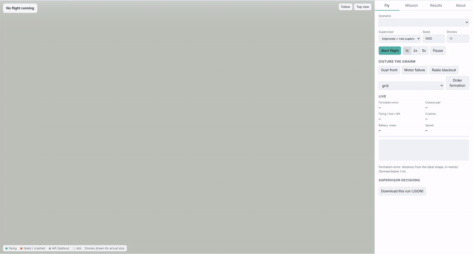
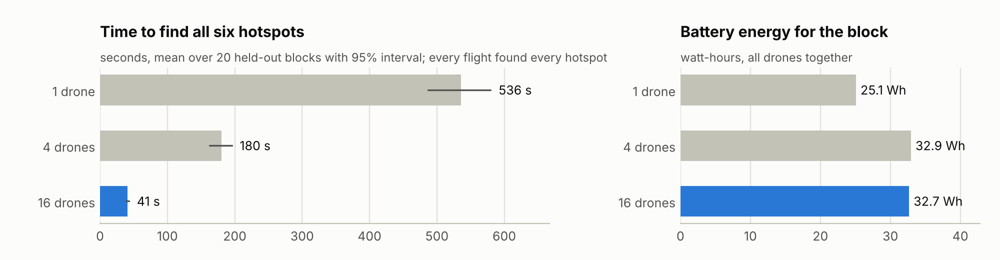
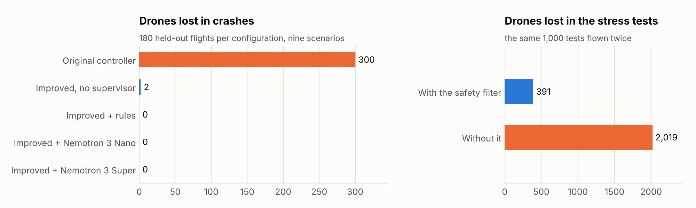
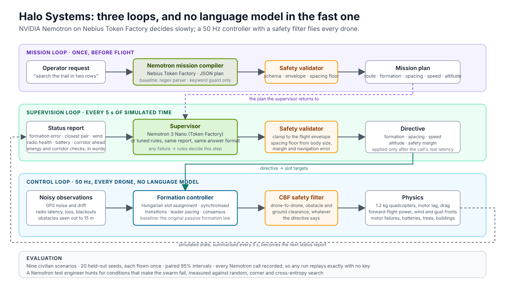
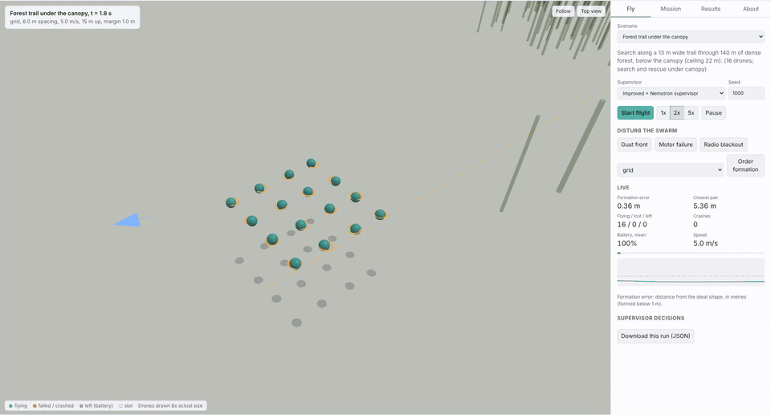

# Halo Systems

**Autonomous drone swarms that find wildfires early and keep flying safely while the fire changes the weather.**

[](LICENSE)

A language model never flies the drones. They fly themselves at 50 Hz behind a safety filter. The simulator tests them flying through injected gust fronts, which stand in for the wind a fire makes. NVIDIA Nemotron, served by Nebius Token Factory, supervises them every 5 seconds, turns an operator's plain-language request into a mission plan, and works as a test engineer that hunts for the conditions that make the swarm fail. Every decision it makes passes a safety check, and every flight result below is measured against conventional baselines on seeds held out from tuning. The wildfire results at the top of this page were flown with the hand-written rule supervisor, and Nemotron's supervision is measured in the [nine supervision scenarios](#supervision-results) further down.



## The headline result: the wildfire valley

The morning after dry lightning, a simulated mountain valley has five fires: one already spreading in open scrub, one under tree crowns, one under a rock overhang no downward camera can see, one smouldering in the open, and one across the valley, outside the survey block. The swarm sweeps the valley floor with downward thermal cameras and watches for smoke with forward cameras. The ground station locates the fires, forecasts their spread with an ensemble of Rothermel runs and briefs the fire crews. It sends evacuation alerts automatically by fixed rules, zone by zone, at Japan-style levels (3 prepare, 4 evacuate, 5 emergency). Each alert passes an alert check first and goes to simulated phones only. No language model takes part in the alert decision, and an operator can cancel an alert or give a zone the all-clear.

The results below come from 20 held-out valleys (seeds 4000-4019, 100 fires), each flown once with the final code by the improved controller and the rule supervisor. Today's ways of finding fires are modelled from cited figures, with the benefit of the doubt: no cloud, a camera with a clear view of the whole valley, every satellite detection credited to the right fire, the fastest published delivery.

| Question | Answer | Evidence |
|---|---|---|
| How many fires does one flight find? | 1 drone 60%, 4 drones 77% [72, 82], 16 drones 86% [80, 91]. Only smoke found the fire under the overhang and the one across the valley: 16 drones found 75% and 85% of them, one drone none | [Finding the fires](results/wildfire_valley/REPORT.md#finding-the-fires) |
| How many are found while still smouldering? | 16 drones found 59% [52, 66] of all fires while they still smouldered at about 4 m². Half of all 100 fires were reported at least 20 minutes before they started to spread (missed fires counted as never found). Today's methods are modelled to start looking only once a fire spreads, so none finds a smouldering fire | [Drones against today's ways](results/wildfire_valley/REPORT.md#drones-against-todays-ways-of-finding-fires) |
| Are they reported before today's earliest method? | 16 drones reported 60 of the 100 fires before the earliest of today's four (geostationary and polar satellites, AI cameras with a clear view, public calls), by a median of 69 minutes. 4 drones: 55, by 74 minutes. 1 drone: 40, by 112 minutes. An AI camera with a clear view, or a call from the public, reports a fire about 4 minutes after it starts to spread, at 100 to 200 m² | [Drones against today's ways](results/wildfire_valley/REPORT.md#drones-against-todays-ways-of-finding-fires) |
| How late do satellites see them? | Geostationary (GOES, 5-minute scans): a median 55 minutes after the fire started to spread, at 15,700 m² (1.6 ha); 93% found in 4 hours. Polar-orbiting (MODIS, VIIRS): 128 minutes, at 72,800 m² (7.3 ha); 89% found | [Drones against today's ways](results/wildfire_valley/REPORT.md#drones-against-todays-ways-of-finding-fires) |
| Are the phones warned in time? | With 16 drones, 94.7% [93.0, 96.4] of the phones the fire reached were warned before it arrived (the same share as with 1 drone), a median 126 minutes ahead; 32 of the 34 missed were phones without signal. Each valley has 63 simulated phones | [Warnings to phones](results/wildfire_valley/REPORT.md#warnings-to-phones) |
| Does the forecast beat alerting by distance? | With nearly the same share warned in time (94.7% against 95.0%), the forecast rule told 24 [18, 30] fewer phones per flight to evacuate that the fire did not reach within 3 hours. Of the phones told to evacuate, that was 20% [9, 32] with the forecast and 49% [41, 57] with distance alone | [Forecast against distance](results/wildfire_valley/REPORT.md#forecast-against-distance-ablation) |
| How close is the spread forecast? | With 16 drones, the forecast's overlap with the true spread of the fires the station knew were spreading has a Sorensen index of 0.71 [0.63, 0.78] at 1 hour and 0.83 [0.79, 0.86] at 3 hours. One drone scores 0.77 and 0.89, because it finishes later and forecasts with more of the fire mapped | [The spread forecast](results/wildfire_valley/REPORT.md#the-spread-forecast) |


These are models of today's methods built from cited figures, not measurements of them. Cameras and callers start their clock when the fire starts to spread, so none of them finds a smouldering fire here; the drones' lead comes from that phase, and from smoulder times the scenario sets. The swarm adds to today's methods rather than replacing them: one flight misses some fires, and today's four plus 16 drones found 100% of the fires, 59% of them before they spread. The valley uses no language model, so it costs nothing to run, and none of its 80 flights had a crash or a near miss (the `collisions`, `ground_crashes`, `obstacle_crashes` and `near_misses` fields in [runs.jsonl](results/wildfire_valley/runs.jsonl)). Methods, assumptions and every source are in [docs/WILDFIRE.md](docs/WILDFIRE.md); the full tables and charts are in [results/wildfire_valley/](results/wildfire_valley/REPORT.md).

**The scout.** [hardware/](hardware/README.md) holds a priced design, from off-the-shelf parts, for the drone the simulator flies: a 7-inch quadcopter with a radiometric thermal camera looking down, an RGB camera looking ahead and a PM2.5 sensor. It costs USD 1,095 per drone and USD 20,281 for 16 drones with a ground station and spares. The folder has the CAD model, parts list, running costs and build guide, and lists the gaps between the design and the simulator, most of them in numbers.

## The wildfire scout: how much faster a swarm sweeps

**Sixteen drones found every smouldering hotspot in a 6-hectare block of scrub 13.3 times faster than one drone** [95% interval 12.0 to 14.5], in 41 s instead of 536 s on average, over 20 held-out blocks. That is 8.3 minutes sooner on a sweep that takes one drone 11.6 minutes, for 30% more battery energy in total. Every flight found every hotspot, with no crashes and no near misses.

<picture>
  <source media="(prefers-color-scheme: dark)" srcset="docs/figures/wildfire-swarm-size-dark.png">
  
</picture>

## What is and is not simulated

All flights are simulations. The simulator models the wind, gust fronts, turbulence, noisy GPS, radio loss, motor failures and batteries a scouting swarm has to fly through.

* **The wildfire valley** simulates the fire's spread (Rothermel's model on land cover, slope and wind), plume heights, smoke and heat detection as probability models of a detector (not image recognition), the forecast, the alerts and the simulated phones. It does not model crown fire, spotting or how people respond to an alert ([the full list](docs/WILDFIRE.md#what-is-not-modelled)). It was flown in a light morning wind of 1.5 to 3 m/s that freshens after take-off.
* **The wildfire scout** keeps fixed hotspots that do not spread, and was flown in a 3 to 6 m/s breeze. The nine supervision scenarios have no fire.
* **Nothing simulates the fire's effect on its own wind.** Gust fronts are injected to stand in for it. Gust fronts, radio loss, failures and short batteries are tested in the nine supervision scenarios, which is also where Nemotron's supervision was measured. Both wildfire scenarios were flown with the rule supervisor.

## Why a swarm, and why now

* **Fire seasons are getting worse.** In 2025 the European Union had its worst wildfire season on record, with over a million hectares burnt in 7,783 fires ([European Commission, 2026](https://civil-protection-humanitarian-aid.ec.europa.eu/news-stories/news/record-number-wildfires-2025-calls-stronger-eu-action-2026-03-31_en)). A UN report projects up to 14% more extreme fires by 2030 and 50% more by the end of the century, and calls for spending to shift to prevention and preparedness ([WMO on the UNEP report, 2022](https://wmo.int/media/news/number-of-wildfires-forecast-rise-50-2100)).
* **Finding a fire early decides what it costs.** US fire services suppress 98% of fires during initial attack. The 1 to 2% that escape become the large fires that account for 30% or more of fire spending ([US Forest Service testimony, 2017](https://www.fs.usda.gov/sites/default/files/fs_media/fs_document/usda-testimony-senr-fire-christiansen-08-03-17.pdf)). A 2026 study of 3,693 California ignitions estimates that an optimised drone network could detect 97% of them, 74% within the first hour, for about 5% of the state's annual prevention spending ([Puech et al., arXiv 2609.18556](https://arxiv.org/abs/2609.18556)).
* **A large fire makes its own weather.** Its heat can build a thunderstorm whose stronger winds fan the fire ([NOAA, 2021](https://www.nesdis.noaa.gov/wildfires-spawn-severe-weather)). A swarm near a fire has to keep its formation and its safety margins in gusts, on a degraded radio link and on short batteries.

One drone with a thermal camera sweeps one strip of ground; sixteen flying line abreast sweep sixteen. The first customers are forest and fire services that already fly single drones and cannot run a fleet without evidence that it stays safe. Mountain search and rescue is the second use: the same sweep, looking for a person's heat signature instead of a hotspot. Halo Systems is that evidence and the software that produces it: a supervised swarm, and a test range in which a language model looks for the crash before it happens in the air.

## Results at a glance

Every flight result below comes from held-out seeds 1000-1019, each flown once after tuning on seeds 0-9 was finished (the wildfire valley above uses its own held-out seeds, 4000-4019); the stress search flies its own search seeds, and the mission compiler is scored on a held-out set of 20 requests. All of it can be regenerated from the rows committed in [results/](results/README.md). The full tables, intervals and figures are in [docs/RESULTS.md](docs/RESULTS.md).

| Question | Answer | Evidence |
|---|---|---|
| How much faster does a swarm find a fire? | 16 drones found all six hotspots in 41 s [38, 43], 4 drones in 180 s and 1 drone in 536 s; seed by seed, 16 drones were 13.3 times faster than one [12.0, 14.5] | [wildfire/REPORT.md](results/wildfire/REPORT.md) |
| Does the supervised swarm crash? | No crashes and no near misses in 180 held-out flights with the rules or with Nemotron supervising, in nine scenarios. The original controller lost 300 drones in the same flights | [REPORT.md](results/REPORT.md) |
| Does the safety filter matter? | Re-flying all 1,000 stress tests without it raised the failing tests from 89 to 289 and the drones lost from 391 to 2,019 | [stress/no_safety_filter](results/stress/no_safety_filter) |
| Is Nemotron a better test engineer than classical search? | It found 39 distinct failing conditions in 200 flights, 2.6 times the best baseline (corner search, 15), but no more kinds of failure | [STRESS.md](results/STRESS.md) |
| Can it turn plain language into a mission plan? | Nemotron 3 Super, and Nano with reasoning on, got all 20 held-out requests fully right, and Nano with reasoning off 18. A regex parser got 9. All three harmful requests were refused, against one for the parser | [mission_eval_*.json](results/) |
| Is it a better supervisor than tuned rules? | Slightly. Nemotron 3 Nano did better than the rules in 4 of 9 scenarios and worse in none (95% paired interval excludes zero, difference over 1%). The gains are small and two come with caveats, see [where the AI did worse](#where-the-ai-did-worse-or-did-not-help) | [REPORT.md](results/REPORT.md) |
| What does it cost? | Nano made 3,400 supervisor calls on the held-out seeds with no fallbacks, at 1.17 s mean and an estimated $0.0039 per flight. The whole project used about 13,100 requests, an estimated $8.23 | [budget.txt](evidence/budget.txt) |
| Can a judge check it without a key? | Yes. Every Nemotron supervisor call was recorded, and 24 held-out Nemotron flights replayed from the recording with no key matched the original rows apart from compute time | [replay_check](results/replay_check/runs.jsonl) |

<picture>
  <source media="(prefers-color-scheme: dark)" srcset="docs/figures/safety-dark.png">
  
</picture>

## Try it, no key needed

```bash
git clone <repo-url> halo-systems && cd halo-systems
python3 -m venv .venv && . .venv/bin/activate
python3 -m pip install -e '.[report]'   # numpy, plus matplotlib for charts
python3 -m unittest discover -s tests   # offline, no key, about a minute
halo list                               # the eleven scenarios
halo run wildfire_scout --config improved+rule --seed 1000 --n 16   # one sweep: all_found_s 33.6, as in results/wildfire
halo run wildfire_valley --config improved+rule --seed 4000 --n 16  # one valley flight: fires_located 5, all_located_s 76.1, as in results/wildfire_valley
halo serve --open                       # live 3D dashboard on http://127.0.0.1:8765; Ctrl-C stops it
```

Run the commands from the repository folder: the dashboard reads `results/` and `evidence/` from there. In the valley run, `targets_found` (3) and `all_found_s` (null) are the generic sweep metrics the scout uses: `targets_found` counts only fires a downward thermal camera held in view, and `all_found_s`, the time until it had all five, stays null because two of the five fires are out of its reach. The valley's own results are `fires_located` and `all_located_s`. CI runs the tests on Python 3.10 to 3.13 ([tests.yml](.github/workflows/tests.yml)).

With no key, `halo serve` replays the recorded Nemotron 3 Nano flights: pick a scenario, a seed from 1000 to 1019 and the Nemotron supervisor, and every call is answered from `results/nemotron_cache.jsonl`, so the flight is the one in the results. On a seed or scenario that was not recorded, the rules take that step and the log says so. A new mission typed into the Mission tab is parsed by the regex baseline, and the page says why; only the default request and the examples can then be flown.

To check one recorded Nemotron flight from the command line, exactly and with no key:

```bash
halo run forest_trail --config improved+nemotron:nvidia/NVIDIA-Nemotron-3-Nano-30B-A3B --seed 1000 \
  --cache results/nemotron_cache.jsonl --cache-mode replay
# about 16 s; prints time_formed_pct 85.7, completion_time_s 86.16, energy_wh_per_km 7.607,
# the same as that flight's row in results/runs.jsonl (18 calls, no fallbacks)
```

To run Nemotron live, put your Nebius Token Factory key in the environment (never in a file you commit). With `NEBIUS_API_KEY` set, `halo serve` calls the model live for each new request, and new calls are added to the cache file (`results/nemotron_cache.jsonl` unless `--cache` names another). Recorded flights replay exactly only without a key (`env -u NEBIUS_API_KEY halo serve`), with the scenario's own swarm size and seeds 1000-1019.

```bash
export NEBIUS_API_KEY=...                                         # from tokenfactory.nebius.com
halo doctor --flight                                              # end-to-end check; writes evidence/latest/
export HALO_SUPERVISOR_MODEL=nvidia/NVIDIA-Nemotron-3-Nano-30B-A3B
halo serve --open --cache live_cache.jsonl                        # Nemotron supervises live and compiles missions
```

A spend guard refuses any call that could take the estimated total past `HALO_BUDGET_USD` (18 by default).

### What responds live in the dashboard

| Control | What happens |
|---|---|
| Scenario, seed, swarm size, controller, supervisor | Starts a new flight; the same seed gives the same conditions |
| Gust front, motor failure, radio blackout | Injected into the running flight; the controller and supervisor react |
| Formation buttons | An operator order, checked by the same safety validator as any directive |
| Mission tab | Plain words to a mission plan with Nemotron, then fly it. Without a key, the regex baseline parses the request, and only the default request and the examples fly |
| Decision log | Every directive with its source (mission, rules, Nemotron, fallback, operator) and reason |
| Results tab | The wildfire valley's held-out results, then the committed benchmark tables and charts |

## How it works



Three loops run at three speeds, and the language model sits only in the two slow ones:

| Loop | Rate | Who decides | What checks it |
|---|---|---|---|
| Mission | Once, before flight | Nemotron mission compiler, or a regex parser | A keyword guard and the model refuse non-civilian requests; every field is sanitised, clamped to the flight envelope and filled with a default if missing |
| Supervision | Every 5 s | Nemotron or the rule supervisor, reading the same status report | A safety validator clamps every directive to the flight envelope, enforces a spacing floor and rate-limits changes |
| Control | 50 Hz, per drone | Slot tracking, consensus and a paced leader | A control-barrier-function safety filter keeps clearance from drones, obstacles and the ground |



* **Physics.** Point-mass quadcopters with the airframe of an earlier private simulator (1.2 kg, thrust-to-weight 2.5, drag area 0.035 m²) with a first-order motor lag and a forward-flight power model (momentum theory plus parasitic drag) that gives about 17 minutes of hover. Wind is a steady mean, correlated turbulence and gust fronts that sweep across the formation. GPS has white noise and a drifting bias. The radio has latency, jitter, packet loss and blackouts. Motors fail and batteries run down. Obstacles are trees and buildings. In the wildfire scout, each drone carries a downward thermal camera, and a hotspot counts as found once a footprint has held it for half a second. In the wildfire valley, each drone also watches for smoke with a forward camera, and the ground station runs the fire forecast and the alerts ([docs/WILDFIRE.md](docs/WILDFIRE.md)).
* **Controllers.** The *original* controller is a faithful port of that simulator's passive formation law, the baseline the project started from. The *improved* controller adds optimal slot assignment with synchronised straight-line transitions, a leader that paces itself to the formation and to bends ahead, consensus on the relative shape, and the safety filter. Near obstacles, the leader holds a speed at which a drone can still stop for an obstacle it has only just sensed.
* **Supervisors.** The rule supervisor and Nemotron read the same status report and return the same JSON directive: formation, spacing, speed, altitude and safety margin. While a call is out, the drones keep flying on the current directive. A failed call (network, deadline, bad JSON) falls back to the rules for that step, and every fallback is counted.

[docs/ARCHITECTURE.md](docs/ARCHITECTURE.md) has the details and the simulator's known simplifications.

## How it uses NVIDIA Nemotron and Nebius Token Factory

**Nebius services used:** Token Factory only, through its OpenAI-compatible chat completions API at `https://api.tokenfactory.nebius.com/v1`. The simulations are numpy on an ordinary CPU and ran outside Nebius; no Nebius AI Cloud, Serverless Endpoints or Serverless Jobs were used.

| Role | Model | Reasoning | Temperature | Token limit | Deadline | Measured on held-out data |
|---|---|---|---|---|---|---|
| Supervisor, every 5 s | Nemotron 3 Nano, `nvidia/NVIDIA-Nemotron-3-Nano-30B-A3B` | Off | 0.2 | 1,200 | 15 s per call, 8 s per attempt | 3,400 calls, 0 fallbacks, 1.17 s mean, 1.43 s 95th percentile (mean over flights) |
| Supervisor, declared comparison | Nemotron 3 Super, `nvidia/nemotron-3-super-120b-a12b` | Off | 0.2 | 1,200 | 15 s per call, 8 s per attempt | 3,474 calls, 0 fallbacks, 1.37 s mean, 1.64 s 95th percentile (mean over flights) |
| Mission compiler | Nano (off and on) and Super | Off; on for one Nano run | 0 | 1,500; 6,000 with reasoning | 60 s per attempt | 18, 20 and 20 of 20 requests fully right; median 5.0 s, 11.7 s and 1.3 s |
| Test engineer | Nano | Off; on for one run | 0.7 | 2,500; 8,000 with reasoning | 180 s per attempt | 39 and 15 distinct failing conditions in 200 flights each |

* **Structured output** uses JSON mode (`response_format: {"type": "json_object"}`), with a fallback for a model that does not support it. It is not schema-constrained decoding, so every reply is parsed defensively and checked field by field before the safety validator sees it. The prompts are in [ai/prompts.py](src/halo_systems/ai/prompts.py) (supervisor), [ai/mission.py](src/halo_systems/ai/mission.py) (mission compiler) and [ai/tester.py](src/halo_systems/ai/tester.py) (test engineer).
* **Reasoning** is switched off with `chat_template_kwargs: {"enable_thinking": false}` where it is not wanted. A supervisor directive that arrives seconds late describes a swarm that has already flown on, so the supervisor runs without it. The mission compiler gains from it: Nano went from 18 to 20 of 20 requests fully right.
* **Latency is part of the result.** In benchmarks, a model's answer takes effect only after its measured latency has passed in simulated time, so a slow answer costs what it would in flight.
* **Reliability.** A standard-library client with https only, deadlines, retries with backoff and jitter, `Retry-After`, a client-side rate limit, response validation and a redacted call log ([ai/client.py](src/halo_systems/ai/client.py)).
* **Exact replay.** Every supervisor call is recorded to a cache keyed on the model, messages, temperature and options, so anyone can replay a Nemotron flight with no key and no cost.

**Cost.** Estimated from the token counts at price ceilings set above the listed prices ([ai/budget.py](src/halo_systems/ai/budget.py)), so the provider's bill is lower or equal:

| | Per supervised flight | 180 held-out flights |
|---|---|---|
| Nemotron 3 Nano | $0.0039 (34,706 tokens) | $0.70 |
| Nemotron 3 Super | $0.0191 (35,382 tokens) | $3.43 |

The whole project, tuning, stress search and mission evaluation included, made about 13,100 requests: 22.3 million prompt tokens and 3.6 million completion tokens, an estimated $8.23 ([evidence/budget.txt](evidence/budget.txt)).

**Where Token Factory helped.** At about $0.004 a supervised flight, we could afford 20 held-out seeds per scenario and configuration, three live tuning rounds and a 1,000-test stress search, and measure the model instead of guessing. Hosted open models meant no GPU to manage, and the request id on every call is what makes the replay cache auditable. The one trap was reasoning being on by default, which cost us four paid empty replies on day one; our feedback is in [docs/DEVPOST.md](docs/DEVPOST.md#feedback-on-nebius-token-factory-and-nvidia-models).

The details, including what the tuning rounds taught us about reasoning and deadlines, are in [docs/NVIDIA_NEBIUS.md](docs/NVIDIA_NEBIUS.md).

## Supervision results

In five of the nine supervision scenarios no supervisor made a difference above the report's 1% threshold. In three, the supervisor decides whether the mission completes:

| Scenario | Metric | Fixed plan | Rules | Nemotron 3 Nano | Nemotron 3 Super |
|---|---|---|---|---|---|
| Forest trail | Missions completed | 5% | 100% | 100% | 100% |
| | Time in formation | 22% | 85% | 86% | 86% |
| Urban canyon | Missions completed | 55% | 100% | 100% | 100% |
| | Time in formation | 36% | 90% | 89% | 86% |
| Degraded radio | Completion time (s) | 66 | 70 | 66 | 66 |
| Low battery | Missions completed | 45% | 100% | 100% | 100% |
| | Completion time (s) | 242* | 138 | 128 | 146 |
| | Energy (Wh per drone-km) | 6.71 | 4.77 | 4.52 | 4.89 |

"Fixed plan" is the improved controller flying the mission plan with no supervisor. \*Over the 9 of 20 flights that completed. The paired intervals, seed-by-seed counts and the other metrics are in [docs/RESULTS.md](docs/RESULTS.md#supervision).

### Where the AI did worse or did not help

* **Two caveats on Nano's wins.** On degraded radio it won by leaving the plan alone: the rules slowed the swarm down, Nano did not, and its flights there were the same as flying with no supervisor. On the low-battery leg, in 90 of the 150 updates where the status report said the planned speed was enough for every drone, Nano kept a higher speed, which its instructions forbid; part of its time and energy gain there comes from breaking the plan.
* Nano took longer than the rules to settle after a change of formation: 6.3 s against 4.8 s in the forest and 4.9 s against 2.6 s in the urban canyon.
* Nemotron 3 Super, the larger model, held formation less well than the rules in the urban canyon, and on the low-battery leg it was slower, used more energy and retired more drones (1.55 per flight against 0.65).
* In six of the nine scenarios, Nano never changed the plan.

## Reproducing the results

```bash
halo bench --scenarios open_transit,formation_changes,forest_trail,urban_canyon,gusty_day,comms_degraded,motor_failures,low_battery,field_survey \
  --configs original+fixed,improved+fixed,improved+rule --seeds heldout --out check/runs.jsonl
halo report check/runs.jsonl --out check
halo bench --scenarios wildfire_scout --configs improved+rule --seeds heldout --n 1,4,16 --out check/wildfire/runs.jsonl
halo report check/wildfire/runs.jsonl --out check/wildfire
mkdir -p check && halo mission-eval --sets heldout --out check/mission_eval_baseline.json   # regex baseline, no key; add --model <id> for Nemotron
PYTHONPATH=src python3 tools/wildfire_valley_sweep.py --out check/wildfire_valley/runs.jsonl   # seeds 4000-4019: 1, 4 and 16 drones, and the distance-rule ablation
PYTHONPATH=src python3 tools/wildfire_valley_report.py check/wildfire_valley/runs.jsonl        # writes REPORT.md and summary.json next to the rows
```

The committed rows already hold every flight, so these commands write to a new `check/` folder; its rows match the ones in `results/` apart from compute-time fields. Seeds 0-9 were used for tuning; every headline flight result outside the wildfire valley uses held-out seeds 1000-1019. The supervision benchmark's simulator, controllers and rules were frozen before any held-out flight, and the Nemotron setup was chosen on tuning seeds and committed before any Nemotron flight on these seeds ([docs/BENCHMARKS.md](docs/BENCHMARKS.md)). The wildfire scout was added afterwards and flown once on the same seed numbers; the change that added the camera leaves every earlier row unchanged. The wildfire valley was built on seeds 2000-2011 and 3000-3019, then flown once with the final code on seeds 4000-4019; a sweep of an earlier version on those seeds was stopped part-way and its rows set aside unread ([docs/WILDFIRE.md](docs/WILDFIRE.md#how-results-are-scored)). The valley's rows come from a sweep script rather than `halo bench`, because each row records its alert rule and the ablation flies the distance rule; `halo run wildfire_valley` flies one flight with the forecast rule. The Nemotron supervisor flights replay exactly from `results/nemotron_cache.jsonl`; the mission-compiler and stress-search calls are kept in call logs instead. [docs/REPRODUCE.md](docs/REPRODUCE.md) lists the other commands behind `results/`, and [results/README.md](results/README.md#wildfire-valley-held-out-seeds-4000-4019-run-once) how to redraw the valley's charts.

## Where things are

| Path | What it holds |
|---|---|
| [src/halo_systems/sim/](src/halo_systems/sim) | Physics, wind, sensing, radio, obstacles, the ground sensor and the simulation engine; for the wildfire valley, terrain, fire spread, smoke, the ground station with its forecast and alerts, and the models of today's detection methods |
| [src/halo_systems/control/](src/halo_systems/control) | Formations, slot assignment, the original and improved controllers, the safety filter |
| [src/halo_systems/supervisor/](src/halo_systems/supervisor) | The rule supervisor and the Nemotron supervisor |
| [src/halo_systems/safety/](src/halo_systems/safety) | The validator every directive passes |
| [src/halo_systems/ai/](src/halo_systems/ai) | Token Factory client, spend guard, call cache, prompts, mission compiler, test engineer, end-to-end check |
| [src/halo_systems/eval/](src/halo_systems/eval) | Scenarios, metrics, statistics, benchmark runner and report |
| [src/halo_systems/dashboard/](src/halo_systems/dashboard) | The live 3D dashboard (`halo serve`) |
| [results/](results/README.md) | Every committed result, with the rows behind it |
| [evidence/](evidence/README.md) | The live end-to-end check against Token Factory, and the spend ledger's total |
| [docs/](docs/README.md) | Results, architecture, the benchmark protocol, Nemotron and Nebius notes, reproduction commands and a code tour, in reading order; the wildfire valley's methods and sources in [WILDFIRE.md](docs/WILDFIRE.md) |
| [hardware/](hardware/README.md) | The scout drone's priced design: CAD model, parts list, running costs and build guide |
| [tools/](tools) | The wildfire valley's sweep, report and charts, the README's figures and the dashboard recorder for the video |
| [tests/](tests) | Unit and integration tests, offline (a fake transport stands in for the API) |

## Limits and responsible use

* **This is a simulation.** The airframe, power and sensor models are textbook approximations that have not been calibrated against hardware, obstacles are simple shapes, and smoke and heat detection are probability models, not image recognition. Only the wildfire valley simulates the fire's spread, by Rothermel's surface model; crown fire, spotting and the fire's effect on its own wind are not modelled, and the wildfire scout's hotspots do not spread. The results compare methods under identical simulated conditions; they are not flight-test results. Today's ways of finding fires are modelled from cited figures, with the benefit of the doubt. [ARCHITECTURE.md](docs/ARCHITECTURE.md#known-simplifications) lists the simplifications a code review found, which apply equally to every configuration.
* **Civilian use only.** With a key, the Nemotron mission compiler refuses requests to harm, chase or intimidate people, animals or vehicles, to drop objects on people or to jam radios. Without a key, the dashboard parses requests with the regex baseline, whose keyword guard catches only explicit wording (it refused 1 of the 3 held-out harmful requests, [docs/RESULTS.md](docs/RESULTS.md#mission-compiler-20-held-out-requests)), so the dashboard then flies only its default request and example missions. Nothing in the code controls a payload. The valley's evacuation alerts go to simulated phones only.
* **The model is advisory.** It never commands the motors, every directive is validated, and the safety filter acts whatever the directive. The stress search shows the filter is not a guarantee: it found conditions in which the swarm fails with the filter on.

## About this entry

Built for the Nebius x NVIDIA hackathon, Physical AI track. The code was written during the submission period, from 12 October 2026; it reuses the airframe parameters and the passive formation law of the entrant's earlier private simulator ([docs/DEVPOST.md](docs/DEVPOST.md#updates-during-the-submission-period)). The project was called SwarmLab until 13 October 2026: some recorded evidence and older commits use that name, the command is now `halo`, and the old `SWARMLAB_` environment variables still work.

Licensed under the [Apache License 2.0](LICENSE). The vendored three.js files in `src/halo_systems/dashboard/static/vendor/` are MIT-licensed ([THREE_LICENSE](src/halo_systems/dashboard/static/vendor/THREE_LICENSE)).
