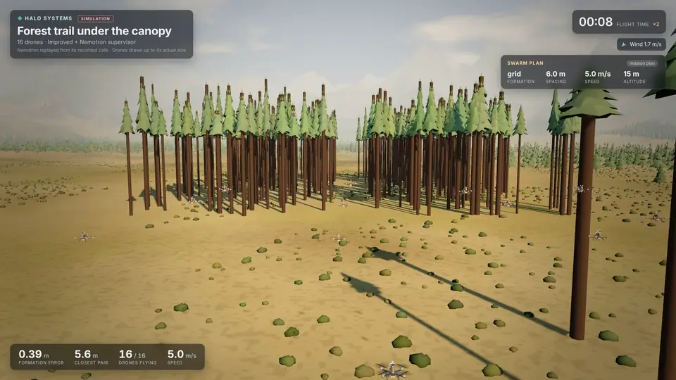

# Halo Systems

**Drone swarms that find wildfires while they still smoulder, tell crews which way they will run, and warn the people in their path.**

[](LICENSE)


## In one minute

* **The problem.** Lightning can start a fire that smoulders unseen for hours, and in the US the 1 to 2% of wildfires that get away from the first crew take 30% or more of fire spending ([the problem in full](#the-problem-who-it-is-for-and-why-now)).
* **Who it is for.** A fire agency's detection team checking last night's lightning strikes for fires, a job its patrol aircraft fly today.
* **What they see.** Sixteen drones sweep the floor of a simulated valley; each fire they find goes to fire dispatch, the crews learn which way it will run, and simulated phones in its path are warned under rules signed in advance. NVIDIA Nemotron on Nebius Token Factory reads the typed job; code builds the plan and decides every alert ([how it works](#how-it-works)).
* **One number.** On 20 simulated valleys Halo was never tuned on, sixteen drones reported 60 of 100 fires before any satellite, AI camera or caller, a median 69 minutes sooner ([all the results](#the-headline-result-the-wildfire-valley)).
* **Try it.** No key needed: install it and run `halo serve --open` to watch the valley live in 3D, or fly a valley patrol from the Mission tab to see the cards to fire dispatch ([the steps](#try-it-no-key-needed)).

> **What is simulated.** Every flight here is a simulation, and no fire agency has reviewed or tried Halo yet. Detection is a probability model of each sensor, not image recognition. Today's ways of finding fires are modelled from published figures, and cameras and callers are modelled to start looking only once a fire spreads, so the drones' lead comes mostly from the smouldering phase, whose length the scenario sets ([what is and is not simulated](#what-is-and-is-not-simulated)).

## The headline result: the wildfire valley

The morning after dry lightning, a simulated mountain valley has five fires: one already spreading in open scrub, one under tree crowns, one under a rock overhang no downward camera can see, one smouldering in the open, and one across the valley, outside the survey block. The swarm sweeps the valley floor with downward thermal cameras and watches for smoke with forward cameras. The ground station locates the fires, forecasts their spread with an ensemble of Rothermel runs and briefs the fire crews. It sends evacuation alerts automatically, zone by zone, at Japan-style levels (3 prepare, 4 evacuate, 5 emergency). These flights used today's alert rule, in which any located fire, a smoulder included, can raise a zone to Level 3. Each alert passes an alert check first and goes to simulated phones only. No language model takes part in the alert decision, and an operator can cancel an alert or give a zone the all-clear. An operator can also type the job in plain words, fly squads over the floor and both slopes, and hold the swarm low for crewed firefighting aircraft (shown on one development seed, not measured). Mountain search and rescue is next.

The results below come from 20 held-out valleys (seeds 4000-4019, 100 fires), each flown once with the final code by the improved controller and the rule supervisor. The fire-direction row comes from a second held-out set flown once after that feature was added (seeds 7000-7019), whose other results repeat these. Today's ways of finding fires are modelled from cited figures, with the benefit of the doubt: no cloud, a camera with a clear view of the whole valley, every satellite detection credited to the right fire, the fastest published delivery.

| Question | Answer | Evidence |
|---|---|---|
| How many fires does one flight find? | 1 drone 60%, 4 drones 77% [72, 82], 16 drones 86% [80, 91]. Only smoke found the fire under the overhang and the one across the valley: 16 drones found 75% and 85% of them, one drone none. Sixteen drones gave each fire's position to within a median 5 m | [Finding the fires](results/wildfire_valley/REPORT.md#finding-the-fires); [the 5 m](results/wildfire_valley/REPORT.md#drones-against-todays-ways-of-finding-fires) |
| How many are found while still smouldering? | 16 drones found 59% [52, 66] of all fires while they still smouldered at about 4 m². Half of all 100 fires were reported at least 20 minutes before they started to spread (missed fires counted as never found). Today's methods are modelled to start looking only once a fire spreads, so none finds a smouldering fire | [Drones against today's ways](results/wildfire_valley/REPORT.md#drones-against-todays-ways-of-finding-fires) |
| Are they reported before today's earliest method? | 16 drones reported 60 of the 100 fires before the earliest of today's four (geostationary and polar satellites, AI cameras with a clear view, public calls), by a median of 69 minutes. 4 drones: 55, by 74 minutes. 1 drone: 40, by 112 minutes. An AI camera with a clear view, or a call from the public, reports a fire about 4 minutes after it starts to spread, at 100 to 200 m². On 20 more held-out valleys (seeds 7000-7019), 16 drones reported 62 of 100 first, by a median of 62 minutes. On the fires that started to spread within 20 minutes of take-off, 16 drones were still first on 8 of 9 and 9 of 12, by a median of 17 and 13 minutes (a breakdown made after the results were known) | [Drones against today's ways](results/wildfire_valley/REPORT.md#drones-against-todays-ways-of-finding-fires); [the second set](results/wildfire_valley_7000/REPORT.md#drones-against-todays-ways-of-finding-fires); [the lead by when each fire starts to spread](results/wildfire_spread_timing/REPORT.md) |
| How late do satellites see them? | Geostationary (GOES, 5-minute scans): a median 55 minutes after the fire started to spread, at 15,700 m² (1.6 ha); 93% found in 4 hours. Polar-orbiting (MODIS, VIIRS): 128 minutes, at 72,800 m² (7.3 ha); 89% found | [Drones against today's ways](results/wildfire_valley/REPORT.md#drones-against-todays-ways-of-finding-fires) |
| Are the phones warned in time? | With 16 drones, 94.7% [93.0, 96.4] of the phones the fire reached were warned before it arrived (the same share as with 1 drone), a median 126 minutes ahead; 32 of the 34 missed were phones without signal. Each valley has 63 simulated phones | [Warnings to phones](results/wildfire_valley/REPORT.md#warnings-to-phones) |
| Does the forecast beat alerting by distance? | With nearly the same share warned in time (94.7% against 95.0%), the forecast rule told 24 [18, 30] fewer phones per flight to evacuate that the fire did not reach within 3 hours. Of the phones told to evacuate, that was 20% [9, 32] with the forecast and 49% [41, 57] with distance alone | [Forecast against distance](results/wildfire_valley/REPORT.md#forecast-against-distance-ablation) |
| How close is the spread forecast? | With 16 drones, the forecast's overlap with the true spread of the fires the station knew were spreading has a Sorensen index of 0.71 [0.63, 0.78] at 1 hour and 0.83 [0.79, 0.86] at 3 hours. One drone scores 0.77 and 0.89, because it finishes later and forecasts with more of the fire mapped | [The spread forecast](results/wildfire_valley/REPORT.md#the-spread-forecast) |
| Which way will the head run? | Sixteen drones' crew briefs were a median 14° [9, 20] off the true head over the next hour, against 22° [16, 28] for running straight downwind of the measured wind (both use the same modelled measurement: the true wind with 0.5 m/s and 5° of noise): a modest gain, closer for 62% of the fires. The cone of likely directions held the true head for 75% of briefs, and the crews got about 12 updates per flight (seeds 7000-7019) | [Which way the head runs](results/wildfire_valley_7000/REPORT.md#which-way-the-head-runs) |


The swarm adds to today's methods rather than replacing them: one flight misses some fires, and today's four plus 16 drones found 100% of the fires, 59% of them before they spread. The valley's 80 flights behind these numbers, their forecasts and their alerts use no language model, so they cost nothing to run, and none had a crash or a near miss (the `collisions`, `ground_crashes`, `obstacle_crashes` and `near_misses` fields in [runs.jsonl](results/wildfire_valley/runs.jsonl)). Methods, assumptions and every source are in [docs/WILDFIRE.md](docs/WILDFIRE.md); the full tables and charts are in [results/wildfire_valley/](results/wildfire_valley/REPORT.md).

**The scout.** [hardware/](hardware/README.md) holds a priced design, from off-the-shelf parts, for the drone the simulator flies: a 7-inch quadcopter with a radiometric thermal camera looking down, an RGB camera looking ahead and a PM2.5 sensor. It costs USD 1,095 per drone and USD 20,281 for 16 drones with a ground station and spares. The folder has the CAD model, parts list, running costs and build guide, and lists the gaps between the design and the simulator, most of them in numbers.

**What a patrol would cost, as an estimate.** With a crew of two, a 16-drone squad would cost about USD 840 a patrol day and check about 29 lightning strikes, about USD 29 a strike. In Alberta, a fire attacked on time that still escaped cost an average USD 2.2 million (CAD 3.1 million) to suppress, against USD 14,600 for one attacked on time and held (2011-2019, moderate hazard); US federal suppression comes to about USD 0.67 to 1.35 million for each escaped fire. So a squad's 120-day season, about USD 100,000, pays for itself on suppression alone if it keeps one fire from escaping every 21 seasons at Alberta's figure, or every 6 to 13 at the US ones ([docs/PATROL_COST.md](docs/PATROL_COST.md)).

## The wildfire scout: how much faster a swarm sweeps

**Sixteen drones found every smouldering hotspot in a 6-hectare block of scrub 13.3 times faster than one drone** [95% interval 12.0 to 14.5], in 41 s instead of 536 s on average, over 20 held-out blocks. That is 8.3 minutes sooner on a sweep that takes one drone 11.6 minutes, for 30% more battery energy in total. Every flight found every hotspot, with no crashes and no near misses.

<picture>
  <source media="(prefers-color-scheme: dark)" srcset="docs/figures/wildfire-swarm-size-dark.png">
  
</picture>

## What is and is not simulated

All flights are simulations. The simulator models the wind, gust fronts, turbulence, noisy GPS, radio loss, motor failures and batteries a scouting swarm has to fly through.

* **The wildfire valley** simulates the fire's spread (Rothermel's model on land cover, slope and wind), plume heights, smoke and heat detection as probability models of a detector (not image recognition), the forecast, the alerts and the simulated phones. It does not model crown fire, spotting, anyone fighting the fire during the flight (a first crew is modelled afterwards), or how people respond to an alert ([the full list](docs/WILDFIRE.md#what-is-not-modelled)). Thermal clutter (sun-heated rock, vehicles, campfires) is not modelled, so the only false fires come from smoke bearings that cross wrongly, and patrol aircraft and lookouts are not in the detection comparison, because no source we found gives when patrols fly or how soon a lookout sees a smoulder's thin plume; patrol aircraft appear only in the cost comparison, chiefly as Alberta's cost per fire found ([PATROL_COST.md](docs/PATROL_COST.md)). It was flown in a light morning wind of 1.5 to 3 m/s that freshens after take-off.
* **The wildfire scout** keeps fixed hotspots that do not spread, and was flown in a 3 to 6 m/s breeze. The nine supervision scenarios have no fire.
* **Nothing simulates the fire's effect on its own wind.** Gust fronts are injected to stand in for it. Gust fronts, radio loss, failures and short batteries are tested in the nine supervision scenarios, which is also where Nemotron's supervision was measured. The wildfire scout, the valley's headline, alert and first-crew flights, the aircraft hold and the missing-hiker search were flown with the rule supervisor (plus one hiker row with none, to hold a lone drone's speed). The squads comparison and the strike checks were flown with no supervisor, so their ways of flying are compared without a supervisor's changes.

## The problem, who it is for, and why now

**The problem.** Most wildfires are caught. US fire services stop or manage 98% of them during initial attack, and the 1 to 2% that escape account for 30% or more of fire spending ([USDA Forest Service, 2017](https://www.fs.usda.gov/sites/default/files/fs_media/fs_document/usda-testimony-senr-fire-christiansen-08-03-17.pdf)). Speed matters: in 9,886 CAL FIRE incidents, the chance of containing a fire within two hours fell as the response time grew ([Cardil et al. 2025](https://www.nwfirescience.org/sites/default/files/publications/wf24160.pdf)).

Lightning fires are the hard ones to catch early. Across 42 datasets, the median time from a lightning strike to the fire being detected ranges from 1.4 to 53.6 hours ([Moris et al. 2023](https://doi.org/10.5194/essd-15-1151-2023)). In May 2019 a lightning strike in northern Alberta most likely started a fire at 18:08. It "held over and grew during the daytime heating", and a lookout first saw it at 13:22 the next day, already 20 hectares. That was the Chuckegg Creek wildfire. It burned 350,135 hectares, took 98 days to bring under control and forced the evacuation of the Town of High Level ([Spring 2019 Wildfire Review](https://open.alberta.ca/dataset/5fa709d9-d70a-4176-a1b8-e097abafa9fe/resource/f42b9020-69e0-4d2c-984b-68ad33761f10/download/af-spring-2019-wildfire-review-final-report.pdf)).

**Who it is for.** The detection team of a wildland fire agency, on the morning after lightning. Agencies already fly this job: Alberta's patrol aircraft are "informed by lightning monitoring systems to target patrols in areas of lightning activity". From 2015 to 2019 they made 12.2% of the province's wildfire detections, at an average of CAD 9.6 million a year (the same review, table 12), an estimated USD 51,000 for each fire they found ([docs/PATROL_COST.md](docs/PATROL_COST.md)).

* **Fire seasons are getting worse.** In 2025 the European Union had its worst wildfire season on record, with over a million hectares burnt in 7,783 fires ([European Commission, 2026](https://civil-protection-humanitarian-aid.ec.europa.eu/news-stories/news/record-number-wildfires-2025-calls-stronger-eu-action-2026-03-31_en)). A UN report projects up to 14% more extreme fires by 2030 and 50% more by the end of the century, and calls for spending to shift to prevention and preparedness ([WMO on the UNEP report, 2022](https://wmo.int/media/news/number-of-wildfires-forecast-rise-50-2100)).
* **Drones can do the finding.** A 2026 study of 3,693 California ignitions estimates that an optimised drone network could detect 97% of them, 74% within the first hour, for about 5% of the state's annual prevention spending ([Puech et al., arXiv 2609.18556](https://arxiv.org/abs/2609.18556)).
* **A large fire makes its own weather.** Its heat can build a thunderstorm whose stronger winds fan the fire ([NOAA, 2021](https://www.nesdis.noaa.gov/wildfires-spawn-severe-weather)). A swarm near a fire has to keep its formation and its safety margins in gusts, on a degraded radio link and on short batteries.

One drone with a thermal camera sweeps one strip of ground; sixteen flying line abreast sweep sixteen. The first customer is a fire agency's detection team, which already sends aircraft out after lightning and already flies single drones, but cannot run a fleet without evidence that it stays safe. Halo Systems is that evidence and the software that produces it: a supervised swarm, and a test range in which a language model looks for the crash before it happens in the air.

## Results at a glance

Every flight result below comes from held-out seeds 1000-1019, each flown once after tuning on seeds 0-9 was finished, unless a row names its own held-out seeds; the stress search flies its own search seeds, and the compilers are scored on held-out requests. All of it can be regenerated from the rows committed in [results/](results/README.md). The full tables, intervals and figures are in [docs/RESULTS.md](docs/RESULTS.md).

| Question | Answer | Evidence |
|---|---|---|
| How much faster does a swarm find a fire? | 16 drones found all six hotspots in 41 s [38, 43], 4 drones in 180 s and 1 drone in 536 s; seed by seed, 16 drones were 13.3 times faster than one [12.0, 14.5] | [wildfire/REPORT.md](results/wildfire/REPORT.md) |
| Does an earlier report stop fires escaping? | Modelled after the flights, with one engine per fire arriving a median 30 minutes after the report: with the drones' reports the first crew reached 40% of the fires while they still smouldered, against none with today's, and the drones' reports prevented 37% of today's escapes (23% with a fixed 60-minute response), nearly all by getting the crew there before the fire took off. The valley is dry and windy by design, so only that share carries over, and only to fires the drones find while they smoulder (seeds 9000-9039) | [wildfire_initial_attack](results/wildfire_initial_attack/REPORT.md) |
| Should public alerts wait until a fire spreads? | No. Over 60 held-out valleys, pre-signed rules that wait sent fewer public alerts than today's rule (383 against 432), but of 1,836 phones the fire reached, 29 to 53 with signal were warned late or never (about 1 in 63 to 1 in 35, depending on the station's random draw), in 11 valleys, against none under today's rule (seeds 9000-9019, 9100-9119, 9150-9169). So the entry's pre-signed rules alert on smoulders too; on 20 held-out valleys flown once after that choice (seeds 9400-9419) and on 8 development valleys, their public alerts were the same as today's rule's in every valley, alert for alert, and their card counts the same as the spreading-only rules', so the alert results above are what the entry's design is expected to give by construction, since with smoulders on its Level 3 rule matches today's | [wildfire_alerts](results/wildfire_alerts/REPORT.md), [valley_stress](results/valley_stress/REPORT.md), [wildfire_alerts_smoulders](results/wildfire_alerts_smoulders/REPORT.md) |
| Do squads per area beat one sweep? | Clearly only at 8 drones (84% of fires against 76%); from 16 up, within the noise. They patrol for 12 minutes, not one crossing, and with 16 drones placed 1.05 false fires per flight against 0.40 (seeds 8000-8019) | [wildfire_valley_squads](results/wildfire_valley_squads/REPORT.md) |
| Does a team checking last night's strikes help, and should Nemotron pick them? | Perhaps a little at 8 drones, at the edge of the noise, and not measurably at 16; Nemotron made no measurable difference. With 8 drones, a team of 4 flying to one lightning strike at a time found 96 of 100 fires whether Nemotron or a hand-written triage rule picked the strikes (+0.00 per flight, -0.20 to +0.20), against 90 with every drone patrolling an area (+0.3 per flight, interval from +0.00), mostly the fire across the valley, with less than half the false fires (0.60 to 0.65 per flight against 1.50). No flight crashed or logged a near miss, but the team brought two drones as close as 5.1 m, against 10.9 m with no team; the cause was not traced. Nemotron's 77 calls cost USD 0.086 (seeds 9300-9319) | [strike_checks](results/strike_checks/REPORT.md) |
| Can the sweep find a missing person? | In a meadow and forest edge, 4 or 16 drones found the person in all 20 searches, 11 of them under tree cover; 1 drone found 16 of 20. Mountain terrain is next (seeds 9200-9219) | [hiker_search](results/hiker_search/REPORT.md) |
| Does the supervised swarm crash? | No crashes and no near misses in 180 held-out flights with the rules or with Nemotron supervising, in nine scenarios. The original controller lost 300 drones in the same flights | [REPORT.md](results/REPORT.md) |
| Does the safety filter matter? | Re-flying all 1,000 stress tests without it raised the failing tests from 89 to 289 and the drones lost from 391 to 2,019 | [stress/no_safety_filter](results/stress/no_safety_filter) |
| Is Nemotron a better test engineer than classical search? | In the formation scenarios it found 39 distinct failing conditions in 200 flights, 2.6 times the best baseline (corner search, 15), but no more kinds of failure. In the wildfire valley it was no better: on 40 held-out valleys the conditions it proposed caused 11 failures, against 10 for random and 13 for corner search (seeds 9100-9119, 9150-9169) | [STRESS.md](results/STRESS.md), [valley_stress](results/valley_stress/REPORT.md) |
| Can it turn plain language into a plan? | Valley jobs: Nano with reasoning got 47 of 48 held-out requests right, without reasoning 39, hand-written rules 20, or 35 if 15 misses that differ only by 12 against 15 minutes of patrol are counted as the same flight (a small set written for the test, not by fire crews; the rules lost mostly on patrol lengths written in words); Nemotron refused all 6 non-civilian ones, the rules none. Missions: Super, and Nano with reasoning on, got all 20 fully right, Nano with reasoning off 18 and a regex parser 9; all three harmful requests were refused, against one for the parser | [valley_eval](results/valley_eval/REPORT.md), [mission_eval_*.json](results/) |
| Is it a better supervisor than tuned rules? | Slightly. Nemotron 3 Nano did better than the rules in 4 of 9 scenarios and worse in none (95% paired interval excludes zero, difference over 1%). The gains are small and two come with caveats, see [where the AI did worse](#where-the-ai-did-worse-or-did-not-help) | [REPORT.md](results/REPORT.md) |
| What does it cost? | Nano made 3,400 supervisor calls on the held-out seeds with no fallbacks, at 1.17 s mean and an estimated $0.0039 per flight. Up to 14 October, the whole project used about 13,100 requests, an estimated $8.23; by 23 October, an estimated $8.57 in all | [budget.txt](evidence/budget.txt) |
| Can a judge check it without a key? | Yes. Every Nemotron supervisor call was recorded, and 24 held-out Nemotron flights replayed from the recording with no key matched the original rows apart from compute time. The valley compiler's held-out score and the strike checks' 20 Nemotron flights replay from their recorded calls the same way | [replay_check](results/replay_check/runs.jsonl), [strike_checks](results/strike_checks/REPORT.md#files) |

<picture>
  <source media="(prefers-color-scheme: dark)" srcset="docs/figures/safety-dark.png">
  
</picture>

## Try it, no key needed

```bash
git clone https://github.com/kenzok4000/halo-systems halo-systems && cd halo-systems
python3 -m venv .venv && . .venv/bin/activate
python3 -m pip install -e '.[report]'   # numpy, plus matplotlib for charts
python3 -m unittest discover -s tests   # offline, no key, about six to seven minutes (206 tests, one process; longer on a busy machine)
halo list                               # the twelve scenarios
halo run wildfire_scout --config improved+rule --seed 1000 --n 16   # one sweep: all_found_s 33.6, as in results/wildfire
halo run wildfire_valley --config improved+rule --seed 4000 --n 16  # one valley flight: fires_located 5, all_located_s 76.1, as in results/wildfire_valley
halo serve --open                       # live 3D dashboard on http://127.0.0.1:8765; Ctrl-C stops it
```

The dashboard opens on the incident: the wildfire valley starts flying with 16 drones and the rule supervisor, with the fire crew brief, the evacuation alerts (each with the operator's all-clear) and the log in front. The scenario, supervisor, seed and drone-count pickers and the disturbance buttons are under **Lab controls**; `?start=0` opens the page without starting a flight. This flight uses today's alert rule, as the measured results do, so it sends no cards to fire dispatch. To see the pre-signed rules, with a card to fire dispatch for each fire the station locates, open the Mission tab, pick **Valley patrol after lightning**, then **Compile patrol** and **Fly this patrol** (the example request is ready and flies without a key), or open http://127.0.0.1:8765/?alert_rule=presigned.

Run the commands from the repository folder: the dashboard reads `results/` and `evidence/` from there. In the valley run, `targets_found` (3) and `all_found_s` (null) are the generic sweep metrics the scout uses: `targets_found` counts only fires a downward thermal camera held in view, and `all_found_s`, the time until it had all five, stays null because two of the five fires are out of its reach. The valley's own results are `fires_located` and `all_located_s`. CI runs the tests on Python 3.10 to 3.13 ([tests.yml](.github/workflows/tests.yml)).

With no key, `halo serve` replays the recorded Nemotron 3 Nano flights: in Lab controls, pick a scenario, a seed from 1000 to 1019 and the Nemotron supervisor, and every call is answered from `results/nemotron_cache.jsonl`, so the flight is the one in the results. On a seed or scenario that was not recorded, the rules take that step and the log says so. A new mission typed into the Mission tab is parsed by the regex baseline, and the page says why; only the default request and the examples can then be flown.

To check one recorded Nemotron flight from the command line, exactly and with no key:

```bash
halo run forest_trail --config improved+nemotron:nvidia/NVIDIA-Nemotron-3-Nano-30B-A3B --seed 1000 \
  --cache results/nemotron_cache.jsonl --cache-mode replay
# about 25 s; prints time_formed_pct 85.7, completion_time_s 86.16, energy_wh_per_km 7.607,
# the same as that flight's row in results/runs.jsonl (18 calls, no fallbacks)
```

To run Nemotron live, put your Nebius Token Factory key in the environment (never in a file you commit). With `NEBIUS_API_KEY` set, `halo serve` calls the model live for each new request, and new calls are added to the cache file (`results/nemotron_cache.jsonl` unless `--cache` names another). Recorded flights replay exactly only without a key (`env -u NEBIUS_API_KEY halo serve`), with the scenario's own swarm size and seeds 1000-1019.

```bash
export NEBIUS_API_KEY=...                                         # from tokenfactory.nebius.com
halo doctor --flight                                              # end-to-end check; writes evidence/latest/
export HALO_SUPERVISOR_MODEL=nvidia/NVIDIA-Nemotron-3-Nano-30B-A3B
halo serve --open --cache live_cache.jsonl                        # Nemotron supervises live and compiles missions
```

A spend guard refuses any call that could take the estimated total past `HALO_BUDGET_USD` (18 by default).

### What responds live in the dashboard

| Control | What happens |
|---|---|
| Lab controls: scenario, seed, swarm size, controller, supervisor | Starts a new flight; the same seed gives the same conditions |
| Lab controls: gust front, motor failure, radio blackout | Injected into the running flight; the controller and supervisor react |
| Formation buttons | An operator order, checked by the same safety validator as any directive |
| Mission tab | Plain words to a mission plan with Nemotron, then fly it. Without a key, the regex baseline parses the request, and only the default request and the examples fly |
| Decision log | Every directive with its source (mission, rules, Nemotron, fallback, operator) and reason |
| Results tab | The wildfire valley's held-out results, then the committed benchmark tables and charts |

## How it works

<picture>
  <source media="(prefers-color-scheme: dark)" srcset="docs/architecture-dark.png">
  
</picture>

The figure follows one valley job from the operator's words to the alerts; the optional strike picker is not part of a typed job and flies only in the strike-check measurement. The flying runs in three loops at three speeds, and a language model can sit only in the two slow ones:

| Loop | Rate | Who decides | What checks it |
|---|---|---|---|
| Mission | Once, before flight | Nemotron mission or valley compiler, or hand-written rules | A keyword guard and the model refuse non-civilian requests; every field is sanitised, clamped to the flight envelope and filled with a default if missing |
| Supervision | Every 5 s | Nemotron or the rule supervisor, reading the same status report | A safety validator clamps every directive to the flight envelope, enforces a spacing floor and rate-limits changes; operator orders, squad moves, airspace holds and strike picks pass it too |
| Control | 50 Hz, per drone | Slot tracking, consensus and a paced leader | A control-barrier-function safety filter keeps clearance from drones, obstacles and the ground |

An optional check team adds one more slow decision in flight: which reported lightning strike to look at next, about four times in a 12-minute patrol, made by Nemotron or a hand-written rule. The validator checks every pick, and code flies the team.



* **Physics.** Point-mass quadcopters with the airframe of an earlier private simulator (1.2 kg, thrust-to-weight 2.5, drag area 0.035 m²) with a first-order motor lag and a forward-flight power model (momentum theory plus parasitic drag) that gives about 17 minutes of hover. Wind is a steady mean, correlated turbulence and gust fronts that sweep across the formation. GPS has white noise and a drifting bias. The radio has latency, jitter, packet loss and blackouts. Motors fail and batteries run down. Obstacles are trees and buildings. In the wildfire scout, each drone carries a downward thermal camera, and a hotspot counts as found once a footprint has held it for half a second. In the wildfire valley, each drone also watches for smoke with a forward camera, and the ground station runs the fire forecast and the alerts ([docs/WILDFIRE.md](docs/WILDFIRE.md)).
* **Controllers.** The *original* controller is a faithful port of that simulator's passive formation law, the baseline the project started from. The *improved* controller adds optimal slot assignment with synchronised straight-line transitions, a leader that paces itself to the formation and to bends ahead, consensus on the relative shape, and the safety filter. Near obstacles, the leader holds a speed at which a drone can still stop for an obstacle it has only just sensed.
* **Supervisors.** The rule supervisor and Nemotron read the same status report and return the same JSON directive: formation, spacing, speed, altitude and safety margin. While a call is out, the drones keep flying on the current directive. A failed call (network, deadline, bad JSON) falls back to the rules for that step, and every fallback is counted.
* **Strike checks (optional).** A team of 4 drones flies to one of the night's reported lightning strikes (last night's or the night before's) at a time and patrols a 120 m square round it for one circuit, 20 m above the area squads. Code builds the strike table and offers only strikes the team can reach and finish in time; the next is picked 40 s before a look ends, nearest first, by a hand-written triage rule or by Nemotron. A failed or unusable Nemotron reply is not replaced by the rule: the team keeps patrolling its square and asks again a circuit later. A fatal error (no key, a rejected key, the budget cap, or in a replay a request never recorded) stops that flight. It is switched on only through the `checks` option of `wildfire_valley()` and its sweep tool, not in `halo run`, the dashboard or a typed job ([sim/strike_check.py](src/halo_systems/sim/strike_check.py)).

**Where each loop runs.** Timed on a 4-core development machine, not a drone or a Jetson ([results/compute](results/compute/REPORT.md)): the controller computes all 16 drones' commands in a median 3.3 ms of its 20 ms step, and the rule supervisor decides in under 0.1 ms. The ground station's once-a-second step takes a median 2.6 ms, and a spread forecast 1.6 s, run every 2 minutes or sooner once a fire is located. A Jetson Orin Nano is the candidate computer for the station; it has not been timed on one. Nemotron's valley compile takes a median 4.7 s, once per job, and a strike pick a median 10.8 s (the slowest 156 s), while the check team keeps patrolling. If the cloud link drops, flight, the station, the forecast and the alerts carry on: the hand-written rules read the valley job, a Nemotron supervisor falls back to the rules (all 18 calls of a forest-trail flight, with no drone lost), and a check team keeps patrolling its square.

[docs/ARCHITECTURE.md](docs/ARCHITECTURE.md) has the details and the simulator's known simplifications.

## How it uses NVIDIA Nemotron and Nebius Token Factory

**Where Nemotron works.** Nemotron never flies the drones and never decides an alert. It turns an operator's plain words into a checked plan: on 48 held-out valley jobs written for the test, Nemotron 3 Nano with reasoning gave the right patrol for 47 and hand-written rules for 20, and on 20 mission requests Nano got 18 fully right and a regex parser 9. It supervises the swarm's formation every 5 seconds in nine flight scenarios, slightly better than tuned rules in 4 and worse in none. As a test engineer it found 2.6 times as many conditions that make the swarm fail as the best classical search in the formation scenarios, but no better than random or corner search in the wildfire valley (11 failures, against 10 and 13, well within chance). In a separate measurement, it picked which reported lightning strike a check team looked at next; on 20 held-out valleys it and a hand-written triage rule each found 96 of 100 fires, no measurable difference, for USD 0.086. Every plan and pick it makes passes a safety check first. The valley flights above used the hand-written rule supervisor, apart from the squads comparison and the strike checks, which used none.

**Nebius services used:** Token Factory only, through its OpenAI-compatible chat completions API at `https://api.tokenfactory.nebius.com/v1`. The simulations are numpy on an ordinary CPU and ran outside Nebius; no Nebius AI Cloud, Serverless Endpoints or Serverless Jobs were used.

| Role | Model | Reasoning | Temperature | Token limit | Deadline | Measured on held-out data |
|---|---|---|---|---|---|---|
| Supervisor, every 5 s | Nemotron 3 Nano, `nvidia/NVIDIA-Nemotron-3-Nano-30B-A3B` | Off | 0.2 | 1,200 | 15 s per call, 8 s per attempt | 3,400 calls, 0 fallbacks, 1.17 s mean, 1.43 s 95th percentile (mean over flights) |
| Supervisor, declared comparison | Nemotron 3 Super, `nvidia/nemotron-3-super-120b-a12b` | Off | 0.2 | 1,200 | 15 s per call, 8 s per attempt | 3,474 calls, 0 fallbacks, 1.37 s mean, 1.64 s 95th percentile (mean over flights) |
| Mission compiler | Nano (off and on) and Super | Off; on for one Nano run | 0 | 1,500; 6,000 with reasoning | 60 s per attempt | 18, 20 and 20 of 20 requests fully right; median 5.0 s, 11.7 s and 1.3 s |
| Valley compiler | Nano | On; off as a comparison | 0 | 800; 6,000 with reasoning | 90 s per attempt | The right patrol for 47 and 39 of 48 requests; median 4.7 s and 1.1 s |
| Test engineer | Nano | Off; on for one run | 0.7 | 2,500; 8,000 with reasoning | 180 s per attempt | 39 and 15 distinct failing conditions in 200 flights each |
| Test engineer, wildfire valley | Nano | On | 0.7 | 12,000 | 180 s per attempt | Its conditions caused 11 failures in 40 valleys, random search 10, corner search 13 |
| Strike picker, wildfire valley (optional) | Nano | On | 0 | 6,000 | 30 s per attempt | 77 calls in 20 valleys, none unusable, median 10.8 s; it and a hand-written triage rule each found 96 of 100 fires |

* **Structured output** uses JSON mode (`response_format: {"type": "json_object"}`), with a fallback for a model that does not support it. It is not schema-constrained decoding, so every reply is parsed defensively and checked field by field before the safety validator sees it. The prompts are in [ai/prompts.py](src/halo_systems/ai/prompts.py) (supervisor), [ai/mission.py](src/halo_systems/ai/mission.py) (mission compiler), [ai/valley.py](src/halo_systems/ai/valley.py) (valley compiler), [ai/tester.py](src/halo_systems/ai/tester.py) and [ai/valley_tester.py](src/halo_systems/ai/valley_tester.py) (test engineers) and [supervisor/strikes.py](src/halo_systems/supervisor/strikes.py) (strike picker).
* **Reasoning** is switched off with `chat_template_kwargs: {"enable_thinking": false}` where it is not wanted. A supervisor directive that arrives seconds late describes a swarm that has already flown on, so the supervisor runs without it. The compilers gain from it: Nano went from 18 to 20 of 20 mission requests fully right, and from 39 to 47 of 48 valley jobs. The strike picker runs with it on and picks 40 s before a look ends, so its thinking overlaps the look; it was not tried with reasoning off.
* **Latency is part of the result.** In benchmarks, a model's answer takes effect only after its measured latency has passed in simulated time, so a slow answer costs what it would in flight.
* **Reliability.** A standard-library client with https only, deadlines, retries with backoff and jitter, `Retry-After`, a client-side rate limit, response validation and a redacted call log ([ai/client.py](src/halo_systems/ai/client.py)).
* **Exact replay.** Every supervisor call is recorded to a cache keyed on the model, messages, temperature and options, so anyone can replay a Nemotron flight with no key and no cost. The valley compiler's and the strike picker's calls are cached the same way (`results/valley_compile_cache.jsonl`, `results/strike_checks/nemotron_cache.jsonl`).

**Cost.** Estimated from the token counts at price ceilings set above the listed prices ([ai/budget.py](src/halo_systems/ai/budget.py)), so the provider's bill is lower or equal:

| | Per supervised flight | 180 held-out flights |
|---|---|---|
| Nemotron 3 Nano | $0.0039 (34,706 tokens) | $0.70 |
| Nemotron 3 Super | $0.0191 (35,382 tokens) | $3.43 |

Up to 14 October, when the spend ledger was read, the whole project, tuning, stress search and mission evaluation included, made about 13,100 requests: 22.3 million prompt tokens and 3.6 million completion tokens, an estimated $8.23 ([evidence/budget.txt](evidence/budget.txt)). Since then the project has used about USD 0.33 more, an estimated USD 8.57 in all by 23 October: USD 0.047 for the valley compiler ([valley_eval](results/valley_eval/REPORT.md)), USD 0.032 for the valley test engineer ([valley_stress](results/valley_stress/REPORT.md)) and about USD 0.25 for the strike picker, USD 0.17 on the development valleys and USD 0.086 on the held-out ones ([strike_checks](results/strike_checks/REPORT.md)).

**Where Token Factory helped.** At about $0.004 a supervised flight, we could afford 20 held-out seeds per scenario and configuration, three live tuning rounds and a 1,000-test stress search, and measure the model instead of guessing. Hosted open models meant no GPU to manage, and the request id on every call is what makes the replay cache auditable. The one trap was reasoning being on by default, which cost us four paid empty replies on day one; our feedback is in [docs/DEVPOST.md](docs/DEVPOST.md#feedback-on-nebius-token-factory-and-nvidia-models).

The details, including what the tuning rounds taught us about reasoning and deadlines, are in [docs/NVIDIA_NEBIUS.md](docs/NVIDIA_NEBIUS.md).

## Supervision results

In five of the nine supervision scenarios no supervisor made a difference above the report's 1% threshold. In three, the supervisor decides whether the mission completes:

| Scenario | Metric | Fixed plan | Rules | Nemotron 3 Nano | Nemotron 3 Super |
|---|---|---|---|---|---|
| Forest trail | Missions completed | 5% | 100% | 100% | 100% |
| | Time in formation | 22% | 85% | 86% | 86% |
| Urban canyon | Missions completed | 55% | 100% | 100% | 100% |
| | Time in formation | 36% | 90% | 89% | 86% |
| Degraded radio | Completion time (s) | 66 | 70 | 66 | 66 |
| Low battery | Missions completed | 45% | 100% | 100% | 100% |
| | Completion time (s) | 242* | 138 | 128 | 146 |
| | Energy (Wh per drone-km) | 6.71 | 4.77 | 4.52 | 4.89 |

"Fixed plan" is the improved controller flying the mission plan with no supervisor. \*Over the 9 of 20 flights that completed. The paired intervals, seed-by-seed counts and the other metrics are in [docs/RESULTS.md](docs/RESULTS.md#supervision).

### Where the AI did worse or did not help

* **Two caveats on Nano's wins.** On degraded radio it won by leaving the plan alone: the rules slowed the swarm down, Nano did not, and its flights there were the same as flying with no supervisor. On the low-battery leg, in 90 of the 150 updates where the status report said the planned speed was enough for every drone, Nano kept a higher speed, which its instructions forbid; part of its time and energy gain there comes from breaking the plan.
* Nano took longer than the rules to settle after a change of formation: 6.3 s against 4.8 s in the forest and 4.9 s against 2.6 s in the urban canyon.
* Nemotron 3 Super, the larger model, held formation less well than the rules in the urban canyon, and on the low-battery leg it was slower, used more energy and retired more drones (1.55 per flight against 0.65).
* In six of the nine scenarios, Nano never changed the plan.
* As a test engineer in the wildfire valley, Nemotron did no better than random or corner search on 40 held-out valleys (11 failures against 10 and 13), and the failure it said it expected happened in 3 of its 36 tests ([valley_stress](results/valley_stress/REPORT.md)).
* Picking which lightning strike a check team looks at next, Nemotron did no better than a hand-written triage rule on 20 held-out valleys: each found 96 of 100 fires. Its checks reached fewer fires not yet found (6 against 10, within the noise), and one call took 156 s and came back too late to use ([strike_checks](results/strike_checks/REPORT.md)).

## Reproducing the results

```bash
halo bench --scenarios open_transit,formation_changes,forest_trail,urban_canyon,gusty_day,comms_degraded,motor_failures,low_battery,field_survey \
  --configs original+fixed,improved+fixed,improved+rule --seeds heldout --out check/runs.jsonl
halo report check/runs.jsonl --out check
halo bench --scenarios wildfire_scout --configs improved+rule --seeds heldout --n 1,4,16 --out check/wildfire/runs.jsonl
halo report check/wildfire/runs.jsonl --out check/wildfire
mkdir -p check && halo mission-eval --sets heldout --out check/mission_eval_baseline.json   # regex baseline, no key; add --model <id> for Nemotron
PYTHONPATH=src python3 tools/wildfire_valley_sweep.py --out check/wildfire_valley/runs.jsonl   # seeds 4000-4019: 1, 4 and 16 drones, and the distance-rule ablation
PYTHONPATH=src python3 tools/wildfire_valley_report.py check/wildfire_valley/runs.jsonl        # writes REPORT.md and summary.json next to the rows
halo valley-eval --sets heldout --think --model nvidia/NVIDIA-Nemotron-3-Nano-30B-A3B \
  --cache results/valley_compile_cache.jsonl --replay --out check/valley_eval.json           # no key: 47 of 48
```

The committed rows already hold every flight, so these commands write to a new `check/` folder; its rows match the ones in `results/` apart from compute-time fields. Seeds 0-9 were used for tuning; every headline flight result outside the wildfire valley uses held-out seeds 1000-1019. The supervision benchmark's simulator, controllers and rules were frozen before any held-out flight, and the Nemotron setup was chosen on tuning seeds and committed before any Nemotron flight on these seeds ([docs/BENCHMARKS.md](docs/BENCHMARKS.md)). The wildfire scout was added afterwards and flown once on the same seed numbers; the change that added the camera leaves every earlier row unchanged. The wildfire valley was built on seeds 2000-2011 and 3000-3019, then flown once with the final code on seeds 4000-4019; a sweep of an earlier version on those seeds was stopped part-way and its rows set aside unread ([docs/WILDFIRE.md](docs/WILDFIRE.md#how-results-are-scored)). The valley's rows come from a sweep script rather than `halo bench`, because each row records its alert rule and the ablation flies the distance rule; `halo run wildfire_valley` flies one flight with the forecast rule. The Nemotron supervisor flights replay exactly from `results/nemotron_cache.jsonl`; the mission-compiler and stress-search calls are kept in call logs instead. [docs/REPRODUCE.md](docs/REPRODUCE.md) lists the other commands behind `results/`, and [results/README.md](results/README.md#wildfire-valley-held-out-seeds-4000-4019-run-once) how to redraw the valley's charts.

The later results' exact commands are in each result's plan ([alerts](results/wildfire_alerts/PREREG.md), [first crew](results/wildfire_initial_attack/PREREG.md), [squads](results/wildfire_valley_squads/PREREG.md), [hiker search](results/hiker_search/PREREG.md), [strike checks](results/strike_checks/PREREG.md)) and at the top of [tools/airspace_hold_demo.py](tools/airspace_hold_demo.py); point `--out` at `check/` so they do not add to the committed rows.

## Where things are

| Path | What it holds |
|---|---|
| [src/halo_systems/sim/](src/halo_systems/sim) | Physics, wind, sensing, radio, obstacles, the ground sensor and the simulation engine; for the wildfire valley, terrain, fire spread, smoke, the ground station with its forecast and alerts, the models of today's detection methods and the strike-check team |
| [src/halo_systems/control/](src/halo_systems/control) | Formations, slot assignment, the original and improved controllers, the safety filter |
| [src/halo_systems/supervisor/](src/halo_systems/supervisor) | The rule supervisor, the Nemotron supervisor and the strike pickers |
| [src/halo_systems/safety/](src/halo_systems/safety) | The validator every directive, squad move, airspace hold and strike pick passes |
| [src/halo_systems/ai/](src/halo_systems/ai) | Token Factory client, spend guard, call cache, prompts, mission compiler, test engineer, end-to-end check |
| [src/halo_systems/eval/](src/halo_systems/eval) | Scenarios, metrics, statistics, benchmark runner and report |
| [src/halo_systems/dashboard/](src/halo_systems/dashboard) | The live 3D dashboard (`halo serve`) |
| [results/](results/README.md) | Every committed result, with the rows behind it |
| [evidence/](evidence/README.md) | The live end-to-end check against Token Factory, and the spend ledger's total |
| [docs/](docs/README.md) | Results, architecture, the benchmark protocol, Nemotron and Nebius notes, reproduction commands and a code tour, in reading order; the wildfire valley's methods and sources in [WILDFIRE.md](docs/WILDFIRE.md), and what a patrol costs in [PATROL_COST.md](docs/PATROL_COST.md) |
| [hardware/](hardware/README.md) | The scout drone's priced design: CAD model, parts list, running costs and build guide |
| [tools/](tools) | The sweeps, reports and charts behind the valley, hiker and strike-check results, the README's figures, the patrol cost model and the dashboard recorder for the video |
| [tests/](tests) | Unit and integration tests, offline (a fake transport stands in for the API) |

## Limits and responsible use

* **This is a simulation.** The airframe, power and sensor models are textbook approximations that have not been calibrated against hardware, obstacles are simple shapes, and smoke and heat detection are probability models, not image recognition. Only the wildfire valley simulates the fire's spread, by Rothermel's surface model; crown fire, spotting and the fire's effect on its own wind are not modelled, and the wildfire scout's hotspots do not spread. The results compare methods under identical simulated conditions; they are not flight-test results. Today's ways of finding fires are modelled from cited figures, with the benefit of the doubt. [ARCHITECTURE.md](docs/ARCHITECTURE.md#known-simplifications) lists the simplifications a code review found, which apply equally to every configuration.
* **Civilian use only.** With a key, the Nemotron mission compiler refuses requests to harm, chase or intimidate people, animals or vehicles, to drop objects on people or to jam radios. Without a key, the dashboard parses requests with the regex baseline, whose keyword guard catches only explicit wording (it refused 1 of the 3 held-out harmful requests, [docs/RESULTS.md](docs/RESULTS.md#mission-compiler-20-held-out-requests)), so the dashboard then flies only its default request and example missions. On the valley compiler's 48 held-out requests it caught none of the 6 non-civilian ones (Nemotron refused all 6) and wrongly refused an ordinary one. The guard matches the bare word "attack" wherever it appears, so a request that says "initial attack" or "air attack" is refused before the model sees it; say "first crew" or "tanker" instead. Without a key, a valley job that is not in the recording is read by those rules and can be flown as an ordinary patrol; a valley plan can only set the drones, the areas, the patrol length and which strikes to check. Nothing in the code controls a payload. The valley's evacuation alerts go to simulated phones only.
* **Alerts and who holds the power.** Public alerts go out automatically under trigger rules the alerting authority signs in advance, and each alert names its rule. A one-tap mode, in which an official approves each checked alert, is in the dashboard (`?approval=manual`) and in the alert sweep (`--arms onetap`, `approval="modelled"`): on 20 held-out valleys (seeds 9000-9019), one-tap approval of the spreading-only pre-signed rules sent 23 fewer public alerts than those rules sent automatically (118 against 141), and one more phone with signal was reached before any warning (4 against 3) ([wildfire_alerts](results/wildfire_alerts/REPORT.md)); the entry's design with one-tap approval has not been measured. In a deployment three roles would sit behind the one screen the demo shows: the drone crew, who fly and hold the swarm; fire dispatch, who get the cards; and the alerting authority (in the US an IPAWS alerting authority, often a different office from the one that orders an evacuation; in Alberta a local authority's authorised user of Alberta Emergency Alert, the provincial system). The alerting authority acts for whichever official holds the legal power to order an evacuation there; it signs the rules and holds the cancel, the all-clear and, in one-tap mode, the approval. The dashboard gives all three to one operator and, as a simplification, labels the alert powers the incident commander's; in practice an incident commander does not hold them alone. Halo's levels are Japan's; as we read the terms US and Canadian agencies use, Halo's Level 3 plays the part of an evacuation warning or evacuation alert ("Set" in Ready, Set, Go!), Halo's Level 4 of an evacuation order ("Go") and Halo's Level 5 of a shelter-in-place message for people who can no longer leave safely ([docs/WILDFIRE.md](docs/WILDFIRE.md#what-the-station-knows-and-does)).
* **The model is advisory.** It never commands the motors, every directive and strike pick is validated, and the safety filter acts whatever the directive. With a check team flying, no flight crashed or logged a near miss, but two drones came as close as 5.1 m (10.9 m without a team), and the cause was not traced. The stress search shows the filter is not a guarantee: it found conditions in which the swarm fails with the filter on.

### Flying it legally

This is a pointer, not legal advice. In the simulator, an operator's hold brings every drone down low while crewed firefighting aircraft work the fire, and the safety validator checks the order ([demo on development seed 3000](results/airspace_hold/REPORT.md)). Every order, accepted or refused, is [logged](docs/ARCHITECTURE.md#aircraft-inbound-airspace-hold). The hold keeps each drone where it is, 10 m above the ground or canopy; it does not yet clear the swarm to an agreed block or land it, which a fire aviation operation may require, and on that seed a 5-minute hold used about 28.7% of a battery per drone. Real flights would also need three approvals:

* **The fire agency's.** In the US, Interior and Forest Service drones fly as public aircraft under the agencies' own [FAA certificates](https://uas.nifc.gov/sites/default/files/sites/default/files/inline-files/FAA%20Form%207711-1%202025-WSA-16323%20REV%203%20Signed.pdf).
* **The incident's.** Inside a wildfire flight restriction, only aircraft the rule lets in may fly, chiefly those working the fire under the official in charge ([14 CFR 91.137](https://www.ecfr.gov/current/title-14/chapter-I/subchapter-F/part-91/subpart-B/subject-group-ECFRe4c59b5f5506932/section-91.137)), and a stray drone can ground firefighting aircraft (["If you fly, we can't"](https://www.faa.gov/sites/faa.gov/files/uas/resources/community_engagement/FAA_drones_wildfires_toolkit.pdf)). Canada bars aircraft below 3,000 feet within 5 nautical miles of a forest fire unless the fire control authority or Transport Canada authorises them ([Canadian Aviation Regulations 601.15 to 601.17](https://laws-lois.justice.gc.ca/eng/regulations/SOR-96-433/page-55.html)).
* **One pilot flying many drones beyond line of sight.** In the US, a civil operator still needs a [waiver](https://www.ecfr.gov/current/title-14/chapter-I/subchapter-F/part-107/subpart-E/section-107.205) for it: the [proposed Part 108 rule](https://www.govinfo.gov/content/pkg/FR-2025-08-07/html/2025-14992.htm) was still a proposal on 21 October 2026. Canada's [lower-risk rules](https://tc.canada.ca/en/aviation/drone-safety/2025-summary-changes-canada-drone-regulations), in force since November 2025, still need a [special flight operations certificate](https://laws-lois.justice.gc.ca/eng/regulations/SOR-96-433/page-114.html) for it. In the EU, civil operators usually need a [national authorisation](https://www.easa.europa.eu/en/domains/drones-air-mobility/operating-drone/specific-category-civil-drones).

## About this entry

Built for the Nebius x NVIDIA hackathon, Physical AI track. The code was written during the submission period, from 12 October 2026; it reuses the airframe parameters and the passive formation law of the entrant's earlier private simulator ([docs/DEVPOST.md](docs/DEVPOST.md#updates-during-the-submission-period)). The project was called SwarmLab until 13 October 2026: some recorded evidence and older commits use that name, the command is now `halo`, and the old `SWARMLAB_` environment variables still work.

Licensed under the [Apache License 2.0](LICENSE). The vendored three.js files in `src/halo_systems/dashboard/static/vendor/` are MIT-licensed ([THREE_LICENSE](src/halo_systems/dashboard/static/vendor/THREE_LICENSE)).
