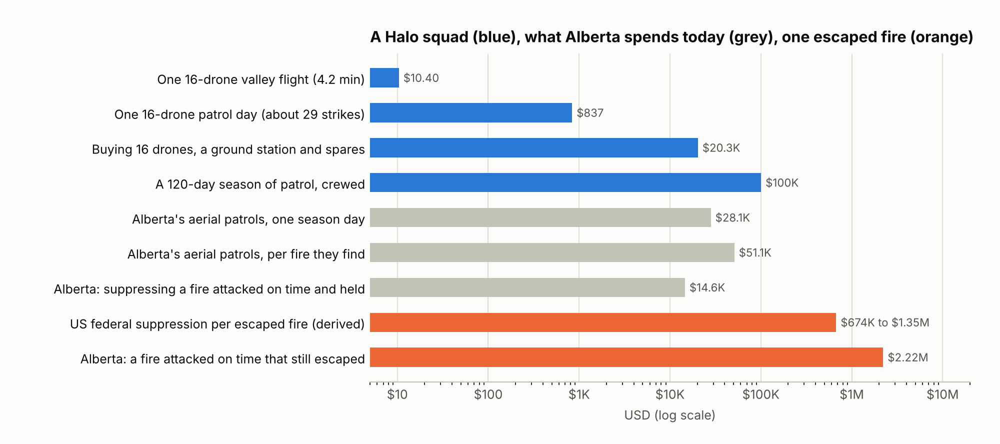
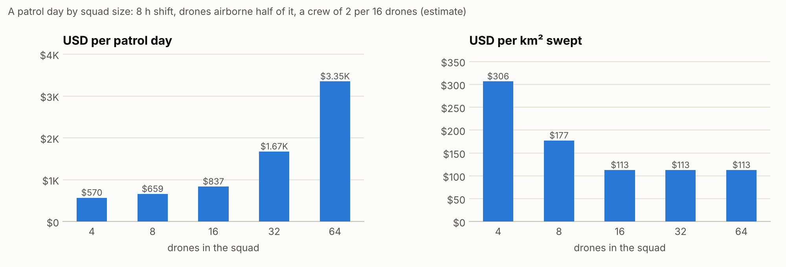

# What a patrol costs

What a day of Halo patrol would cost, against what a fire agency spends on finding fires today and what a fire that escapes initial attack costs to put out. The drone has not been built, so every Halo cost here is an estimate from its priced design ([hardware/](../hardware/README.md)) and the simulator's measured flights. The model is [tools/patrol_cost.py](../tools/patrol_cost.py); it writes the full tables to [results/patrol_cost/TABLES.md](../results/patrol_cost/TABLES.md) and the figures below. USD figures converted from Canadian dollars use the Bank of Canada's 2025 average, 1.3978 CAD per USD [[9]](#sources).

## In short

* **A 16-drone squad with a crew of two costs about USD 840 a patrol day.** In that day it checks about 29 lightning strikes, at about USD 29 a strike. Each strike is swept as a 500 x 600 m area around the reported point, two of the valley's measured block sweeps, which holds about 79% of strikes given the lightning network's location error. Buying the squad, its ground station and spares costs USD 20,281, and a 120-day season of patrol about USD 100,000.
* **Agencies already pay for this job.** Alberta's patrol aircraft "are informed by lightning monitoring systems to target patrols in areas of lightning activity" [[1]](#sources). From 2015 to 2019 they cost an average CAD 9.6 million (USD 6.9 million) a year and made 12.2% of the province's detections [[1]](#sources). Against an average season of 1,107 fires [[2]](#sources), that is about 135 fires a year, or an estimated USD 51,000 for each fire they found. Their spend for one day of Alberta's 245-day fire season [[3]](#sources), about USD 28,000, would pay for about 33 crewed squad-days, checking about 975 strikes.
* **A fire that escapes costs far more than one caught in time.** In Alberta from 2011 to 2019, at moderate hazard, a fire attacked on time that still escaped cost an average CAD 3.1 million (USD 2.2 million) to suppress, against CAD 20,422 (USD 14,600) for one attacked on time and held; one attacked late that escaped averaged CAD 1.2 million (USD 0.84 million) [[1]](#sources). The review puts the difference at "between $1 million and $3 million per wildfire at moderate to high hazard levels" [[1]](#sources). In the US, the 1 to 2% of fires that escape take 30% or more of fire spending [[4]](#sources); on federal suppression alone [[5]](#sources)[[6]](#sources), that is about USD 0.67 to 1.35 million for each escaped fire. Suppression is only part of the bill: in five US case studies it was 9% of a fire's total cost [[7]](#sources).
* **Break-even.** A crewed squad's season pays for itself on suppression cost alone if it keeps one fire from escaping every 21 seasons at Alberta's figure for a fire attacked on time that still escaped, every 8 for one attacked late, or every 6 to 13 at US federal suppression costs. Whether it does depends on how many fires it reaches first that would otherwise have escaped. A simple first-crew model, run after the flights on 40 held-out valleys, gives a share, not a count: the drones' reports prevented 37% of today's escapes (23% if every crew takes an hour), in a valley that is dry and windy by design ([initial attack](../results/wildfire_initial_attack/REPORT.md)). How many fires escape in a season where a squad would fly is not measured.

<picture>
  <source media="(prefers-color-scheme: dark)" srcset="figures/patrol-vs-escape-dark.png">
  
</picture>

## A patrol day by squad size

| Drones | Crew | USD per day | km² swept a day, open ground | USD per km² swept | Strikes checked a day | USD per strike | To buy (USD) |
|---|---|---|---|---|---|---|---|
| 4 | 2 | 570 | 1.9 | 306 | 18 | 32 | 5,769 |
| 8 | 2 | 659 | 3.7 | 177 | | | 10,607 |
| **16** | **2** | **837** | **7.4** | **113** | **29** | **29** | **20,281** |
| 32 | 4 | 1,675 | 14.9 | 113 | 59 | 29 | 40,562 |
| 64 | 8 | 3,349 | 29.8 | 113 | 117 | 29 | 81,124 |

The two coverage columns are two ways to spend the same day: sweeping open ground all shift, or checking strikes one by one. A 16-drone day of strike checks sweeps about 8.8 km² in all.

<picture>
  <source media="(prefers-color-scheme: dark)" srcset="figures/patrol-day-dark.png">
  
</picture>

How the day is built:

* **The shift.** An 8-hour patrol shift, with each drone airborne half of it: 4 flight hours, about 11 battery changes. Charging sets the ceiling: on mains power the build sheet's two chargers give 1,000 W, which with the three charged packs each drone starts with keeps a 16-drone squad airborne at most about 70% of the shift, before charger losses. So 50% leaves room for weather holds and checks.
* **The sweep.** Half of the airborne time is scanning, at the 16-drone rate measured on the wildfire scout's block, 0.39 ha a minute per drone ([results/wildfire/REPORT.md](../results/wildfire/REPORT.md)). The rest is launch, transit, turns and landing.
* **Hardware.** The build sheet's cost per drone flight hour without its ground-station share, USD 5.57 over a 300-hour drone life, covers the drone, battery wear, propellers, motors and charging. The ground station is counted on its own line, spread over 300 squad flight hours ([hardware/COSTS.md](../hardware/COSTS.md)). Each squad of 16 has its own ground station and crew.
* **Crew.** Two people per 16 drones, a remote pilot and an observer, at the US median firefighter wage of USD 28.50 an hour, wages only [[8]](#sources). Crew time is most of a small squad's day, which is why the cost per km² falls until 16 drones and then stays flat.
* **A strike.** The US lightning network's median location error is about 200 m [[10]](#sources). With the error spread evenly in all directions, one 500 x 300 m block centred on the reported point holds about 54% of strikes, and two side by side, 500 x 600 m, about 79%. So each strike gets two sweeps of the valley's block, each taking the measured flight time: 8.4 minutes for 16 drones (the mean over the 20 held-out valley flights in [runs.jsonl](../results/wildfire_valley/runs.jsonl)). With launch, landing, a battery check and a short drive, a strike takes about 16 minutes, so the squad checks 29 in a shift. A 4-drone squad takes 19 minutes of flight a strike, checks 18, and found 77% of the valley's fires instead of 86%.

Across drone lives of 100 to 1,000 hours, a crew of two or none, 50% or 75% airtime, and half or all of it scanning, the 16-drone squad costs USD 15 to 172 per km² swept; the base case is USD 113 ([TABLES.md](../results/patrol_cost/TABLES.md)). The 75% rows would need a DC supply for the chargers.

## Per fire found, not per square kilometre

Lookouts, aircraft, cameras and satellites watch whole regions for a plume. Spread over Alberta's 390,000 km² Forest Protection Area and its 245-day season [[1]](#sources)[[3]](#sources), its lookouts cost about USD 0.05 and its aerial patrols USD 0.07 per km² a day. A 16-drone squad costs about USD 113 for each km² it sweeps. Halo is not a way to watch a region; it is a close look at the places lightning struck, where a smouldering fire puts up too little smoke to be seen from far away. The comparison that matters is per strike checked and per fire found.

In the valley, where the scenario puts five fires in every block, a 16-drone flight costs USD 10.40 and finds 4.3 of them. A real strike mostly leaves no fire, and the simulator does not know what share do. If one strike in 20 left a fire, then with the fire inside the swept area 79% of the time and found 86% of the time when it is, a fire found would cost about USD 840; if one in 100, about USD 4,200. Alberta's patrols spend an estimated USD 51,000 for each fire they find, though they also cover ground no squad would be sent to.

## What is not counted

* **Approvals.** US rules allow one remote pilot per aircraft without a waiver and require the pilot to see the aircraft throughout the flight [[11]](#sources). A squad of 16 with a crew of two needs a waiver or the proposed Part 108 rule.
* **Other costs.** Training, insurance, a vehicle, docks, software, data links beyond the bill of materials, and crashes beyond what a 300-hour life absorbs ([hardware/COSTS.md](../hardware/COSTS.md)). The 100-hour row of the sensitivity stands in for a hard first season.
* **Weather days.** The model prices a flying day; a season has days the squad cannot fly.
* **The finds themselves.** The valley's fires and their smoulder times are set by the scenario, today's methods are modelled from published figures rather than measured, and nobody fights the fires during the flights. The first-crew model afterwards gives the share of escapes prevented in one dry, windy valley design, not a count per season ([WILDFIRE.md](WILDFIRE.md#what-is-not-modelled)).

## Sources

Each figure from sources 1 to 7 and 9 is quoted in `COMPARISON` in [tools/patrol_cost.py](../tools/patrol_cost.py) with the words it was read from; the wage, the lightning network's accuracy and the drone rules are named in its `BUILD` and `ASSUMPTIONS`.

1. MNP LLP for the Government of Alberta, [Spring 2019 Wildfire Review, Final Report](https://open.alberta.ca/dataset/5fa709d9-d70a-4176-a1b8-e097abafa9fe/resource/f42b9020-69e0-4d2c-984b-68ad33761f10/download/af-spring-2019-wildfire-review-final-report.pdf), November 2020: page 69 (patrols and lightning monitoring), table 12 (detection shares and costs, fiscal years 2015-2019), table 16 and page 114 (suppression cost by outcome, 2011-2019, fires other than recreation and residential ones; moderate hazard is head fire intensity class 3-4), and the Forest Protection Area of about 39 million hectares.
2. Government of Alberta, Forestry and Parks, [Annual Report 2023-2024](https://open.alberta.ca/dataset/2dedbb29-e005-4802-bf6e-03bf77536add/resource/b86465e8-a8e3-45de-91d8-3fec19c700db/download/fp-annual-report-2023-2024.pdf): a five-year average of 1,107 wildfires a season, given beside the 2023 season. The report does not name the years, most likely 2018-2022, a different window from the review's detection shares; with the review's own average since 1990, 1,266 a year, the patrols' cost per fire found would be about USD 44,600.
3. [Forest and Prairie Protection Act (Alberta)](https://kings-printer.alberta.ca/documents/Acts/F19.pdf), s. 17(1): the fire season runs from 1 March to 31 October, 245 days.
4. USDA Forest Service, [testimony of Victoria C. Christiansen](https://www.fs.usda.gov/sites/default/files/fs_media/fs_document/usda-testimony-senr-fire-christiansen-08-03-17.pdf), 3 August 2017: fire services "suppress or manage 98 percent of fires during initial attack"; the large fires that escape "account for 1 to 2 percent of total fires but result in 30 percent or more of fire expenditures".
5. National Interagency Fire Center, [federal firefighting costs, suppression only](https://www.nifc.gov/fire-information/statistics/suppression-costs): a mean of USD 2.79 billion a year over 2015-2023.
6. National Interagency Fire Center, [total wildland fires](https://www.nifc.gov/fire-information/statistics/wildfires): a mean of about 62,200 fires a year in all jurisdictions over the same years, 2015-2023. With [4] and [5]: 30% of USD 2.79 billion over 1 to 2% of 62,200 fires is USD 0.67 to 1.35 million per escaped fire. This is federal suppression spread over every US escape, including the many that federal agencies do not pay for.
7. Headwaters Economics, [The Full Community Costs of Wildfire](https://headwaterseconomics.org/wp-content/uploads/full-wildfire-costs-report.pdf), May 2018: "suppression costs comprise only nine percent of total wildfire costs", in five US case studies.
8. US Bureau of Labor Statistics, [occupational employment and wages, firefighters (33-2011), May 2025](https://api.bls.gov/publicAPI/v2/timeseries/data/OEUN000000000000033201108): a median of USD 28.50 an hour.
9. Bank of Canada, [annual average exchange rates](https://www.bankofcanada.ca/rates/exchange/annual-average-exchange-rates/): 1.3978 CAD per USD in 2025.
10. Nag, Murphy, Cummins, Pifer and Cramer, [Recent Evolution of the U.S. National Lightning Detection Network](https://www.vaisala.com/sites/default/files/documents/Nag%20et%20al-Recent%20Evolution%20of%20the%20U.S.%20National%20Lightning%20Detection%20Network-2014-ILDC-ILMC.pdf), 2014: the network's median location accuracy improved "from about 300 m to about 200 m in the interior of the network".
11. 14 CFR [107.35](https://www.ecfr.gov/current/title-14/chapter-I/subchapter-F/part-107/subpart-B/section-107.35) (one aircraft per remote pilot) and [107.31](https://www.ecfr.gov/current/title-14/chapter-I/subchapter-F/part-107/subpart-B/section-107.31) (visual line of sight).
