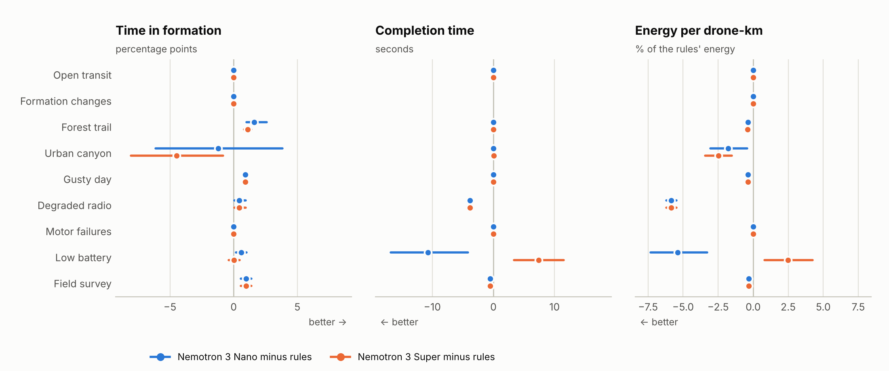
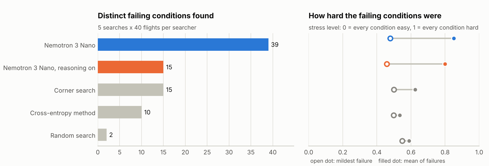

# Results

Every flight result here comes from held-out seeds, each flight run once. Most use seeds 1000-1019. The wildfire valley has its own, 4000-4019, and each later valley and missing-hiker result names its own set (8000-8019, 9000-9019, 9000-9039, 9100-9119 and 9150-9169, 9200-9219). The stress search flies its own search seeds. The mission and valley compilers are scored on held-out sets of 20 and 48 requests. The simulator, controllers and rules were frozen before any held-out flight (in the wildfire valley, before the flights reported here; see its protocol), and the Nemotron setup was chosen on tuning seeds 0-9 and committed before any Nemotron flight on the held-out seeds ([BENCHMARKS.md](BENCHMARKS.md)). The generated reports behind each section are [REPORT.md](../results/REPORT.md) (95% confidence intervals and seed-by-seed comparisons for every number), [STRESS.md](../results/STRESS.md), [wildfire/REPORT.md](../results/wildfire/REPORT.md), [wildfire_valley/REPORT.md](../results/wildfire_valley/REPORT.md), and for the later results [wildfire_alerts/REPORT.md](../results/wildfire_alerts/REPORT.md), [wildfire_initial_attack/REPORT.md](../results/wildfire_initial_attack/REPORT.md), [wildfire_valley_squads/REPORT.md](../results/wildfire_valley_squads/REPORT.md), [valley_eval/REPORT.md](../results/valley_eval/REPORT.md) and [hiker_search/REPORT.md](../results/hiker_search/REPORT.md). The figures outside the wildfire valley are drawn from the committed rows by [tools/make_figures.py](../tools/make_figures.py), which also prints every plotted number.

## Wildfire scouting: what the swarm is for

The wildfire scout sweeps a 300 × 200 m block of dry scrub for six smouldering hotspots with downward thermal cameras (45° field of view, 20 m up, a 16.6 m strip per drone). The same 20 held-out blocks were flown with 1, 4 and 16 drones, with the improved controller and the rule supervisor; Nemotron was not flown on this scenario. Every flight found every hotspot, with no crashes and no near misses. What changes is time ([results/wildfire/REPORT.md](../results/wildfire/REPORT.md)):

| Drones | Time to find all six hotspots | First find | Time to cover 90% of the block | Coverage rate | Energy for the block |
|---|---|---|---|---|---|
| 1 | 536 s [487, 580] | 96 s | 620 s | 0.5 ha/min | 25.1 Wh |
| 4 | 180 s [163, 196] | 22.5 s | 198 s | 1.6 ha/min | 32.9 Wh |
| 16 | 41 s [38, 43] | 6.5 s | 44 s | 6.2 ha/min | 32.7 Wh |

Means over the 20 held-out blocks, with 95% bootstrap intervals. Seed by seed, sixteen drones found the last hotspot 13.3 times faster than one drone [12.0, 14.5], 8.3 minutes earlier [7.4, 9.0] on a block that one drone needs 11.6 minutes to finish, for 30% more battery energy in total. The drones fly line abreast 14 m apart, so sixteen of them sweep the block in one lane where one drone needs thirteen.

<picture>
  <source media="(prefers-color-scheme: dark)" srcset="figures/wildfire-swarm-size-dark.png">
  
</picture>

The sweep was flown in a 3 to 6 m/s breeze with turbulence. The harder weather a large fire can whip up, gust fronts, is tested in the supervision scenarios below, with radio loss, motor failures and short batteries. In this scenario the fire does not spread: hotspots are fixed points, and a camera finds one once its footprint has covered it for half a second. The wildfire valley below simulates the spread. No scenario simulates the fire's effect on its own wind; gust fronts are injected to stand in for it.

## Wildfire valley: finding fires, forecasting their spread, warning phones

The wildfire valley is a mountain valley the morning after dry lightning, with five fires per flight: one already spreading in open scrub, one under tree crowns, one under a rock overhang that no camera looking down can see, one smouldering in the open, and one across the valley outside the survey block. The swarm sweeps the valley floor with downward thermal cameras and watches ahead for smoke. The ground station locates the fires, forecasts their spread with an ensemble of 16 runs of Rothermel's fire model, 3 hours ahead, briefs the fire crews and sends evacuation alerts zone by zone at Japan-style levels (3 prepare, 4 evacuate, 5 emergency). In the flights reported first below, alerts went out automatically under today's rule, in which any located fire, a smoulder included, can raise a zone to Level 3, each after an alert check, to simulated phones only; an operator can cancel an alert or give a zone the all-clear. The pre-signed trigger rules chosen for public alerts were measured later ([below](#alerts-under-pre-signed-rules-seeds-9000-9019)). No language model finds the fires, makes the forecast or decides an alert; one only reads a valley job typed in plain words ([below](#valley-jobs-in-plain-words-48-held-out-requests)). The drones carry the sensors of the Halo scout in [hardware/](../hardware/README.md), a design priced from off-the-shelf parts. The scenario, the station and every assumption with its source are in [WILDFIRE.md](WILDFIRE.md).

**Protocol.** Held-out seeds 4000 to 4019 (20 valleys, 100 fires), each flown once with the final code: 80 flights, with 1, 4 and 16 drones, and the 16-drone flights again with alerts by distance alone, all on the improved controller with the rule supervisor. Seeds 2000 to 2011 and 3000 to 3019 were used while the scenario and the station were built. An earlier sweep on seeds 4000 to 4019 was stopped part-way when the station changed, and its rows were set aside unread. The models of today's detection methods were checked only on seeds 3000 to 3003. Brackets are 95% bootstrap intervals over seeds. The tables are copied from [wildfire_valley/REPORT.md](../results/wildfire_valley/REPORT.md), which `tools/wildfire_valley_report.py` generates from [runs.jsonl](../results/wildfire_valley/runs.jsonl) (means and intervals in [summary.json](../results/wildfire_valley/summary.json)); `tools/wildfire_valley_figures.py` draws the charts.

**What is simulated.** The valley simulates the fire's spread (Rothermel's surface fire model on land cover, slope and wind), plume heights, smoke and heat detection, the forecast, the alerts and the phones. Smoke and heat detection are probability models of a detector, not image recognition. Crown fire, spotting and the fire's effect on its own wind are not modelled; each makes real fires faster and less predictable than this forecast assumes. The swarm flies its sweep (or, as an option, a 12-minute squad patrol) and lands without going back to check a fire, it flies 20 m above the canopy straight over a spreading fire, its simulated GNSS error is about a sixth of the scout's receiver, and an alert counts as delivered, not as acted on.

### Fires found by swarm size

A fire counts as found when the station places one within 60 m of its burning ground (its ignition point while it smoulders). A false fire is a location more than 60 m from every fire's burning ground, including ones the station later merged into a real fire. Mapped: burning ground the thermal cameras mapped by the end of the flight ([REPORT.md](../results/wildfire_valley/REPORT.md#finding-the-fires)).

| Drones | Fires found (%) | False fires per flight | Duplicates merged per flight | Smoke fix error, median (m) | Mapped (ha), median | All found by (s) |
|---|---|---|---|---|---|---|
| 1 | 60.0 [60.0, 60.0] | 0.00 [0.00, 0.00] | 0.35 | n/a | 0.21 | none of 20 flights |
| 4 | 77.0 [72.0, 82.0] | 0.30 [0.00, 0.75] | 0.25 | 5.7 | 0.20 | 2 of 20 flights; median 459 s |
| 16 | 86.0 [80.0, 91.0] | 0.45 [0.25, 0.65] | 0.15 | 9.3 | 0.19 | 8 of 20 flights; median 189 s |

More drones found more fires, but also placed more false ones: 0.45 per flight with sixteen. Sixteen drones found all five fires in 8 of 20 flights. One drone cannot locate a fire by smoke, because a smoke fix needs bearings from three or more drones ([WILDFIRE.md](WILDFIRE.md)). In all 20 of its flights the single drone was also retired at its battery reserve before completing the mission (`completed` false and one drone retired in every one-drone row of runs.jsonl).

### Hidden fires

By where the fire was: share found, share of those found by smoke, and the median time to find it.

| Fire | 1 drone | 4 drones | 16 drones |
|---|---|---|---|
| Spreading at the start, open scrub | 100% found, 0% by smoke, 288 s | 100% found, 80% by smoke, 88 s | 95% found, 89% by smoke, 1 s |
| Under tree crowns | 100% found, 0% by smoke, 352 s | 95% found, 16% by smoke, 188 s | 95% found, 26% by smoke, 34 s |
| Under a rock overhang | 0% found, 0% by smoke | 75% found, 100% by smoke, 130 s | 75% found, 100% by smoke, 24 s |
| Smouldering in the open | 100% found, 0% by smoke, 345 s | 95% found, 63% by smoke, 184 s | 80% found, 88% by smoke, 19 s |
| Across the valley | 0% found, 0% by smoke | 20% found, 100% by smoke, 393 s | 85% found, 100% by smoke, 140 s |

The two fires no downward camera can reach were found only by smoke: the one under the overhang in 75% of flights with four or sixteen drones, and the one across the valley in 20% of flights with four and 85% with sixteen.

### Against today's ways of finding fires

The same fires, found by the methods fire services use today, modelled from published figures with the benefit of the doubt: no cloud, a camera with a clear view of the whole valley, every satellite detection credited to the right fire, the fastest published delivery (`src/halo_systems/sim/detection.py`; sources in [WILDFIRE.md](WILDFIRE.md#drones-against-todays-methods)). They watch for 4 hours from 08:00; the drones fly once, for up to 40 minutes, and anything they miss counts as not found. Time is measured from when each fire started to spread: negative means found while it still smouldered. Shares are of all 100 fires.

| Method | Found in 4 h (%) | Found before it spread (%) | Found under 0.1 ha (%) | Minutes after it spread, median | Size when found, median (m²) | Says where to within |
|---|---|---|---|---|---|---|
| Geostationary satellite (GOES, 5-min scans) | 93 [89, 97] | 0 [0, 0] | 0 [0, 0] | +55 | 15,700 | a 2 km pixel or larger |
| Polar-orbiting satellites (MODIS, VIIRS) | 89 [83, 95] | 0 [0, 0] | 3 [0, 6] | +128 | 72,800 | a 375 m to 1 km pixel |
| AI camera network, clear view | 100 [100, 100] | 0 [0, 0] | 100 [100, 100] | +4 | 200 | a bearing from each camera |
| AI camera network, as deployed (sees 22% of fires) | 24 [17, 32] | 0 [0, 0] | 24 [17, 32] | not found | 150 | a bearing from each camera |
| Public calls (911 / 119) | 99 [97, 100] | 0 [0, 0] | 78 [70, 86] | +4 | 200 | the caller's description |
| Earliest of today's four (camera with a clear view) | 100 [100, 100] | 0 [0, 0] | 100 [100, 100] | +4 | 100 |  |
| Halo drones, 1, one flight | 60 [60, 60] | 40 [40, 40] | 43 [40, 46] | +26 | 4 | its burning ground (median, measured) |
| Halo drones, 4, one flight | 77 [72, 82] | 55 [50, 60] | 59 [53, 65] | -18 | 4 | 3 m (median, measured) |
| Halo drones, 16, one flight | 86 [80, 91] | 59 [52, 66] | 68 [62, 74] | -20 | 4 | 5 m (median, measured) |
| Today's four plus 16 drones | 100 [100, 100] | 59 [52, 66] | 100 [100, 100] | -20 | 5 |  |

With 1 drone, the drone reported 40 of 100 fires before the earliest of today's four, by a median of 112 minutes. With 4 drones, the swarm reported 55 of 100 fires before the earliest of today's four, by a median of 74 minutes. With 16 drones, the swarm reported 60 of 100 fires before the earliest of today's four, by a median of 69 minutes. Each median is over the fires that swarm reported first, a different set for each size.

These are models of today's methods built from cited figures, not measurements of them. Cameras and callers start their clock when the fire starts to spread, so none of them finds a smouldering fire here; the drones' lead comes mostly from that phase, and from smoulder times the scenario sets (from 20 minutes before take-off to 4 hours after). Once a fire spreads, a camera with a clear view or a call from the public reports it about 4 minutes later. Aerial patrols after lightning are left out because no source gives how often or when they fly. The drones add to today's methods rather than replace them: together, today's four and sixteen drones found every fire.

### Forecast skill

The last forecast of each flight against the true spread; fewer drones sweep for longer, so their last forecast is made later, with more of the fire mapped. Sorensen index: overlap between the ground the forecast's median says will burn and the ground that does burn, counting only ground that burns after the forecast (1 is a perfect match). "Located fires" compares with the true spread of the fires the station knew were spreading; "all fires" with every fire, found or not. Phone arrival error: forecast median arrival minus the true arrival, at phones the fire reaches within 3 hours (negative is early). Brier score: the forecast probability of fire within 60 minutes at each phone against what happened (0 is perfect).

| Drones | Made at (min), median | Sorensen, 1 h | Sorensen, 3 h | Sorensen, 3 h, all fires | Phone arrival error, mean abs (min) | Bias (min) | Brier, 60 min |
|---|---|---|---|---|---|---|---|
| 1 | 13.0 | 0.77 [0.72, 0.81] | 0.89 [0.87, 0.91] | 0.76 [0.71, 0.81] | 17.6 [11.6, 25.5] | 12.9 [5.9, 21.8] | 0.038 [0.022, 0.059] |
| 4 | 8.5 | 0.74 [0.68, 0.79] | 0.85 [0.82, 0.89] | 0.76 [0.71, 0.80] | 20.4 [15.2, 26.5] | 12.6 [4.5, 20.9] | 0.032 [0.020, 0.048] |
| 16 | 3.5 | 0.71 [0.63, 0.78] | 0.83 [0.79, 0.86] | 0.77 [0.72, 0.82] | 24.6 [17.7, 33.2] | 2.2 [-9.4, 15.2] | 0.029 [0.018, 0.042] |

Fewer drones score better on overlap with the located fires and on arrival error, because they finish later and forecast with more of the fire mapped. Against all fires, found or not, the three swarm sizes overlap about equally, and sixteen drones have the lowest mean bias and Brier score.

### Warnings to phones

Each flight has 63 simulated phones (homes, a campground, hikers, drivers and a ranch); 5% have no signal. Alerts arrive 5 to 30 s after they are sent. A phone is reached when fire comes within 50 m of it within 3 hours of take-off. Warned in time: an alert at Level 3 or above delivered before the fire arrives, as a share of the phones reached. Lead time: how long before the fire arrives the first alert lands (median over phones, then over flights). Evacuated: told Level 4 or 5.

| Drones | Phones reached per flight | Warned in time (%) | Missed, with signal | Missed, no signal | Lead time, median (min) | Lead time, 10th pct (min) | Evacuation lead, median (min) | Evacuated but not reached in 3 h (%) | Alerts per flight, Levels 3 / 4 / 5 | Alerts rejected by the check |
|---|---|---|---|---|---|---|---|---|---|---|
| 1 | 32.1 | 94.7 [93.0, 96.4] | 2 | 32 | 124 | 60 | 64 | 10 [5, 18] | 4.2 / 1.9 / 1.0 | 0 of 144 |
| 4 | 32.1 | 94.9 [93.2, 96.5] | 1 | 32 | 126 | 62 | 85 | 18 [9, 29] | 4.5 / 2.1 / 1.1 | 0 of 154 |
| 16 | 32.1 | 94.7 [93.0, 96.4] | 2 | 32 | 126 | 64 | 100 | 20 [9, 32] | 3.6 / 2.2 / 1.4 | 0 of 144 |

The share warned in time is about the same for every swarm size, and for alerts by distance alone (below), so it is not a gain from the swarm or the forecast. With sixteen drones, 32 of the 34 phones missed had no signal. The check rejected none of the alerts, so these flights do not show it stopping a bad one.

### Forecast against distance

The 16-drone flights again, with the alert rule replaced by distance alone: Level 5 within 150 m and Level 4 within 800 m of a spreading fire, Level 3 within 1,600 m of any. Paired by seed; differences are forecast minus distance.

| Drones | Rule | Warned in time (%) | Lead time, median (min) | Phones evacuated per flight | Evacuated but not reached in 3 h (%) | Warned but not reached in 3 h per flight |
|---|---|---|---|---|---|---|
| 16 | forecast | 94.7 [93.0, 96.4] | 126 | 23.4 | 20 [9, 32] | 17.9 |
| 16 | distance | 95.0 [93.3, 96.7] | 126 | 59.2 | 49 [41, 57] | 28.8 |

Over 20 paired seeds the forecast rule changes phones warned in time by -0.1 [-0.2, 0.0] per flight and phones evacuated that the fire did not reach by -24.1 [-30.2, -18.2] per flight. The forecast told about 24 fewer phones per flight to leave that the fire did not reach, and warned about the same share in time.

### Alerts under pre-signed rules (seeds 9000-9019)

Pre-signed trigger rules are an option in the simulator. An alerting authority would sign each rule in advance; a public alert goes out only for a fire the station believes is spreading, and a newly found fire, smouldering or not, goes to fire dispatch as a card (simulated). Seeds 9000-9019 (20 valleys) were flown once with 16 drones flying today's single sweep, each valley under three alert policies: today's rule, the pre-signed rules sent automatically, and the pre-signed rules with an official's one-tap approval after a modelled delay (median 90 s). The flight is the same in all three; only the alerts differ. No language model takes part in any alert or card. Totals over the 20 valleys, from [wildfire_alerts/REPORT.md](../results/wildfire_alerts/REPORT.md):

| | Today's rule | Pre-signed, automatic | Pre-signed, one-tap |
|---|---|---|---|
| Public alerts sent | 148 | 141 | 118 |
| Sent while every fire behind it was still smouldering | 11 | 9 | 7 |
| Sent for false fires only | 0 | 0 | 0 |
| Phones warned before the fire reached them (660 reached) | 635 | 632 | 631 |
| Phones reached without a warning (with signal) | 0 | 3 | 4 |
| Phones warned that the fire did not reach within 3 h | 360 | 336 | 335 |
| Cards to fire dispatch (of them for false fires) | 0 | 92 (11) | 91 (10) |
| Median warning lead, minutes (median over valleys) | 127.6 | 127.6 | 126.3 |

Pre-signed rules changed little. Paired by valley, the automatic arm sent 7 fewer public alerts than today's rule (95% bootstrap interval -14 to -1) and 2 fewer while every fire still smouldered (-6 to +0). Level 4 and 5 alerts were nearly the same (48 and 25 against 49 and 24), because they come from fires already spreading. The cost: 3 phones with signal that the fire reached got no warning in time, against none under today's rule (+0 to +8). All three were hikers on the ridge trail, in two valleys, reached 2.4 to 2.7 hours after take-off. Their fires had gone to fire dispatch as cards 30 s into the flight and took off 41 and 46 minutes after take-off. The swarm had landed after 4 minutes, so no drone saw them spread and no public alert followed; today's rule had warned those phones on the smoulder. So under pre-signed rules, a fire found smouldering depends on fire dispatch acting on its card, or on another flight seeing it take off. Whether squads or a second flight would close that gap was not measured. One-tap approval waited a median 86 s per valley; while an alert waits, a later forecast can raise the zone's level, so fewer, higher alerts went out. The valley results above and the squads below were flown under today's rule.

**On 40 more valleys.** After the valley test engineer's run ([below](#in-the-wildfire-valley-seeds-9100-9119-and-9150-9169)), its 40 valleys were flown on the drawn day under both rules, paired the same way ([valley_stress/REPORT.md](../results/valley_stress/REPORT.md)). Of 1,176 phones the fire reached within 3 h, the pre-signed rules warned 26 to 50 late or never, depending on the station's random draw, in 9 valleys; today's rule, on the same draw as the 50, warned none late. Today's rule sent 284 public alerts against 242, 61 against 25 while every fire behind them still smouldered, and 83 against 69 that the fire did not justify within the level's window; the pre-signed rules also sent 195 cards to fire dispatch. Across these 40 valleys and the 20 above, the pre-signed rules warned 29 to 53 of 1,836 reached phones late or never (about 1 in 63 to 1 in 35), in 11 of 60 valleys, and today's rule warned all of them in time, for about 13% more public alerts (432 against 383).

### The first crew and escapes (seeds 9000-9039, modelled)

Nobody fights the fires during the flights. Afterwards, [tools/wildfire_initial_attack.py](../tools/wildfire_initial_attack.py) takes each true fire's report time, by today's methods as deployed and with the drones' card to fire dispatch added. It adds a response time drawn once per fire (lognormal, median 30 minutes) and races the fire line (the cleared strip that stops a fire) that one Type 3 engine, a wildland fire engine with a crew of three, builds against the true fire's perimeter. A fire escapes if it is not contained, or is larger than 10 acres (4.05 ha, CAL FIRE's initial-attack goal) when it is. Seeds 9000-9039 (40 valleys, 197 fires) are the pre-signed arm of the alert sweep plus 20 more valleys, and the plan was written before the run ([PREREG.md](../results/wildfire_initial_attack/PREREG.md)). From [wildfire_initial_attack/REPORT.md](../results/wildfire_initial_attack/REPORT.md):

| | Today's reports | With the drones' reports |
|---|---|---|
| First crew on scene while the fire still smoulders | 0 of 197 | 79 |
| Median size when the first crew arrives (ha) | 0.62 | 0.07 |
| Fires escaped, one Type 3 engine | 150 | 95 |
| Share of today's escapes prevented | | 55 of 150 (37%) |

| Sensitivity | Escapes prevented | First crew on a smoulder, with the drones |
|---|---|---|
| Response drawn per fire, median 30 min (as above) | 55 | 79 |
| Response fixed at 15 / 60 / 120 min | 69 / 36 / 13 | 103 / 46 / 15 |
| Line built at 2 / 4 / 8 times one engine's rate | 47 / 50 / 33 | 79 / 79 / 81 |
| Today's methods with a camera that sees every fire | 53 | 79 |

With the drones, the first crew reached 79 of 197 fires (40%) while they still smouldered, 34.0 to 46.2 percentage points more than with today's reports (95% bootstrap over valleys), and 77 of those were held. 53 of the 55 escapes prevented are fires the crew reached before they took off: on this dry, windy day, a fire that has taken off grows faster than one crew builds line. Giving today's methods a camera that sees every fire changes their escapes only from 150 to 147, so the gain is about seeing fires before they spread, not camera coverage. One prediction written before the run missed: today's escapes came out lower than predicted.

**Caveat.** The valley is a dry, windy day by design, so its escape rates are far above real ones (CAL FIRE's goal is to contain 95% of fires at 10 acres or less), and they do not transfer. The share of escapes prevented is the result to carry over (37% here, 23% with a fixed 60-minute response, 36 to 56% with stronger first crews), and only to fires the drones would find while they smoulder. The race lets a fire burn freely until it is contained, which overstates sizes in both columns.

### Squads per area (seeds 8000-8019)

As an option, the drones fly as squads over the valley's three areas, the floor (F), the north slopes (N) and the south slopes (S). Each squad patrols its own area line abreast for 12 minutes, inside one battery; drones that do not fit across an area wait in reserve (R) at the launch point. Seeds 8000-8019 (20 valleys) were flown once after the plan in [PREREG.md](../results/wildfire_valley_squads/PREREG.md) was written: 300 rows in three arms (280 distinct flights, since at 4 drones B and D are the same flight), A today's flight (one sweep of the floor), B one squad patrolling the floor, and D squads per area, all under today's alert rule and with no supervisor. From [wildfire_valley_squads/REPORT.md](../results/wildfire_valley_squads/REPORT.md):

| Drones | D: drones per area | Found: A / B / D | Found while smouldering: A / B / D | Across-valley fire: A / B / D | False fires per flight: A / B / D |
|---|---|---|---|---|---|
| 4 | F4-N0-S0-R0 | 78% / 72% / 72% | 53% / 50% / 50% | 35% / 15% / 15% | 0.20 / 0.55 / 0.55 |
| 8 | F4-N4-S0-R0 | 76% / 74% / 84% | 53% / 51% / 58% | 30% / 20% / 75% | 0.00 / 0.40 / 1.00 |
| 16 | F4-N6-S6-R0 | 84% / 80% / 88% | 58% / 55% / 62% | 75% / 50% / 100% | 0.40 / 0.35 / 1.05 |
| 32 | F6-N12-S12-R2 | 86% / 80% / 90% | 62% / 55% / 64% | 75% / 50% / 100% | 0.50 / 0.35 / 1.50 |
| 64 | F11-N12-S12-R29 | 87% / 80% / 91% | 61% / 55% / 65% | 100% / 50% / 100% | 0.70 / 0.35 / 0.85 |

Paired by valley, squads per area found 0.40 to 0.55 more fires per flight than one floor squad from 8 drones up, every interval above zero, and the fire across the valley in every valley from 16 drones. Against today's single sweep the gain is clear only at 8 drones (+0.40 per flight, +0.10 to +0.70). From 16 up it is +0.20 per flight, with intervals that include zero, and at 4 drones one sweep beats a patrol (-0.30, -0.65 to -0.05). This is not an equal-time comparison: the squads patrol for 12 minutes, while today's sweep ends when the line has crossed the floor once (about 10 minutes at 4 drones, 4 at 16, under 2 at 32 and 64), so part of the squads' gain is that they keep looking for longer. The cost is false fires: 0.85 to 1.50 per flight from 8 drones up, against 0.35 to 0.40 for one floor squad. Under today's alert rule they led to public alerts in 5 of the 20 valleys at 8 drones (17 alerts in all); how the pre-signed rules treat them was not measured. Phones warned in time did not change (26.8 to 26.9 per flight in every arm and size). No camera saw the fire under the overhang in any of the 280 flights; every arm placed it by smoke while it still smouldered, in 176 of the 300 rows. No crashes and no drones retired in any flight. The prediction written before the run that squads would only match one floor squad from 16 drones up was wrong: they kept finding more.

### Aircraft inbound (development seed 3000, a demonstration)

When crewed firefighting aircraft come into the valley, the operator orders a hold: every flying drone stops where it is and descends to the hold altitude (10 m above the surface the drones follow, tree crowns included), while the ground station, smoke watch and alerts keep running. On resume the swarm climbs back and carries on its sweep. Both orders pass the safety validator and are logged like any directive ([ARCHITECTURE.md](ARCHITECTURE.md#aircraft-inbound-airspace-hold)). On development seed 3000, with 16 drones and a 5-minute hold, both orders were accepted with no violations. Every flying drone was within 1.5 m of the hold altitude and slower than 0.5 m/s 6.1 s after the order, the hold used 28.7% of one battery per drone with no drone retired, and the sweep finished 305 s later with the same 5 fires located. This is a demonstration of the control on one seed, not a measurement ([airspace_hold/REPORT.md](../results/airspace_hold/REPORT.md)). What flying it for real would need is in the README's [Flying it legally](../README.md#flying-it-legally).

### Valley jobs in plain words (48 held-out requests)

The operator types the valley job, for example "We had dry lightning last night. Put 16 drones over the whole valley for 12 minutes and check last night's strikes." Nemotron 3 Nano reads it into a short spec: how many drones, which areas, how long, and which strikes by when and where. Code checks the spec, builds the squads and applies the strike filter to the valley's own list, so the model never picks a strike or a lane itself. A keyword guard refuses non-civilian requests before any call, and every plan passes the safety validator before a drone moves. Scored once on 20 October 2026 on 48 held-out requests (strike lists from seeds 9040-9087), at temperature 0, from [valley_eval/REPORT.md](../results/valley_eval/REPORT.md):

| Held-out, 48 requests | Nano, reasoning on | Nano, reasoning off | Hand-written rules |
|---|---|---|---|
| Same patrol as the gold reading | 47 | 39 | 20 |
| Every field right | 47 | 36 | 17 |
| Fields right | 99.2% | 95.0% | 85.3% |
| Strike lists right (of 32 requests that ask for strikes) | 31 | 28 | 24 |
| Strikes chosen: right / extra / missed | 138 / 0 / 17 | 136 / 2 / 19 | 138 / 65 / 17 |
| Requests outside civilian use refused (of 6) | 6 | 6 | 0 |
| Median time per request | 4.7 s | 1.1 s | under 0.01 s |
| Cost of the calls (47 requests; the guard refused one before any call) | USD 0.0164 | USD 0.0061 | none |

The one miss with reasoning on was not the model's. The keyword guard refused request 145 ("every single strike on it, no matter where it landed") before any call, because "strike on it" reads to the guard like an order to strike something, so Nemotron never saw it; its 17 strikes are every "missed" strike in that column. The guard is shared with the mission compiler and errs on the side of refusing; it was left as it is, and the miss stays in the score. The hand-written rules read seventeen patrol lengths in words wrongly, let all six non-civilian requests through and added 65 strikes nobody asked for. On the 16 tuning requests, seen while the prompt was written, the scores were 16, 12 and 14 of 16. 48 requests is a small set (one request is two points), and they were written for the test and checked by blind readers, not by fire crews: they show how the compiler handles varied phrasing, not how real dispatchers talk. Without a key, `halo valley-eval --replay` answers from the recorded calls in `results/valley_compile_cache.jsonl` and gives the same scores.

## Missing-hiker search (held-out seeds 9200-9219)

The same kind of thermal sweep, looking for a person instead of a fire: one sweep of a 400 × 250 m meadow and forest edge, line abreast at 20 m with thermal cameras looking down, flown with the rule supervisor. The person, a heat signature 0.8 m across, lies in the open half the time and otherwise under 30 to 80% tree crown; the same seed puts the person in the same place whatever the swarm size. A find needs half a second of the person in some camera's view, longer when partly hidden. No model is in the loop. Seeds 9200-9219 (20 searches) had never been flown before, and the plan ([PREREG.md](../results/hiker_search/PREREG.md)) set no threshold. From [hiker_search/REPORT.md](../results/hiker_search/REPORT.md):

| Drones | Found | In the open | Under trees | Time to find, median | 90% found within | Flight took, median |
|---|---|---|---|---|---|---|
| 1 | 16 of 20 | 9 of 9 | 7 of 11 | 7.3 min | not reached | 12.6 min |
| 4 | 20 of 20 | 9 of 9 | 11 of 11 | 3.9 min | 4.6 min | 6.2 min |
| 16 | 20 of 20 | 9 of 9 | 11 of 11 | 0.8 min | 2.4 min | 3.1 min |
| 1, speed held (no supervisor) | 19 of 20 | 9 of 9 | 10 of 11 | 11.2 min | 14.9 min | 16.2 min |

Time to find counts a miss as never found. One drone has to choose between speed and coverage. The rule supervisor sped the lone drone up to 12 m/s to finish the sweep on one charge, and it missed 4 of the 11 people under trees, all under heavy crown (69% to 77% hidden). With the planned 6 m/s held, it found 19 of 20 but ran out of usable charge before finishing in every search (87.8% of the area covered, median): a person in the part it never reached would not be found. No drones were lost and there were no collisions. Twenty searches is a small set, and this is a meadow and forest edge, not a mountain: mountain search and rescue has not been measured.

## Supervision

In five scenarios (open transit, formation changes, gusty day, motor failures, field survey) no supervisor made a difference above the report's 1% threshold. In three, the supervisor decides whether the mission completes. On degraded radio, the rules slowed the swarm down and cost time and energy, while Nemotron left the plan alone:

| Scenario | Metric | Fixed plan | Rules | Nemotron 3 Nano | Nemotron 3 Super |
|---|---|---|---|---|---|
| Forest trail | Missions completed | 5% | 100% | 100% | 100% |
| | Time in formation | 22% | 85% | 86% | 86% |
| Urban canyon | Missions completed | 55% | 100% | 100% | 100% |
| | Time in formation | 36% | 90% | 89% | 86% |
| | Energy (Wh per drone-km) | 13.48 | 7.68 | 7.55 | 7.49 |
| Degraded radio | Completion time (s) | 66 | 70 | 66 | 66 |
| | Energy (Wh per drone-km) | 6.73 | 7.15 | 6.73 | 6.73 |
| Low battery | Missions completed | 45% | 100% | 100% | 100% |
| | Completion time (s) | 242* | 138 | 128 | 146 |
| | Energy (Wh per drone-km) | 6.71 | 4.77 | 4.52 | 4.89 |
| | Drones retired at the battery reserve | 16.00 | 0.65 | 0.50 | 1.55 |

"Fixed plan" is the improved controller flying the mission plan with no supervisor. \*Over the 9 of 20 flights that completed.

Nemotron 3 Nano against the rules, seed by seed: the mean difference, its 95% paired bootstrap interval, and how many of the 20 seeds were better, tied or worse:

| Scenario | Time in formation | Completion time | Energy per drone-km |
|---|---|---|---|
| Forest trail | +1.62 pp [+1.01, +2.60], 14/6/0 | −0.01 s [−0.03, +0.01], 0/20/0 | −0.36% [−0.49, −0.21], 0/20/0 |
| Urban canyon | −1.20 pp [−6.14, +3.82], 8/1/11 | −0.01 s [−0.04, +0.01], 0/20/0 | −1.77% [−3.05, −0.44], 13/3/4 |
| Degraded radio | +0.44 pp [+0.05, +0.93], 3/17/0 | −3.85 s [−4.00, −3.70], 20/0/0 | −5.85% [−6.20, −5.48], 20/0/0 |
| Low battery | +0.58 pp [+0.17, +1.00], 8/10/2 | −10.73 s [−16.80, −4.17], 15/0/5 | −5.39% [−7.33, −3.27], 16/1/3 |

Higher time in formation and lower time and energy are better. A seed counts as tied when the difference is within 1% of the rules' mean, which is why the forest trail's energy saving, real but small, shows as 20 ties. The figure below draws the same intervals for every scenario where a supervisor matters, Super included. Super was worse than the rules on the low-battery leg (+7.39 s [+3.38, +11.47] and +2.48% energy [+0.81, +4.23]) and held formation less well in the urban canyon (−4.47 pp [−8.06, −0.82]).

<picture>
  <source media="(prefers-color-scheme: dark)" srcset="figures/supervisor-vs-rules-dark.png">
  
</picture>

Nano never changed the plan in six of the nine scenarios. It made 3,400 calls with no fallbacks, at about 1.2 s per call and an estimated $0.004 per flight.

## Mission compiler (20 held-out requests)

| Parser | Fields right | Requests fully right | Harmful requests refused (guard or model) | Median call |
|---|---|---|---|---|
| Regex and keyword baseline | 83.9% | 9 of 20 | 1 of 3 | n/a |
| Nemotron 3 Nano, reasoning off | 97.6% | 18 of 20 | 3 of 3 | 5.0 s |
| Nemotron 3 Nano, reasoning on | 100% | 20 of 20 | 3 of 3 | 11.7 s |
| Nemotron 3 Super | 100% | 20 of 20 | 3 of 3 | 1.3 s |

A keyword guard caught one of the harmful requests before any model saw it, and Nemotron refused the other two ("smash into its windscreen", "diving at" a dog). On the valley compiler's 48 held-out requests the same guard caught none of the 6 non-civilian ones, which Nemotron refused, and wrongly refused one ordinary request ([above](#valley-jobs-in-plain-words-48-held-out-requests)).

## Stress testing (5 searches of 40 flights per searcher, against the improved controller with rules)

<picture>
  <source media="(prefers-color-scheme: dark)" srcset="figures/stress-search-dark.png">
  
</picture>

| Searcher | Failures | Distinct failing conditions | Kinds of failure | Mean stress level of failures | Mildest failure |
|---|---|---|---|---|---|
| Random | 2 | 2 | 1 | 0.59 | 0.55 |
| Cross-entropy method | 10 | 10 | 8 | 0.53 | 0.50 |
| Corners of the parameter box | 15 | 15 | 13 | 0.62 | 0.50 |
| Nemotron 3 Nano | 46 | 39 | 13 | 0.85 | 0.48 |
| Nemotron 3 Nano, reasoning on | 16 | 15 | 11 | 0.80 | 0.46 |

Nemotron found 2.6 times as many distinct failing conditions as the best baseline, but no more kinds of failure than corner search, and mostly near the hard end of every range: the stress level runs from 0 (every condition at its easy end) to 1 (every condition at its hard end). Its mildest failures were slightly milder than any baseline's. With reasoning on, 20 of the 200 flights were random tests, which the search runs in place of a model's batch when the call fails: here 5 calls failed, all at the 8,000-token limit: 4 before any answer and 1 partway through its JSON.

### In the wildfire valley (seeds 9100-9119 and 9150-9169)

A second search hunted for conditions that make the wildfire valley's ground station fail: a late warning, a missed fire, a false alarm, a needless evacuation or a lost drone. Each searcher flew 2 searches of 20 tests on the same 40 held-out valleys, which were also flown on the drawn day, so a failure counts as caused by the conditions only when that valley did not fail the same way on the drawn day. The station used the pre-signed alert rules, sent automatically; no language model takes part in any alert or card ([valley_stress/REPORT.md](../results/valley_stress/REPORT.md)).

| Searcher | Failures the conditions caused | Kinds of failure | Mildest of them (stress level) |
|---|---|---|---|
| Random | 10 | 9 | 0.31 |
| Corners of the parameter box | 13 | 12 | 0.38 |
| Nemotron 3 Nano, reasoning on | 11 | 12 | 0.36 |

Here Nemotron was no better than random or corner search; the searchers differ by a few tests in 40, well within chance. Three of its 11 came from random top-ups, after one call reached the 12,000-token limit before giving any tests; its own 36 tests caused 8. Each test it proposed named the failure it expected, and by a rough keyword check that failure happened in 3 of 36: it expected missed fires in 13 tests and lost drones in 8, and one fire was missed and no drone was lost. No drone was lost in the 160 tests, including 32 drones in twice the day's wind. Late warnings were the commonest failure for every searcher: under the pre-signed rules a smoulder that takes off near homes brings no public alert until the station believes it is spreading ([above](#alerts-under-pre-signed-rules-seeds-9000-9019)). Ten calls cost USD 0.026.

## Ablations and sensitivity

<picture>
  <source media="(prefers-color-scheme: dark)" srcset="figures/safety-dark.png">
  
</picture>

Removing the leader's pacing cut time in formation during formation changes from 75% to 48%, and with motor failures from 93% to 85%. Removing slot reassignment cut it during formation changes to 54%. Removing the blend between formations raised it slightly, to 78%, but cost 7% more energy there and 5.5 s more on the forest trail. Removing consensus or the state filter made no measurable difference, and removing feedforward saved 1% of energy during formation changes. Removing the safety filter made no difference beyond noise in the nine scenarios, where the supervisor keeps the swarm out of trouble, but across the 1,000 stress tests it tripled the failures. With GPS error tripled, the improved controller with rules still lost no drones in the forest, where the original lost 9.1 per flight, but it held formation for less of the flight than the original did (4% against 13%). Neither kept the formation within 1 m for most of the flight.

## Where the AI did worse or did not help

* On the low-battery leg, Nano's directive was above the planned speed for 77% of the flight, against 55% for the rules. In 90 of the 150 updates where the status report said the planned speed was enough for every drone, Nano kept a higher speed, which its instructions forbid. Super did that once in 243. Part of Nano's time and energy gain on that leg comes from breaking the plan.
* Nano took longer than the rules to settle after a change of formation: 6.3 s against 4.8 s in the forest and 4.9 s against 2.6 s in the urban canyon.
* In gusts the rules widen the spacing and Nano does not, so its closest pairs were nearer (1.93 m against 2.08 m on average), with no near misses for either.
* Nemotron 3 Super, the larger model, held formation less well than the rules in the urban canyon, and on the low-battery leg it was slower, used more energy and retired more drones (1.55 per flight against 0.65).
* Nano with reasoning on completed 3 of 5 forest flights in the last tuning round, where the rules completed 5, and took several seconds per call. It was not run on the held-out seeds.
* Nano with reasoning off got 2 of 20 mission requests wrong: a convoy "nose to tail" became line abreast, and "2 km by 800 m" became 800 m by 2 m.
* Nano with reasoning off missed 9 of the 48 valley jobs: five named areas when the request named none, three read the clock or the list wrongly ("half past two this morning" as 14:30), and one was the guard's refusal. It is not fully repeatable at temperature 0: 13 of 16 tuning requests during development, 12 of 16 when scored.
* In six of the nine scenarios, Nano never changed the plan, so its flights there were the same as flying with no supervisor.
