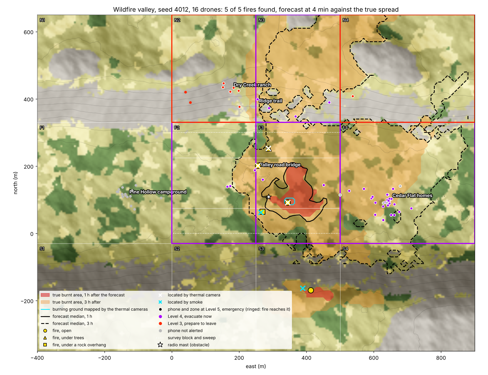
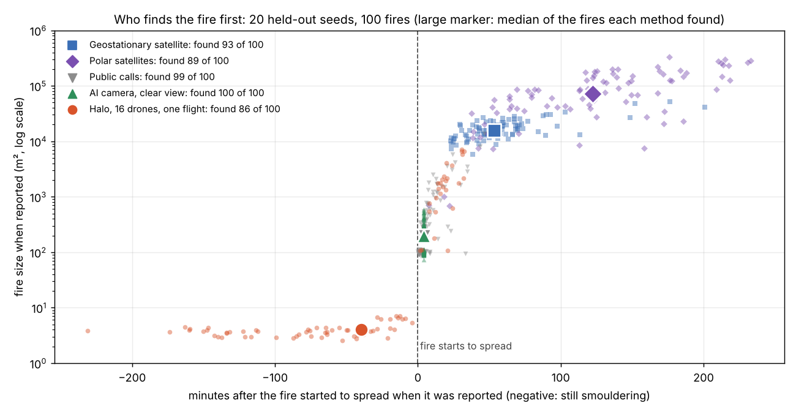
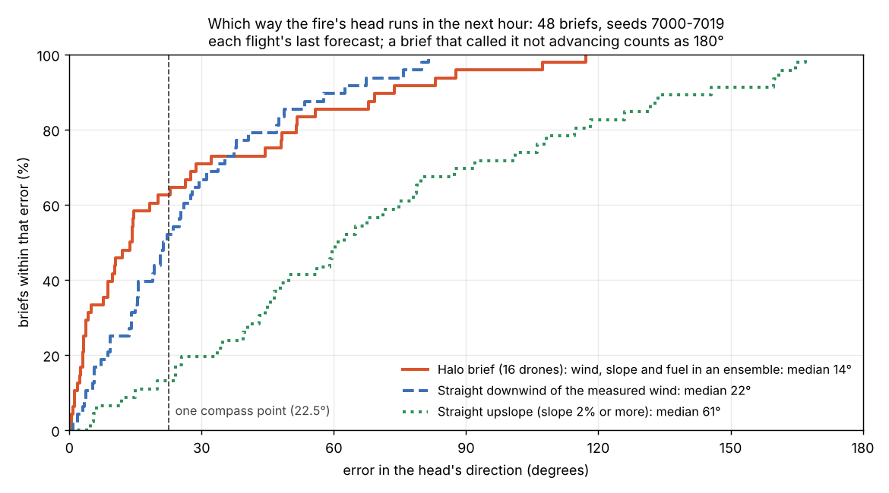

# The wildfire valley

The morning after dry lightning, a few fires smoulder in a mountain valley. Some are in the open, one is under
tree crowns, one is under a rock overhang where no camera looking down can see it, and one is across the valley.
A swarm of scout drones sweeps the valley floor. The ground station finds the fires from the drones' thermal
images and smoke sightings, forecasts which way and how far each will spread and how soon, tells the fire crews
which way each fire's head is running and why, and drafts evacuation alerts for the zones in the fire's path. By
default (today's rule) alerts go out automatically by fixed rules, at levels modelled on Japan's evacuation scale,
once each passes a check, and Level 3 also counts smouldering fires as if they took off now. The entry's alert
design uses pre-signed rules instead: public alerts go out automatically only under trigger rules the alerting
authority signed in advance, with Level 3 still counting smouldering fires, and each located fire also goes to
fire dispatch as a card. Either way an operator
can cancel an alert or give the all-clear. Alerts go to simulated phones only, and cards to a simulated dispatch.

This page describes the scenario (`wildfire_valley` in `src/halo_systems/eval/scenarios.py`), what the
simulation treats as true, what the station is allowed to know, how each result is scored, and every assumption
with its source. Results are in [results/wildfire_valley/REPORT.md](../results/wildfire_valley/REPORT.md); the
fire-direction results, on a second held-out set, in
[results/wildfire_valley_7000/REPORT.md](../results/wildfire_valley_7000/REPORT.md).
The station, the crew briefs, the cards and the alerts call no language model, and neither does the flight unless
it is given a Nemotron supervisor or a Nemotron strike picker. No result on this page uses a Nemotron supervisor, so
each flight behind them cost nothing to run, except the check team's 20 flights with Nemotron picking strikes (USD
0.086).
Three optional extras use Nemotron on Nebius Token Factory: reading a job in plain words into a patrol
([results/valley_eval/REPORT.md](../results/valley_eval/REPORT.md)), a test engineer that looks for conditions
under which the station fails ([results/valley_stress/REPORT.md](../results/valley_stress/REPORT.md)), and picking
which of last night's lightning strikes a check team looks at next
([results/strike_checks/REPORT.md](../results/strike_checks/REPORT.md)).

## Results in brief

Held-out seeds 4000 to 4019 (20 valleys, 100 fires), each flown once with the final code; brackets are 95%
bootstrap intervals over seeds. Full tables: [REPORT.md](../results/wildfire_valley/REPORT.md).

- **Finding fires before they spread.** Sixteen drones on one flight found 86% of the fires [80, 91], and 59%
  [52, 66] of all fires while they still smouldered at about 4 m^2. Half of all 100 fires were reported at least 20
  minutes before they started to spread (missed fires counted as never found). Today's methods are modelled
  to start looking only once a fire spreads.
- **Against today's methods, given every benefit of the doubt.** An AI camera with a clear view, or a call
  from the public, reports a fire about 4 minutes after it starts to spread, at 100 to 200 m^2; a
  geostationary satellite after 55 minutes, at 1.6 ha; polar satellites after 128 minutes, at 7.3 ha. As
  deployed in California in 2024, cameras saw 22% of fires. The sixteen drones reported 60 of the 100 fires
  before the earliest of today's four methods, by a median of 69 minutes. That lead comes mostly from the
  smouldering phase, whose length the scenario sets (see "Assumptions and sources"). Split by when each fire
  starts to spread (post-hoc, pooling these seeds and 7000 to 7019), the drones were first on 1 of 57 fires
  already spreading at take-off and on 17 of 21 that started to spread within 20 minutes, by a median of 13 to
  17 minutes.
- **Forecast.** With sixteen drones, the forecast's median matched the true spread of the fires the station
  knew were spreading with a Sorensen overlap of 0.71 [0.63, 0.78] at 1 hour and 0.83 [0.79, 0.86] at 3 hours.
  One drone scores 0.77 and 0.89, because it finishes later and forecasts with more of the fire mapped.
- **Warnings.** 94.7% [93.0, 96.4] of the phones the fire reached were warned before it arrived, a median
  126 minutes ahead; 32 of the 34 missed were phones without signal. Against alerts by distance alone, the
  forecast rule told 24 [18, 30] fewer phones per flight to evacuate that the fire did not reach, with the
  same share warned in time.
- **Which way the fire runs.** Each brief tells the fire crews which way a fire's head will run in the next
  hour, how sure the station is, how fast and why; the crews hear again only when that changes enough to act
  on. On a second held-out set (seeds 7000 to 7019, flown once), sixteen drones' briefs were a median 14
  degrees [9, 20] off the true head, against 22 [16, 28] for running straight downwind of the measured wind
  (see "Which way the fire runs" below).
- **The first crew, while the fire still smoulders.** On a third held-out set (seeds 9000 to 9039, 40 valleys,
  197 fires, flown once), with the drones' cards to fire dispatch the first crew reached 79 fires (40%) while
  they still smouldered, against none with today's reports. In a simple containment model with one engine per
  fire, the drones' reports prevented 37% of the fires that escaped initial attack with today's reports. The
  valley's day is dry and windy by design, so the escape rates themselves are far above real ones; the share
  prevented is the result (see "Getting the first crew there" below).
- **Squads per area.** On another held-out set (seeds 8000 to 8019, 300 flights, flown once), splitting the
  drones into squads over the valley floor and both slopes found 88% of fires with 16 drones, against 80% for one
  squad on the floor and 84% for today's single sweep (within the noise; the squads beat the single sweep clearly
  only at 8 drones, 84% against 76%), and the fire across the valley in every valley. The cost was about one
  false fire per flight against 0.35 (see "Squads" below).
- **Checking last night's strikes.** On another held-out set (seeds 9300 to 9319, 140 flights, flown once), a team
  of 4 of 8 drones checking lightning strikes one at a time, picked by a hand-written triage rule or by Nemotron,
  found 96% of fires, against 90% with every drone in the area squads (+0.3 per flight, at the edge of the noise),
  with less than half the false fires (0.60 to 0.65 per flight against 1.50). Between Nemotron and the rule there
  was no measurable difference: 96 of 100 fires each, +0.00 per flight (-0.20 to +0.20), for USD 0.086 over 20
  flights (see "Checking last night's strikes" below).

## What is simulated as true

| Part | Model | Where |
|---|---|---|
| Ground | A valley 1,300 x 1,000 m on a 5 m grid: a floor with a knoll, ridges whose crests stand 130 to 195 m above it on each side, rock on steep high ground. The survey block is 500 x 300 m on the floor | `sim/terrain.py` |
| Land cover and fuel | Scrub (Anderson fuel model 6, dormant brush), grass (model 1), forest (model 10, timber litter and understory) and rock (no fuel). Forest crowns 10 to 20 m tall, scrub 1.5 m | `sim/terrain.py`, `sim/fire.py` |
| Fire spread | Rothermel's surface fire model with Albini's revisions, wind and slope added as vectors, an elliptical fire shape, and arrival times by minimum travel time on a 16-neighbour grid. A patchy multiplier on the spread rate (log-normal, sigma 0.3, about 40 m patches) makes each hillside burn differently; the station never sees it | `sim/fire.py`, `sim/wildfire.py` |
| Weather | Hourly periods from six hours before take-off. Light morning wind (1.5 to 3 m/s) that turns up the valley (within 70 degrees) and freshens by 0.4 to 0.9 m/s an hour after take-off, veering up to 8 degrees an hour. Fine dead fuel moisture falls from 10% to a floor of 5% | `eval/scenarios.py` |
| Fires | Five per flight: one already spreading in open scrub (lit 10 to 35 minutes before take-off), one under tree crowns (60 to 80% hidden from above), one under a rock overhang (fully hidden), one smouldering in the open, and one across the valley outside the survey block. Smouldering fires cover 3 to 6 m2 until they take off, at seeded times from 20 minutes before take-off to 4 hours after | `eval/scenarios.py` |
| Smoke | A bent-over plume: smoke rises at 1.5 m/s while the wind carries it, to a top that grows with the burning area (12 m for 10 m2, up to 150 m). Crowns hide the plume below 60% of their height; the overhang hides it below 4.5 m. A particulate (PM2.5) plume spreads by the Gaussian plume equation | `sim/smoke.py` |
| Obstacles | A 45 m radio mast on the knoll, three dead snags standing 18 to 26 m above the crowns, and the rock overhang | `eval/scenarios.py` |
| People | 63 phones: 26 homes down the valley, 14 at a campground up it, 8 hikers on a ridge trail, 10 drivers on the valley road and 5 at a ranch. 5% have no signal | `eval/scenarios.py` |

## What the drones sense

The airframe is the one in [hardware/](../hardware/README.md): a 7-inch quadcopter with a radiometric thermal
camera looking down, an RGB camera looking ahead and a PM2.5 sensor. The swarm flies line abreast 14 m apart at
6 m/s, 20 m above the tree tops (it follows the highest crown within 15 m), so the same sweep covers the block in
fewer lanes the more drones there are.

- **Thermal camera, looking down (45 degree field of view).** A fire is found after 0.5 s in view, scaled by the
  share of it visible from above: a fire under crowns that are 70% closed needs 1.7 s, and one with less than 15%
  visible (the overhang) is never found this way. Position comes from the finding drone's own navigation, and one
  image shows the hot ground inside its footprint (20 to 35 m across), not a large fire's whole extent.
- **The same camera maps burning ground.** Once a second, every 10 m cell inside a drone's footprint that is
  burning or burnt is marked on the station's map, placed by the drone's position estimate. Under tree crowns a
  look sees the fire 40% of the time. Mapping is how the station learns a spreading fire's real shape and size.
- **RGB camera, looking ahead (90 degree field of view; the scout's lens sees 66, a gap listed in
  [hardware/README.md](../hardware/README.md)).** A plume point counts as visible when it is above
  whatever hides the fire, in the field of view, within the 2.5 km haze limit and not behind terrain. A plume of
  burning area A at range r is noticed at a rate ln 2 (R50 / r)^3 per second, with R50 = 300 m x sqrt(A / 10 m2):
  a smouldering patch is seen within a second half the time at about 200 m, a spreading fire across the whole
  valley. A sighting reports the bearing to the lowest smoke the drone can see (2 degree error) and the
  elevation angles of that point and of the plume top (1 degree error).
- **PM2.5 sensor.** Inside the plume, above 35 ug/m3, the drone reports that the source is upwind.

## What the station knows and does

The station sees only the drones' reports, their own position estimates, their wind estimate (the mean of the
swarm's last 5 s of wind measurements; before it has a second of them, the weather forecast) and a weather
forecast that is right in shape and wrong in detail (a speed bias of about 20%, a direction bias of about 12
degrees, hour-to-hour errors and a fuel moisture error).

1. **Locate.** A thermal find is a fire at that position, and mapped burning ground more than 60 m from every
   located fire is a new one. Smoke bearings are crossed in pairs; a tight cluster of crossings is only a
   candidate, because the bearings of two different plumes also cross. A candidate becomes a fire when a
   least-squares fix from at least six bearings by three or more drones, spread over at least 30 degrees, agrees
   to within 1.5 bearing errors and is still placed to within 40 m when any one drone's bearings are left out.
   The fix is then moved upwind by the plume's drift (wind x height / rise speed), with the height from the
   elevation angles. A fix within 60 m of a known fire (its position, its mapped ground, its estimated radius, or
   the downwind line of its plume) is that fire. A thermal find upgrades a smoke location it lands on, and
   located fires that turn out to stand on one patch of mapped ground are merged into the first one found.
2. **Size.** Mapped ground and the hotspot image measure a fire directly, so they set its size when there are
   any. Only otherwise does the plume size it: each later sighting that points along one located fire's plume,
   and could not be any other located fire's plume at any size, records the height of the plume top it saw,
   solved for the drift, with an uncertainty from its range. The median of the latest well-measured tops (known
   to 12 m or better, from at least three drones) gives the burning area by the plume-top law. Area grows as the
   top to the power 2.9 and the tallest plumes look alike, so a top above 90% of the highest plume gives only a
   lower bound. A fire estimated under 50 m2 is treated as smouldering.
3. **Forecast.** An ensemble of 16 spread runs on a 10 m grid, 3 hours ahead, from the mapped burning ground and
   a disc of each located fire's estimated area. Each member perturbs the wind direction (10 degrees), wind speed
   (15%), fuel moisture (1 point), spread rate (30%, log-normal) and each located fire's position (its location
   error). The first period uses the wind measured now, later periods the weather forecast. The measurement is
   modelled: the true wind at the fire's time with 0.5 m/s and 5 degrees of noise, not the drones' own wind
   estimate (which the station uses to place smoke). It runs twice: for the fires believed to be spreading, and for every located fire as if the
   smouldering ones took off now. It reruns every 2 minutes, and 30 seconds after news (a new fire, one taking off).
4. **Brief the crews.** For each fire: how it was found, whether it is spreading, which way its head runs (a
   compass bearing with a cone for its uncertainty) and how fast, what drives it (the wind the swarm measured, the
   slope, the fuel ahead and how dry it is), its size in one and two hours, and which named places it reaches
   and when. The brief goes to the fire crews' devices (simulated) when the fire is first located, and again only
   when it changes enough to act on. See "Which way the fire runs" below.
5. **Alert.** The valley is divided into twelve fixed evacuation zones (south slopes, valley floor and north
   slopes, four across), as US counties divide theirs and Japanese towns issue evacuation information by district.
   After every forecast, fixed rules give each zone a level in the spirit of Japan's five-level evacuation scale:

   | Level | Message | Rule: the forecast gives fire within 50 m of a phone in the zone |
   |---|---|---|
   | 3, prepare to leave | Those who need longer leave now; everyone else gets ready | at 30% or more within 3 hours, counting smouldering fires as if they took off now |
   | 4, evacuate now | Everyone leaves now | at 30% or more within 60 minutes, from the fires believed to be spreading |
   | 5, emergency | Fire is here; shelter if you cannot get out safely | at 50% or more within 15 minutes |

   The station issues only Levels 3 to 5; Levels 1 and 2 of the scale are not modelled. A zone's level only rises
   automatically. Each alert passes `AlertCheck`: a message of 1 to 360 characters (the limit for Wireless
   Emergency Alerts on 4G and later networks, and for EU-Alert); a hazard, area, action, expiry and authority;
   a channel marked as simulated; a zone polygon under 5,000 ha; 1 to 5,000 recipients; an expiry of 1 to 12
   hours; a Level 4 or 5 that cites the current forecast at its threshold; a level above the zone's current
   one; and no duplicate in the last 10 minutes. A checked alert goes out at once, by cell broadcast to every
   phone in the zone (simulated phones only), arriving 5 to 30 s later; it replaces the zone's earlier alert.
   No language model takes part. An operator can cancel the alert in force (a false alarm: the zone's phones
   are told, and for 30 minutes the rules re-alert that zone only above the level withdrawn, and at Level 5 at
   least) or give a zone the all-clear (for 30 minutes, only a level above the one it had goes out); both
   messages pass a check too. A manual mode, where each alert waits for a tap and the zone is raised only once
   it is sent, is kept for drills.

## Squads, jobs in plain words, and alerts under pre-signed rules

These are options in the scenario. Its defaults are one sweep and today's alert rule, and the headline results
(seeds 4000 to 4019, and 7000 to 7019 for which way the fire runs) use them. Pre-signed rules are the entry's alert
design, chosen by the entrant on 20 October 2026; on 21 October, after T5b, the entrant chose that their Level 3
rule also counts smoulders (`smoulder_alerts`, below). The first crew's results use the pre-signed rules' cards
to fire dispatch as the drones' reports, and the squads' results use squads.

**Squads.** `squads` flies the drones as squads over the valley's three areas, the valley floor (F, the survey
block), the north slopes (N) and the south slopes (S), each squad patrolling its own area on a circuit, line
abreast, until the patrol time ends (12 minutes by default, one battery). `"auto"` splits the drones
(`control.squads.allocate`): each area first gets the smallest squad that flies its whole circuit within the
patrol, in the order floor, north, south, while drones are left; further drones go to the area whose circuit is
slowest, in steps that save a lane; an area stops at the widest line that fits across it (21 on the floor, 22 on
each slope), and drones left over wait in reserve. `"F6-N5-S5"` sets the counts by hand. An operator can move
drones between squads during the flight; every order passes the validator (a squad keeps at least one drone), and
the moved drones fly across and join. With a strike list, each squad starts on the lane nearest the night's
strikes in its area. Results by squad size, on held-out seeds 8000 to 8019:
[results/wildfire_valley_squads/REPORT.md](../results/wildfire_valley_squads/REPORT.md).
On those 20 valleys (300 flights, flown once), squads per area found 84% to 91% of the fires with 8 to 64
drones, against 74% to 80% for one squad patrolling the floor (+0.40 to +0.55 fires per flight, every interval
above zero), and the fire across the valley in every valley from 16 drones. Against today's single sweep the gain is
clear at 8 drones (+0.40 per flight) and smaller from 16 up (+0.20, within the noise); at 4 drones one sweep beats a
patrol (78% against 72%). The squads patrol for 12 minutes, longer than one sweep takes, and that is part of the
gain. The cost is false fires: 0.85 to 1.50 per flight against 0.35 to 0.40 for one floor squad, and under today's
alert rule they led to public alerts in 5 of the 20 valleys at 8 drones (never for the floor squad). Phones warned
in time did not change. No crashes in any flight.

**Aircraft inbound.** When crewed firefighting aircraft (air tankers, helicopters, a lead plane) come into the
valley, the operator orders a hold: `POST /api/runs/<id>/inject {"kind": "aircraft", "op": "hold"}` (optionally
`"altitude_m"`), and later `"op": "resume"`. The order passes the same safety validator as every directive and is
logged like one: a hold is never refused for timing and never climbs (it is clamped to the swarm's altitude now);
a resume needs a hold in force, at least 3 s old. Every flying drone stops where it is and descends to the hold
altitude (10 m above the treetops by default); squads and drones flying between squads stop too, and squad moves
are refused until the resume. The ground station, smoke watch and alerts keep running. On resume the swarm climbs
back and carries on the sweep where it stopped. A demonstration on development seed 3000 with 16 drones (a
5-minute hold 42% of the way along the sweep): every drone was stopped at the hold altitude 6.1 s after the order, the
hold cost 28.7% of a battery, the sweep finished 305 s later and found the same 5 fires
([results/airspace_hold/REPORT.md](../results/airspace_hold/REPORT.md)). Runs without an order are unchanged. What flying it for real would need is in the README's [Flying it legally](../README.md#flying-it-legally).

**A job in plain words (Nemotron).** The operator types the job, for example "We had dry lightning last night.
Put 16 drones over the whole valley for 12 minutes and check last night's strikes." Nemotron 3 Nano, with
reasoning, reads it into a short spec: how many drones, which areas, how long, and which strikes to check (by when
and where). Code, not the model, turns the spec into the patrol: the squad split, the lane each squad starts on,
and the chosen strikes outside every patrolled area, which are listed rather than flown. A keyword guard refuses
non-civilian requests before any call. Fixed rules in code hold every plan to at most 64 drones, no more in one
line than fit across an area and a patrol of 1 to 15 minutes, and set the formation's speed, spacing and height;
in flight every directive passes the safety validator. On 48 held-out
requests, Nemotron with reasoning gave the same patrol as the hand-written reading in 47, against 20 for
hand-written rules and 39 with reasoning off (median 4.7 s and USD 0.016 for the 47 calls; the keyword guard
refused the other request before any call):
[results/valley_eval/REPORT.md](../results/valley_eval/REPORT.md). Without a key, the page replays recorded calls,
and any other request falls back to the hand-written rules, saying so.

**Checking last night's strikes (Nemotron).** With `checks` (`{"picker": "rule"}`, `"nearest"` or `"nemotron"`;
`sim/strike_check.py`), a check team of 4 drones (squad C) flies to one strike at a time, patrols a 120 m square
round it for one circuit and moves on, while the area squads patrol as before. It flies 20 m above the squads and
keeps that height between strikes; its drones move in step to points beside the new square and join it together. The
next strike is picked 40 s before a look ends, from a table code builds (night, hours ago, distance, ground and
slope, whether a squad patrols it, how much of the ground round it a thermal camera has seen, the nearest located
fire, unexplained smoke bearings that pass near it, and the nearest people), offering only strikes the team can
reach and finish looking at before the patrol ends. Three pickers: nearest first (last night's strikes before the
night before's); a hand-written triage rule (strikes a located fire explains last, unexplained smoke seen by two or
more drones first, then last night's, then the night before's, nearest first); and Nemotron 3 Nano with reasoning,
which answers with a strike and a one-sentence reason. Every pick passes the safety validator, and no picker sees
which strike started a fire. On held-out seeds 9300 to 9319 (the plan written before the run:
[PREREG.md](../results/strike_checks/PREREG.md)), at 8 drones Nemotron and the rule each found 96% of fires and 69%
while smouldering (+0.00 per flight, -0.20 to +0.20); nearest found 95%, and no team (F4-N4) 90%, a gain at the edge
of the noise (+0.3 per flight, interval from +0.00), mostly the fire across the valley, which F4-N4 does not patrol
(19 or 20 of 20 against 14). With 16 drones the area squads already cover the valley and the team added nothing
measurable (96% against 95%). Teams placed fewer false fires (0.60 to 1.00 per flight against 1.50), and phones
warned in time did not change. Nemotron made 77 calls, none unusable, for USD 0.086 (median 10.8 s each). No flight
crashed or logged a near miss, but the team brought two drones as close as 5.1 m, against 10.9 m with no team (the
cause was not traced): [results/strike_checks/REPORT.md](../results/strike_checks/REPORT.md).

**A test engineer (Nemotron).** `tools/wildfire_valley_stress.py` varies nine conditions of the day, from the
wind and fuel moisture to haze and the number of drones, to find where the station fails: a late warning, a missed
fire, a false alarm, a needless evacuation or a lost drone. Nemotron 3 Nano sees every test so far and proposes the
next batch; random search and corner search fly the same number of tests on the same held-out valleys (seeds 9100
to 9119 and 9150 to 9169), all under the pre-signed rules as T3 flew them (public alerts only for fires believed
spreading, sent automatically). Nemotron was no better than either: in 40 tests each, its tests caused 11 failures
(3 of them from random tests drawn when a reply gave none), against 10 for random search and 13 for corner search
(ten calls, USD 0.026). Late warnings were the commonest failure for every searcher. Under the pre-signed
rules as tested, a smoulder that takes off near homes brings no public alert until the station believes it is
spreading; re-flown under today's rule, 31 of the 43 failing tests with late warnings warned every phone in time:
[results/valley_stress/REPORT.md](../results/valley_stress/REPORT.md).

**Public alerts under pre-signed rules.** With `alert_rule="presigned"`, a public alert goes out only for fires
the station believes are spreading, each under a trigger rule the alerting authority signed in advance: Level 3
at 30% or more within 3 hours, Level 4 at 30% or more within an hour, Level 5 at even odds within 15 minutes. A
fire found smouldering goes to fire dispatch as a card instead (simulated), with its position, size and status,
and gets a new card when the station comes to believe it is spreading or its fix moves more than 30 m (or twice
its error) from where the last card put it; once a card has said spreading, later ones do too. An official's
one-tap approval (`approval="modelled"`, a median 90 s) can be added. Results against today's rule, on held-out
seeds 9000 to 9019: [results/wildfire_alerts/REPORT.md](../results/wildfire_alerts/REPORT.md).
Over 20 valleys, pre-signed rules sent 141 public alerts against 148, 9 against 11 while every fire behind them
still smouldered, and warned 336 phones the fire did not reach within 3 h, against 360; 3 of the 660 phones the
fire reached got no warning in time, against none. All three were hikers reached hours later by a fire the drones
had found smouldering and carded to fire dispatch, which took off after the swarm had landed. The median lead was
the same (128 minutes).

**Smoulders under pre-signed rules (`smoulder_alerts`).** After T5b's run, its 40 drawn-day valleys (seeds 9100 to
9119 and 9150 to 9169) were flown again under both rules on the same draw. The pre-signed rules warned 50 of the
1,176 phones the fire reached late or never, in 9 valleys; today's rule warned none late. As first searched, the
pre-signed rules had warned 26 late, so the count moves with the draw
([results/valley_stress/REPORT.md](../results/valley_stress/REPORT.md)). With T3, that is 29 to 53 of 1,836 phones
(about 1 in 63 to 1 in 35) against none, for about 13% more public alerts under today's rule (432 against 383). On
the same draw only the alerts differ, so today's extra Level 3 alerts, for located smoulders, are what warned those
phones in time. With `smoulder_alerts=True` (`--smoulder-alerts` on the command line; `"smoulder_alerts": true`
with `"alert_rule": "presigned"` on the dashboard API), the pre-signed Level 3 rule (T3) also counts each located
smoulder as if it took off now, as today's rule does. Levels 4 and 5 still need a fire believed spreading, and every
located fire still goes to fire dispatch as a card. On development seeds 3000 to 3007 (16 drones), its public
alerts were exactly today's rule's, and its cards matched the pre-signed rules' in time, place and status; in two
valleys two cards named a different head direction, because alert deliveries share a random stream with the
forecast ensemble. On 21 October the entrant chose this as the entry's alert design: the dashboard's
pre-signed mode counts smoulders unless a run asks otherwise (`"smoulder_alerts": false`). It drafts public alerts
exactly as today's rule does (identical on the development seeds above), so today's-rule alert results carry over,
and its cards go out as in the first crew's study.
`alert_rule="presigned"` on its own, in code and on the command line, is the rule as T3, T4 and T5b flew it.

**Getting the first crew there (modelled).** `tools/wildfire_initial_attack.py` takes each true fire's report
time, today's (the earliest of today's methods as deployed) and with the drones' card to fire dispatch added,
adds a response time drawn once per fire (lognormal, median 30 minutes), and races the line one Type 3 engine
builds (NWCG initial-action rates by fuel) against the true fire's perimeter, run on to 12 hours. A fire escapes
if it is not contained, or is larger than 10 acres (4.05 ha, CAL FIRE's initial-attack goal) when it is. Every
number is fixed in the tool's docstring with its source; the plan was written before the run
([PREREG.md](../results/wildfire_initial_attack/PREREG.md)). On held-out seeds 9000 to 9039 (the pre-signed arm of
the alert sweep plus 20 more valleys): the first crew was on scene while the fire still smouldered for 40% of
the fires with the drones and none with today's reports (34 to 46 percentage points more, 95% bootstrap over
valleys). The drones' reports prevented 37% of the escapes with today's reports (22 to 34 percentage points of
all fires), nearly all of them fires the crew reached before they took off. With the response fixed at 60
minutes they prevented 23%; with line built at 8 times one engine's rate, 56%. Giving today's methods a camera
that sees every fire cut their escapes by 2%. Because the valley's day is dry and windy by design, only these
shares carry over, not the escape rates. Full table and caveats: [results/wildfire_initial_attack/REPORT.md](../results/wildfire_initial_attack/REPORT.md).

**Crew outputs.** The latest briefs download as map files (`/api/runs/<id>/crew.geojson` or `crew.kml`): each
fire's position and error, the head's arrow for the next hour, its direction cone and the named places it reaches,
placed at 0 N 0 E unless an anchor is given, so a simulated file cannot be taken for a real place. Each brief is
also written as a short message in the order of the size-up report in the NWCG Incident Response Pocket Guide
(`sim/crew_export.py`).

## How results are scored

All scores compare the station's picture with the truth, which the station never sees.

| Score | Definition |
|---|---|
| Fires found | The station placed a fire within 60 m of a true fire's burning ground (or its ignition point, while it smoulders) at that moment |
| False fires | Locations more than 60 m from every fire's burning ground, counting those later merged into another fire |
| Smoke fix error | Distance from a smoke-only location to the fire's burning ground, when first located |
| Sorensen index, 1 h and 3 h | 2 x overlap / (forecast area + true area), counting only ground that burns after the forecast is made (ground already burnt would flatter it); 1 is perfect. "Located fires" uses the true spread of the fires the station knew were spreading (located as spreading, or with mapped ground); "all fires" uses every fire |
| Phone arrival error | Forecast median arrival minus true arrival, at phones the fire reaches within 3 hours of the forecast |
| Brier score | Mean squared difference between the forecast probability of fire within 60 minutes at each phone and what happened |
| Reached | Fire within 50 m of the phone within 3 hours of take-off |
| Warned in time | An alert at Level 3 or above was delivered before the fire arrived |
| Lead time | True arrival minus first delivery |
| Evacuated, not reached | Phones told to leave (Level 4 or 5) that the fire did not reach within 3 hours |
| Head direction error | Angle between the brief's head bearing and the true head's bearing over the next hour (see "Which way the fire runs"); a brief that says the head will not advance, though it does, counts as 180 degrees off |
| Truth in the cone | The true head's bearing lies inside the brief's cone (among briefs that give a cone) |

The last forecast of each flight is scored. A smaller swarm finishes its sweep later, so its last forecast is made
later, with more of the fire mapped; the report gives the time. Intervals are 95% bootstrap intervals over seeds.

**Which seeds were used for what.** Seeds 2000 to 2011 were flown while the scenario and the station were built.
A first sweep on seeds 3000 to 3019 then found that more drones gave a worse 1-hour forecast (Sorensen 0.57 with
one drone, 0.41 with sixteen) and an early bias of 22 minutes. The cause was sizing: with more drones, more fires
were first located by smoke and sized from the plume top, which over-estimated the largest fires by up to 23
times and made some smouldering fires look like spreading ones, and the single-image hotspot area was not
limited to the camera's footprint. The station was changed
(thermal mapping, sizing from direct measurements first, a three-drone rule for plume sizing, merging of
duplicate locations, the swarm's own wind estimate in place of the truth before it had one) and the
found-fire score was corrected to measure from the burning ground rather than the ignition point. Seeds 3000 to
3019 then became development seeds too. A sweep of an earlier version on seeds 4000 to 4019 was
stopped part-way when these changes began, and its rows were set aside unread. The results in the report are
from seeds 4000 to 4019, flown once with the final code; the models of today's detection methods were checked
only on seeds 3000 to 3003 before that.

## Drones against today's methods

How would these fires be found without the drones? `src/halo_systems/sim/detection.py` applies the methods fire
services use today to the same true fires, with every number taken from a published source and, where a source
gives a range, the end that favours today's method: no cloud, a camera with a clear view of the whole valley,
every satellite detection credited to the right fire (one geostationary pixel is wider than the valley), and the
fastest published delivery. The flight starts at 08:00 local time; today's methods watch from before then until
12:00, while the drones fly once, for up to 40 minutes, and anything they miss counts as not found. Nothing was
tuned: the rules were written from the sources below and checked only on development seeds.

| Method | Rule in the simulator | Published basis |
|---|---|---|
| Geostationary satellite | A scan every 5 minutes; detected at the first scan with fire radiative power (FRP) of 34.5 MW or more; delivered 266 s later | GOES ABI scans the US every 5 min ([NOAA](https://www.goes-r.gov/users/abiScanModeInfo.html)). ABI was "hard to detect fires smaller than ~34.5 MW" (Li et al. 2020, Remote Sensing of Environment 237: 111600); the theoretical minimum at nadir in clear sky is about 4,000 m^2 at 800 K, or 93 MW (GOES-R Fire ATBD v2.6). Latency requirement 266 s for the US sector (same ATBD). In the field, fast fires showed 15 to 25 min after ignition and 7 of 26 never did (Govil et al. 2020, Remote Sensing 12: 166) |
| Polar-orbiting satellites | One daylight pass each for MODIS on Terra (10:30), VIIRS on NOAA-20 and NOAA-21 (12:40) and Suomi NPP (13:30), each within 50 min of that time; detected if FRP reaches 2.3 MW (MODIS) or 0.33 MW (VIIRS); delivered within a minute | Overpass times and pixel sizes: [NASA FIRMS FAQ](https://www.earthdata.nasa.gov/data/tools/firms/faq). MODIS "routinely detects ... fires 1000 m^2 in size" and flaming fires a tenth of that "under very good observing conditions" (same FAQ); 100 m^2 at 800 K is 2.3 MW by the ATBD's own conversion; VIIRS the same area scaled by its pixel area (375 m against 1 km pixels). Ultra-real-time data "within a minute of satellite overpass" in the US and Canada (FIRMS FAQ) |
| AI camera network | Smoke picked up 4 min after the fire starts to spread | Pano AI: "usually within four to five minutes" (as reported by Rancho Palos Verdes, [GovTech 2022](https://www.govtech.com/products/california-city-moves-to-install-wildfire-detection-cameras)). A research system took a median 13.5 min after smoke appeared (Govil et al. 2020). In 2024 CAL FIRE's cameras saw 1,668 of 7,553 fires in its area and were first for 636 ([FireRescue1, 2025](https://www.firerescue1.com/artificial-intelligence/over-1-000-ai-cameras-help-spot-calif-wildfires-before-the-first-911-call)). The clear-view camera sees every fire; a second rule, "as deployed", sees each fire with a 1,668 in 7,553 (22%) chance |
| Public calls | First call an exponential time after the fire starts to spread, mean 10 min (78% within 15 min) | "In densely populated California, most fires are reported within 15 min" (Govil et al. 2020). Elsewhere it is slower: in Alberta, public reports came a median 0.75 h after the estimated start (Alberta historical wildfire data 2006 to 2025, our calculation) |
| Fire radiative power | FRP (MW) = fuel burnt (kg/s) / 0.368, the whole fuel load of the cell's fuel model burnt as the front passes, averaged over 5 min | Wooster et al. (2005), Journal of Geophysical Research 110: D24311, equation 14 |

Cameras and callers start their clock when the fire starts to spread: a spot smouldering under a few square
metres puts up no smoke that a camera kilometres away or a passer-by picks out. That is the gap the drones fill.
Lightning fires can smoulder for a long time before anyone reports them: across 42 datasets the median
"holdover" time ranges from 1.4 to 53.6 hours (Moris et al. 2023, Earth System Science Data 15: 1151), and
fire services fly patrols after lightning storms to look for them (Government of Alberta). Patrols are not in
the comparison because no source gives how often or when they fly; an Alberta review puts aerial patrols at
12% of detections for an average of CAD 9.6 million a year over 2015 to 2019, about USD 6.9 million (Spring 2019
Wildfire Review, table 12).

**The lead, by when each fire starts to spread.** Because the lead comes mostly from the smouldering phase,
[a breakdown of the committed rows](../results/wildfire_spread_timing/REPORT.md) splits it by when each fire
starts to spread. It is post-hoc: nothing was flown for it and the bins were picked after the results were
known. On fires already spreading at take-off the sixteen drones were first on 1 of 30 (seeds 4000 to 4019)
and 0 of 27 (seeds 7000 to 7019); a satellite or camera usually has those first. On fires that start to spread
within 20 minutes of take-off they were first on 8 of 9 and 9 of 12, by a median of 17 and 13 minutes. After
that the lead is close to the time left before the fire spreads plus today's detection delay
([timing.png](../results/wildfire_spread_timing/timing.png)), so the median of 69 minutes is a property of the
smoulder times the scenario draws.

**How the alerts compare with Japan's.** Japan's evacuation information has five levels; since 20 May 2021,
Level 3 tells older people and others who need time to leave, Level 4 tells everyone to leave, and Level 5
means it is already too late to leave safely (Cabinet Office and Fire and Disaster Management Agency poster,
[bousai.go.jp](https://www.bousai.go.jp/oukyu/hinanjouhou/r3_hinanjouhou_guideline/pdf/poster.pdf)). Mayors
decide Levels 3 to 5. Japan's earthquake early warning, by contrast, is fully automatic: in 2011 it was issued
8.6 s after the first station detected the quake (JMA), and cell broadcast reaches phones within 4 s of reaching
the network (ETSI TS 122 268). Halo issues its fire levels the way the earthquake warning is issued, by fixed
rules with no one in the loop when an alert goes out; under the pre-signed rules the alerting authority signs those
rules in advance, and a person can always cancel or clear.

## Which way the fire runs

A crew deciding where to work needs to know which way a fire's head will run, how fast, and why. The US
wildland fire services' pocket guide asks crews to "validate forecast with current on-site weather conditions,
especially windspeed and direction" and to "identify hazardous fuels and significant terrain ahead of the fire",
and, under communications, to "provide updates on any situation change" (NWCG Incident Response Pocket Guide,
PMS 461, January 2025, pages 33 and 5). The station does this from what the swarm measured and sends it to the
crews' devices (simulated: nothing is sent anywhere). No language model takes part.

**Finding the head.** Each of the forecast's 16 members is a full spread run (Rothermel over the valley's fuels
and slopes, with the wind the swarm measured, perturbed). In each member, ground burning now belongs to the
located fire nearest it, and each cell reached later belongs to the fire whose burning ground is nearest that
cell, so one fire's spread is not credited to a neighbour merely because its centre is nearer. Distances to a
located fire are measured from its estimated edge (its position plus the radius of its estimated area), and a
patch of burning ground more than 60 m from every located fire's edge belongs to none. A fire's head is its
ground furthest beyond its burning front within the next hour, and its bearing runs from the nearest burning
ground to that point. Cells within half a cell of the furthest that head the same way (within 60 degrees) are
averaged, so grid ties do not pull the bearing to one side, and a fire with two heads of about the same length
gets one of them, not a direction between them (`front_owner`, `_furthest` and `head_of` in
`sim/wildfire.py`). The brief gives:

- **which way**: the most common direction among the members' heads (the bearing with the most members within
  22.5 degrees of it, averaged with the members within 45 degrees), as a compass direction;
- **how sure**: a cone, given as degrees either side of that bearing, holding 80% of the members' bearings and
  widened in quadrature by 10 degrees for errors the members do not represent, chiefly the patchy spread rate
  the station never sees. A cone of 90 degrees or more either side is reported as an uncertain direction;
- **how fast**: the median advance in the hour among the members whose head advances, and where the median
  forecast puts the head at 15, 30, 60 and 120 minutes;
- **why**: the measured wind, the slope ahead (the average slope of the ground the members burn in the hour),
  and Rothermel's wind and slope factors for the commonest fuel there. The brief names what pushes the head the
  way it runs: the wind or the slope when its push along the head is at least twice the other's, both
  otherwise, and says when the other works against it (a run down the slope, say). Where neither pushes that
  way, the head runs where there is fuel to burn, and the brief says so ("where the fuel leads, with the wind
  ... against it"). It also lists the fuels the members burn in the hour, by share, and the fine-fuel moisture;
- its size in one and two hours, and the named places it reaches and when.

A brief reads, for example (seed 4012, sixteen drones, one minute into the flight, sent to the crews because the
fire had started to spread): "Fire 1 (thermal find, spreading): head runs north-northeast (within 41°) at about
3.5 m/min, driven by the wind (2.6 m/s from the southwest); burning into dormant brush 59%, timber litter and
understory 22%, short grass 18%; fine fuels at 7% moisture; about 3.8 ha in 1 h and 26.0 ha in 2 h; reaches
Valley road bridge in about 86 min, Cedar Flat homes in about 101 min." Two minutes later the crews were told
again, "head turned east; head slower", with the new brief.

**Telling the crews.** A fire's brief goes out when the fire is first located. After that it goes out again only
when it changes enough to act on, compared with what the crews were last told: the fire starts or stops
spreading; its head starts or stops advancing; its direction becomes clear or uncertain; while its direction
is clear, its head turns by 30 degrees or more and beyond the cone the crews were given; its head speed rises by
half or falls by a third (and by at least 0.5 m/min); or it will now reach a named place, or reach one 15
minutes or more sooner by the clock. A fire merged into another is withdrawn ("Fire 3 is merged into Fire 1;
disregard its earlier brief"). Each update says why it was sent ("head turned southeast", "reaches Cedar Flat
homes sooner"); for a smouldering fire, it says what the head would do if the fire took off now ("would run
east if it takes off"). An update carries the whole brief, including the head's expected track.

**Scoring.** The true head is found the same way, on each true fire's own arrival times over the ground it
reaches before any other fire, from its burning ground at the time of the flight's last forecast (or from its
ignition point if it has not yet taken off and no other fire has burnt it). Every brief in that forecast, sent to
the crews or not, is matched to the true fire whose burning ground is nearest the located fire, within 60 m, and
scored if that fire's head advances at least 20 m in the next hour; two located fires on one true fire are both
scored. A moving fire with no located fire within 60 m of its ground is counted as not located. A brief that says
the head will not advance, though it does, counts as 180 degrees off. Two simple rules give a baseline: straight
downwind of the wind the swarm measured, and straight upslope under the fire (where the slope is 2% or more).

**Results.** On a second held-out set, seeds 7000 to 7019 (20 valleys), each flown once with the final method
(commit d4efe78; the later change to how the reasons are worded, below, leaves every score unchanged, checked
on development flights), the briefs in each flight's last forecast against the true head over the next hour.
Brackets are 95% bootstrap intervals over seeds; full table in
[results/wildfire_valley_7000/REPORT.md](../results/wildfire_valley_7000/REPORT.md).

| Drones | Briefs scored | Brief error, median | Within 22.5 degrees | Wind-only rule | Slope-only rule | Brief closer than wind-only | Truth in the cone | Crew updates per flight |
|---|---|---|---|---|---|---|---|---|
| 1 | 33 | 11° [6, 14] | 70% | 13° [8, 16] | 79° | 58% [45, 71] | 73% | 7.2 |
| 4 | 44 | 15° [10, 22] | 66% | 18° [14, 27] | 59° | 59% [45, 72] | 64% | 12.6 |
| 16 | 48 | 14° [9, 20] | 62% | 22° [16, 28] | 61° | 62% [49, 77] | 75% [64, 86] | 12.3 |

With sixteen drones, the brief's direction was a median 14 degrees off the true head, against 22 for the rule
of running straight downwind of the measured wind, and closer than that rule for 62% of the fires. Both use the
same modelled measurement of the wind (the true wind with 0.5 m/s and 5 degrees of noise; see Forecast above). The gain is
modest and the intervals overlap: in this valley the wind sets most heads, and the brief adds the slope and the
fuel. Straight upslope alone is a poor guide (about 60 degrees off). With one or four drones the brief and the
wind rule are close (11 against 13, 15 against 18). No brief called a moving head not advancing. The cone held
the true head for 75% of briefs with sixteen drones, a little under the 80% it was set to on development seeds,
and for 64% with four. The head's speed was off by a median 0.5 m/min. Ten moving fires across the twenty
sixteen-drone flights had no located fire near them: fires the swarm did not find. The other results on this
second held-out set match the first (sixteen drones: 86% of fires found; 62 of 100 reported before the earliest
of today's methods, by a median of 62 minutes; Sorensen 0.72 at 1 hour and 0.83 at 3 hours; 95.0% of reached
phones warned, a median 129 minutes ahead; 24 fewer needless evacuations per flight than alerts by distance).

**How the method was settled.** The first version measured each member's head from the fire's located
position and split the ground between fires by their nearest centre. On development seeds 3000 to 3019 (sixteen
drones) its median error was 16 degrees, and its cone held the true head for only about half of the fires; the
worst misses came from one fire's spread being credited to a neighbour. Measuring from the burning front,
sharing ground by the nearest burning ground and widening the cone by 10 degrees brought it to 12 degrees (the
wind-only rule: 29), with the cone holding 83%. A first held-out attempt on seeds 5000 to 5019 was stopped after
eight one-drone flights, when the brief was found to give no area for some fires located by smoke; its rows were
set aside unread. Seeds 6000 to 6019 were then flown once (commit 5c2c9df): a median error of 12 degrees against
24 for the wind-only rule. Two independent reviews of that code then found faults: grid ties pulling bearings to
one side, a plain mean naming a direction between two groups of members, a two-headed fire given a direction
between its heads, a fire overrun by another still scored as moving, and missed heads left out of some columns;
and, in the crew updates, time passing read as a fire coming sooner, and merged fires never withdrawn. After the
fixes, on the same development seeds, the median error was 10 degrees (wind-only 26) and the cone held 77%; the
10-degree widening was kept. Because the method changed after seeds 6000 to 6019 had been seen, the results
above come from fresh seeds 7000 to 7019, flown once; the 6000 rows are not in the repository. Last, the
reasons were found to name a driver pushing more than 90 degrees away from the head in about one brief in eight
(the slope under the fire at the foot of a rock face, say, or a wind the head runs across where the fuel runs
out). They now use the average slope of the ground the head burns into, name only what pushes along the head,
and say when the head simply follows the fuel; this changes the wording of the brief and no score.

## Assumptions and sources

| Assumption | Value | Source or status |
|---|---|---|
| Surface spread rate | Rothermel (1972) with Albini (1976) | Rothermel, USDA Forest Service Research Paper INT-115; Albini, General Technical Report INT-30 |
| Fuel models | Anderson's 13 standard models (1, 2, 3, 4, 5, 6, 8, 9, 10 implemented) | Anderson (1982), General Technical Report INT-122. Reproduced within 20% of his table, the valley's three within 8% (`fire.anderson_check`) |
| Fire shape | Length-to-breadth ratio from the effective wind | Anderson (1983), Research Paper INT-305 |
| Midflame wind | 0.28 to 0.55 of the 20 ft wind by fuel model | Albini and Baughman (1979), Research Paper INT-221 |
| Spread over the grid | Minimum travel time | Finney (2002), Canadian Journal of Forest Research 32: 1420-1424 |
| Particulate dispersion | Gaussian plume, Pasquill-Gifford class D | Briggs' rural dispersion fits (1973) |
| PM2.5 trigger | 35 ug/m3 | US EPA 24-hour PM2.5 standard |
| Alert length | 360 characters | Wireless Emergency Alerts, 47 CFR 10.430 (FCC Report and Order 16-127, in force since May 2019); ETSI TS 102 900 for EU-Alert |
| Smoke detection range, plume rise and top, bearing and elevation errors, emission rate | As above | Stated assumptions, to be calibrated against real footage and sensor logs |
| Smouldering phase | 3 to 6 m2 until each fire starts to spread, at a seeded time (uniform): under crowns 20 to 150 min after take-off, under the overhang 10 to 90, in the open 30 to 240, across the valley from 20 min before take-off to 30 after. The fire already spreading started 10 to 35 min before take-off | Stated assumption, chosen by the authors; the drones' lead over today's methods comes mostly from this phase. Observed lightning holdover (strike to detection) has medians of 1.4 to 53.6 h across 42 datasets (Moris et al. 2023) |
| Alert levels | Five levels, 3 to 5 sent to phones | Japan's evacuation alert levels as revised on 20 May 2021 (Cabinet Office and Fire and Disaster Management Agency); the probability and time thresholds are stated assumptions |
| Today's detection methods | See "Drones against today's methods" | Sources in that section |
| Head direction cone | Degrees either side of the bearing: the ensemble's 80% spread of head bearings, widened in quadrature by 10 degrees | The 10 degrees was set on development seeds 3000 to 3019 so that the true head fell inside about 80% of the time (among briefs that give a cone) |
| When the crews are told again | The fire starts or stops spreading; its head starts or stops advancing; its direction becomes clear or uncertain; while the direction is clear, the head turns by 30 degrees or more and beyond the cone last sent; its speed rises by half or falls by a third (and by at least 0.5 m/min); a place is now reached, or reached 15 minutes sooner by the clock; a merged fire is withdrawn | Stated assumption. The NWCG pocket guide asks crews, under communications, to "provide updates on any situation change" |
| Weather forecast errors, patchiness of spread, delivery delay, phones without signal | As above | Stated assumptions |

## What is not modelled

- Crown fire, spotting (embers starting new fires ahead of the front) and the fire's effect on its own wind.
  Each makes real fires faster and less predictable than this forecast assumes.
- Image recognition. Smoke and heat detection is a probability model of a detector, not a neural network run
  on rendered images.
- The design's navigation error. The simulator's GNSS error is about a sixth of the scout's receiver
  ([hardware/README.md](../hardware/README.md) lists this and the other gaps between the design and the simulator).
- Re-tasking from what the station finds, beyond the strike list. The swarm flies its sweep, or each squad its
  circuit until the patrol ends, and lands. A strike list sets the lane each squad starts on (and, in a job in
  plain words that names no area, which areas are flown). A check team, when flown, picks its next listed strike
  partly from what the station has found (located fires and unexplained smoke), but never goes back to a strike it
  has checked. An operator can move drones between squads or hold the swarm for aircraft, but no drone is sent to
  watch a fire or check a doubtful fix that is not on the list.
- Flying over flames. The scouts sweep 20 m above the canopy straight over a spreading fire, through its heat
  and smoke; a real crew would climb or route around it.
- How people respond. An alert counts as delivered, not as acted on; there is no traffic on the valley road.
- Reports from the crews. Briefs go to the crews; what crews see on the ground does not come back into the
  forecast.
