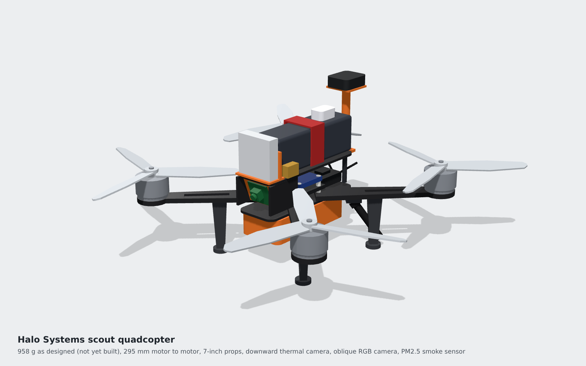
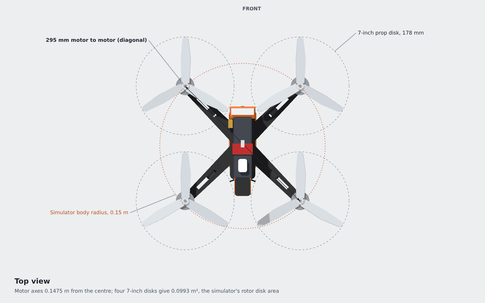
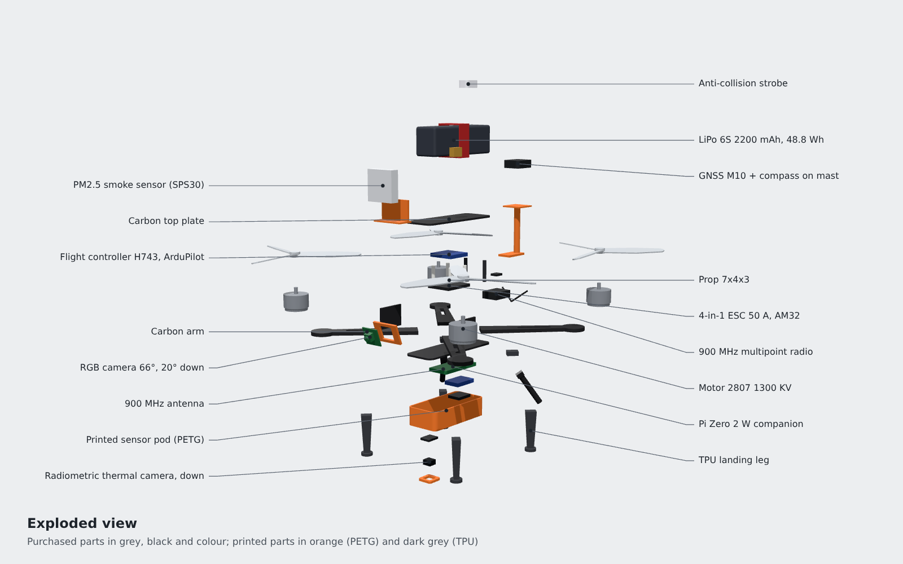
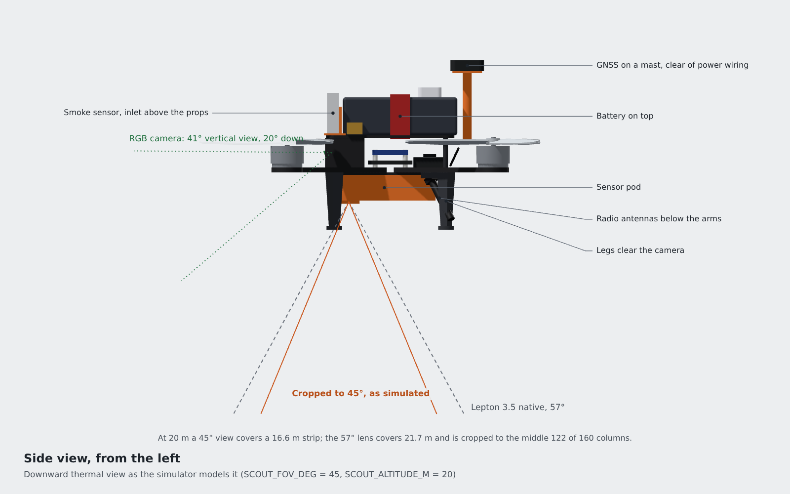

# Halo scout: the drone the simulator flies



The Halo scout is a 7-inch quadcopter designed around off-the-shelf hobby parts. It has not been built yet. It looks down with a radiometric thermal camera for smouldering hotspots after lightning, looks ahead with an RGB camera for smoke, samples the air with a particulate sensor and reports over a shared 900 MHz radio. It flies ArduPilot, with a Raspberry Pi Zero 2 W as companion computer. It carries cameras, sensors and radios only.

This folder is its hardware design: parametric CAD, exports, renders, a costed bill of materials, running costs and build steps, all checked against the airframe in [`src/halo_systems/sim/body.py`](../src/halo_systems/sim/body.py).

## At a glance

| Figure | Simulator | This design |
|---|---|---|
| All-up mass | 1,200 g | 958 g in the CAD; 1,006 g with a 5% integration margin |
| Props | four 7-inch, 0.0993 m^2 of disk | four 7x4x3 tri-blades, 0.0993 m^2 |
| Body radius | 0.15 m | 0.1475 m to the motor axis; 0.236 m to the prop tips |
| Thrust-to-weight | 2.5 | about 10 (retailer thrust figure) |
| Drag area (Cd A) | 0.035 m^2 | frontal area 0.011 to 0.013 m^2 from the CAD |
| Avionics power | 8 W | 6.6 W typical, 14.0 W if every peak coincides |
| Usable battery energy | 41 Wh | 41.5 Wh (85% of a 48.8 Wh 6S 2200 mAh pack) |
| Hover endurance, `body.py` formula | 17.0 min | 22.4 min with the margin; 18.1 min if motor and ESC losses are counted |
| Downward thermal field of view at 20 m | 45 degrees | 57 degrees native, cropped to 45 in software |
| Cost per drone | | USD 1,095 |
| 16 drones, ground station and spares | | USD 20,281 |
| Cost per swarm flight hour | | USD 92 for hardware, USD 149 with a crew of two |

## Files

| File | Size | What it is |
|---|---|---|
| [cad/halo_scout.py](cad/halo_scout.py) | 31.6 kB | Parametric CadQuery model. Key dimensions are named constants at the top. Writes everything in `exports/` |
| [exports/halo_scout.glb](exports/halo_scout.glb) | 229 KiB | Low-poly glTF binary, 53 named nodes, 5,418 triangles. Coordinate convention below |
| [exports/halo_scout.step](exports/halo_scout.step) | 1.8 MB | STEP assembly, named and coloured parts, millimetres |
| [exports/halo_scout.stl](exports/halo_scout.stl) | 519 kB | Whole drone as one mesh, millimetres |
| [exports/print/](exports/print/) | 7 files, 80 kB | Each printed part on its own, ready to slice (envelope geometry: add holes before printing) |
| [exports/mass_properties.json](exports/mass_properties.json) | 1.5 kB | Mass, centre of mass, inertia tensor (CAD and glTF axes), projected areas, camera footprint |
| [renders/](renders/) | 4 PNGs, 105 to 126 kB | Three-quarter, top, exploded and side views, 1600 x 1000 |
| [renders/render.html](renders/render.html), [render.cjs](renders/render.cjs) | 15 kB, 2 kB | The page and script that draw the PNGs from the GLB in headless Chromium |
| [bom.csv](bom.csv) | 11.9 kB | The parts list with prices, masses, power, sources and the date checked. The single source for everything below |
| [budget.py](budget.py) | 26.7 kB | Reads the CSV and the CAD masses, runs the simulator's own endurance formula, writes the three files below |
| [BOM.md](BOM.md) | 16.9 kB | Bill of materials and the mass, power and endurance budget against the simulator |
| [COSTS.md](COSTS.md) | 4.1 kB | Cost per flight hour and per hectare |
| [budget.json](budget.json) | 6.7 kB | Every computed number, for other tools |
| [BUILD.md](BUILD.md) | 18.3 kB | Tools, build time, step-by-step build and set-up, pre-flight checks and the legal note |

## Renders

| | |
|---|---|
|  |  |
| Top: prop disks, the simulator's 0.15 m body radius, 295 mm motor diagonal | Exploded, with every part labelled |



## Regenerate

```bash
# Run from the repository root.

# CAD and exports (one library: CadQuery 2.8.0; numpy and Pillow come with it)
python3 -m venv cad_venv && cad_venv/bin/pip install cadquery==2.8.0
cad_venv/bin/python hardware/cad/halo_scout.py

# BOM.md, COSTS.md and budget.json (needs only numpy, like the simulator)
python3 hardware/budget.py

# Renders (Node 18+ with Playwright; CHROMIUM_PATH optional)
NODE_PATH=/path/to/node_modules node hardware/renders/render.cjs
```

Edit `bom.csv` for prices and parts, the constants at the top of `cad/halo_scout.py` for geometry, and the assumptions at the top of `budget.py` for running costs. Then run the three steps in order.

## GLB coordinate convention

- **Units:** metres.
- **Axes:** right-handed, **+Y up**, **+Z forward** (the nose), **+X left**. This is glTF's own convention, so any glTF viewer shows the drone upright.
- **Origin:** the centre of mass of the whole drone, battery included. The CAD frame (x forward, y left, z up, millimetres) is shifted to it on export.
- **Nodes:** one root node, `halo_scout`, whose `extras` repeat the convention. Under it, one named node per part (`arm_FR`, `battery`, `thermal_camera`, `gnss_mast` and so on). Each node's translation is its part's centre relative to the centre of mass, and each node's `extras` give a label, a group, the part's mass in grams, its BOM id and an `explode_m` offset for exploded views.
- **Props:** `prop_FR`, `prop_RL`, `prop_FL` and `prop_RR` are separate nodes with their origin on the motor shaft, so spinning one is a rotation of that node about its own +Y. Their `extras` give `spin` (`ccw` or `cw`, seen from above; `ccw` is a positive rotation about +Y) and `ardupilot_motor`, the motor number in ArduPilot's standard Quad X (front right 1 and rear left 2 turn counter-clockwise; front left 3 and rear right 4 clockwise). [BUILD.md](BUILD.md) keeps the flight controller's default Betaflight X order, which numbers the same motors 2, 3, 4 and 1 with the same spin directions.
- **Inertia:** `exports/mass_properties.json` gives the inertia tensor about the centre of mass in both CAD and glTF axes.

To fly it in a three.js view like the Halo Systems dashboard, which maps a simulator point (x east, y north, z up) to three.js with `toV(p) = (x, z, -y)`:

```js
// drone = the loaded GLB scene; three.js puts glTF extras in userData.
drone.position.copy(toV(p));                       // origin is the centre of mass
drone.rotation.y = Math.PI / 2 + yaw;              // yaw: heading counter-clockwise from east
for (const name of ["prop_FR", "prop_RL", "prop_FL", "prop_RR"]) {
  const prop = drone.getObjectByName(name);
  prop.rotation.y += (prop.userData.spin === "ccw" ? 1 : -1) * omega * dt;
}
```

The simulator has no yaw state, so take `yaw = atan2(v_north, v_east)` from the velocity. The dashboard already flies this model: [`drone_model.js`](../src/halo_systems/dashboard/static/drone_model.js) loads a copy of this GLB (`static/models/halo_scout.glb`) with the vendored `GLTFLoader`, and `scene3d.js` takes the yaw from the velocity the same way.

## Gaps against the simulator

Where real parts cannot match `body.py` or the wildfire scenario, the gap is stated here in numbers. The simulator's parameters were not changed.

1. **Mass: lighter than simulated.** 958 g in the CAD, 1,006 g with a 5% margin for wiring and fixings, against 1,200 g. Hover power by the simulator's formula falls from 144.5 W to 111.4 W. The simulator is conservative here, and the 194 g of headroom could carry a larger battery.
2. **Thrust-to-weight: about four times the simulator's.** Four motors at the retailer's 2.64 kg each give about 10.5 against 2.5. BUILD.md caps tilt and acceleration in ArduPilot (`ANGLE_MAX`, `WPNAV_ACCEL`) so the drone flies inside the simulated envelope.
3. **Body radius: the props reach further.** The motor axes sit at 0.1475 m, close to the 0.15 m `radius_m`, but the prop tips reach 0.236 m. The simulator counts a collision when two centres pass within 0.30 m; real props would touch at 0.47 m. With the real tip radius, the safety validator's smallest spacing (at its 0.5 m minimum margin) would rise from 2.04 m to 2.21 m. The wildfire sweep flies at 14 m spacing, so it is unaffected.
4. **Drag area: smaller than simulated.** The CAD's frontal area is 0.011 m^2 without props and 0.013 m^2 with them, so Cd A is perhaps 0.011 to 0.016 m^2 against 0.035 m^2. The simulator overstates drag, which is conservative.
5. **Figure of merit: motor and ESC losses are missing.** `body.py` applies its rotor figure of merit, 0.6, straight to battery power. With an assumed 80% motor-and-ESC efficiency the effective value is 0.48, and hover endurance falls from 22.4 to 18.1 minutes, still above the simulator's 17.0. Step 12 of BUILD.md measures it.
6. **Avionics power: fits, with little headroom.** 6.6 W typical against 8 W. If the radio sent at 1 W all the time while every other peak coincided, it would reach 14.0 W, so the swarm radio is run at 100 to 250 mW.
7. **Thermal camera: wider, rectangular, and cropped.** The Lepton 3.5 sees 57 x about 44 degrees; keeping the middle 122 of its 160 columns gives the simulator's 45 degrees (a 16.6 m swath at 20 m, 0.136 m per pixel). The simulator's footprint is a circle. At 6 m/s a point stays in view for about 2.7 s, about 23 frames at 8.7 Hz, well over the simulator's 0.5 s dwell.
8. **Hotspot size.** The simulated hotspots are 3 to 8 m across, 22 to 59 Lepton pixels at 20 m. A fresh ignition after lightning can be well under a metre, a few pixels. A hot spot that small still stands out by temperature, but the simulator does not model detection at that scale.
9. **Navigation error: about six times the simulator's.** The simulator's GNSS error is about 0.29 m per axis (0.15 m noise plus a 0.25 m drifting bias). The Micro M10 is specified at 2.0 m CEP, about 1.7 m per axis. Neighbouring camera strips overlap by only 2.6 m at 14 m spacing, about one standard deviation of the error between two independent receivers, so gaps between strips would appear. Nearby receivers share much of their error, so the real relative error is smaller, but the receiver does not specify it. Fixes: RTK GNSS, or use the Lepton's full 57 degrees, which gives 7.7 m of overlap at the same spacing.
10. **Radio rate: far below 50 Hz.** In the simulator every drone broadcasts its state every 0.02 s step, with 50 ms latency, 2% loss and 400 m range. On one shared 900 MHz channel, 16 drones each sending a 40-byte MAVLink position message 50 times a second need 256 kbit/s of payload alone. The radio's default air rate is 64 kbit/s (up to 750 kbit/s at shorter range), which allows at most about 12 updates per drone per second before overheads. Expect a few. The simulator's radio model has no rate setting, so this was not tested.
11. **Smoke sensor: a threshold, not readings.** The wildfire valley simulates the PM2.5 sensor as a trigger at 35 ug/m3 above background in a Gaussian plume (`pm_threshold_ugm3` in [`sim/smoke.py`](../src/halo_systems/sim/smoke.py)); the wildfire scout scenario has no smoke. The SPS30 sits in the rotor wash, so its readings are relative: a rise above the block's background. The simulator does not model the rotor wash or the sensor's response time.
12. **Software: no hardware bridge yet.** The repository has no onboard program for the Pi and no MAVLink bridge between the simulator's controller and ArduPilot. The intended split: ArduPilot flies each drone in GUIDED mode, the companion computer turns the controller's output into acceleration or velocity set-points, and the ground station runs the supervisor.
13. **Forward RGB camera: narrower than simulated.** The Camera Module 3's standard lens sees 66 x 41 degrees and is tilted 20 degrees down, so its view ends just above the horizon. The simulator's smoke camera sees 90 degrees across with no vertical limit (`camera_hfov_deg` in [`sim/smoke.py`](../src/halo_systems/sim/smoke.py)). So the smoke sightings were not tested with the real lens, and in the wildfire valley smoke gave the only finds of the fire under the overhang and the fire across the valley.

## Options

- **Onboard NVIDIA compute.** A Jetson Orin Nano would run heavier vision models on the drone. NVIDIA lists the Orin Nano modules at 7 W to 15 W ([NVIDIA](https://www.nvidia.com/en-us/autonomous-machines/embedded-systems/jetson-orin/)); the Super developer kit was USD 399 at [SparkFun](https://www.sparkfun.com/products/22098) on 2026-10-14. In place of the Pi at its lowest mode, avionics would rise from 6.6 W to about 11.5 W, over the 8 W budget, and hover endurance by the same formula would drop to about 21 minutes before counting its extra mass. This design keeps heavy inference on the ground and sends compact detections over the radio.
- **Regional radios.** Use the 868 MHz RFD868ux-EU in the UK and EU in place of the US 900 MHz radio.

## What could not be sourced

- The price of assorted wire, screws and fixings: a range, USD 8 to 15 per drone, marked estimated.
- Published masses for the PureThermal Mini Pro board, its cable, the OTG adapter, the SD card, the camera ribbon, the battery strap, the XT60 lead and the fixings: estimated, about 52 g in all.
- Maker current figures for the RC receiver, the Remote ID module, the Camera Module 3 and the Kakute H7 itself: estimated.
- Motor-and-ESC efficiency in hover, and the drone's real drag coefficient: assumed until measured (BUILD.md, step 12).
- The battery's cycle life: Tattu does not publish one; COSTS.md uses half of a general LiPo figure.
- A current final FAA rule for beyond visual line of sight flight (Part 108): still a proposal on 2026-10-14.
