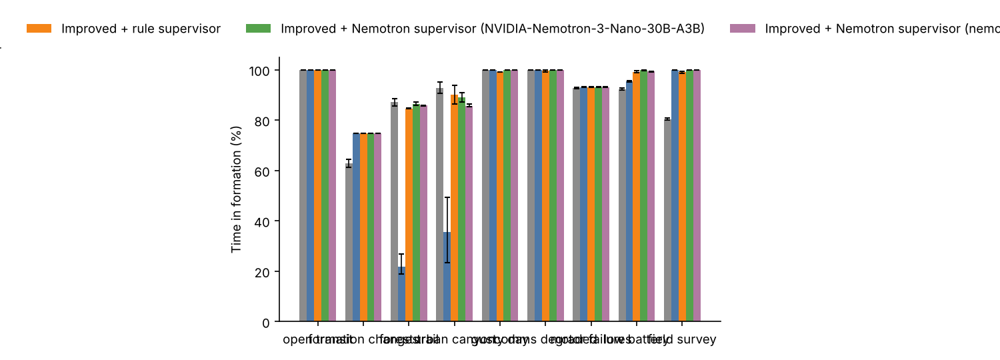
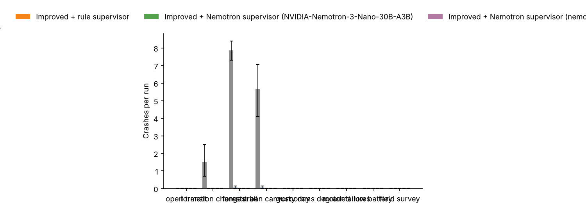
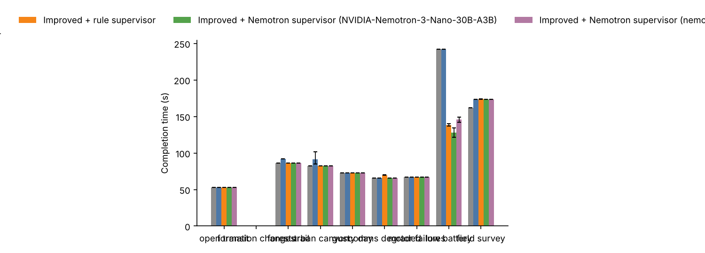
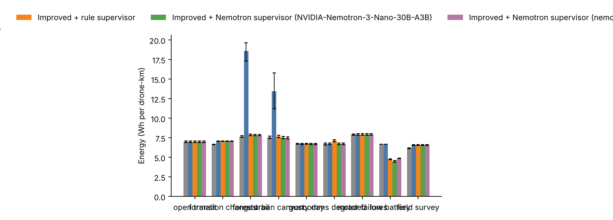

# Benchmark report

Source: `runs.jsonl`, 900 runs, seeds 1000-1019 (20 seeds).

Crashes count drones destroyed by collisions with each other, obstacles or the ground. Completion time and energy average only the runs where the value exists.

## Results by scenario

### open_transit

Mean over 20 seeds, with 95% bootstrap intervals.

| Configuration | Time in formation (%) | Formation error, mean (m) | Crashes per run | Near misses per run | Missions completed (%) | Completion time (s) | Energy (Wh per drone-km) | Drones retired (low battery) | Time faster than planned (%) |
|---|---|---|---|---|---|---|---|---|---|
| Original controller | 100 | 0.41 [0.41, 0.42] | 0.00 | 0.00 | 100 | 53 | 6.99 [6.89, 7.09] | 0.00 | 0 |
| Improved controller | 100 | 0.41 [0.40, 0.42] | 0.00 | 0.00 | 100 | 53 | 6.99 [6.89, 7.09] | 0.00 | 0 |
| Improved + rule supervisor | 100 | 0.41 [0.40, 0.42] | 0.00 | 0.00 | 100 | 53 | 6.99 [6.89, 7.09] | 0.00 | 0 |
| Improved + Nemotron supervisor (NVIDIA-Nemotron-3-Nano-30B-A3B) | 100 | 0.41 [0.40, 0.42] | 0.00 | 0.00 | 100 | 53 | 6.99 [6.89, 7.09] | 0.00 | 0 |
| Improved + Nemotron supervisor (nemotron-3-super-120b-a12b) | 100 | 0.41 [0.40, 0.42] | 0.00 | 0.00 | 100 | 53 | 6.99 [6.89, 7.09] | 0.00 | 0 |

### formation_changes

Mean over 20 seeds, with 95% bootstrap intervals.

| Configuration | Time in formation (%) | Formation error, mean (m) | Crashes per run | Near misses per run | Missions completed (%) | Completion time (s) | Energy (Wh per drone-km) | Drones retired (low battery) | Time faster than planned (%) |
|---|---|---|---|---|---|---|---|---|---|
| Original controller | 63 [61, 65] | 3.32 [3.16, 3.47] | 1.50 [0.70, 2.50] | 5.55 [4.60, 6.60] | n/a | n/a | 6.67 [6.65, 6.70] | 0.00 | 0 |
| Improved controller | 75 | 3.09 [3.09, 3.10] | 0.00 | 0.00 | n/a | n/a | 7.09 [7.07, 7.12] | 0.00 | 0 |
| Improved + rule supervisor | 75 | 3.09 [3.09, 3.10] | 0.00 | 0.00 | n/a | n/a | 7.09 [7.07, 7.12] | 0.00 | 0 |
| Improved + Nemotron supervisor (NVIDIA-Nemotron-3-Nano-30B-A3B) | 75 | 3.09 [3.09, 3.10] | 0.00 | 0.00 | n/a | n/a | 7.09 [7.07, 7.12] | 0.00 | 0 |
| Improved + Nemotron supervisor (nemotron-3-super-120b-a12b) | 75 | 3.09 [3.09, 3.10] | 0.00 | 0.00 | n/a | n/a | 7.09 [7.07, 7.12] | 0.00 | 0 |

### forest_trail

Mean over 20 seeds, with 95% bootstrap intervals.

| Configuration | Time in formation (%) | Formation error, mean (m) | Crashes per run | Near misses per run | Missions completed (%) | Completion time (s) | Energy (Wh per drone-km) | Drones retired (low battery) | Time faster than planned (%) |
|---|---|---|---|---|---|---|---|---|---|
| Original controller | 87 [86, 88] | 0.72 [0.70, 0.75] | 7.85 [7.30, 8.40] | 0.90 [0.60, 1.25] | 100 | 86 | 7.67 [7.59, 7.76] | 0.00 | 0 |
| Improved controller | 22 [19, 27] | 22.65 [19.60, 25.09] | 0.05 [0.00, 0.15] | 0.00 | 5 [0, 15] | 92 | 18.62 [17.29, 19.68] | 0.00 | 0 |
| Improved + rule supervisor | 85 | 2.28 [2.25, 2.32] | 0.00 | 0.00 | 100 | 86 | 7.89 [7.81, 7.97] | 0.00 | 0 |
| Improved + Nemotron supervisor (NVIDIA-Nemotron-3-Nano-30B-A3B) | 86 [86, 87] | 2.06 [1.91, 2.15] | 0.00 | 0.00 | 100 | 86 | 7.86 [7.78, 7.94] | 0.00 | 0 |
| Improved + Nemotron supervisor (nemotron-3-super-120b-a12b) | 86 | 2.14 [2.14, 2.16] | 0.00 | 0.00 | 100 | 86 | 7.86 [7.78, 7.94] | 0.00 | 0 |

### urban_canyon

Mean over 20 seeds, with 95% bootstrap intervals.

| Configuration | Time in formation (%) | Formation error, mean (m) | Crashes per run | Near misses per run | Missions completed (%) | Completion time (s) | Energy (Wh per drone-km) | Drones retired (low battery) | Time faster than planned (%) |
|---|---|---|---|---|---|---|---|---|---|
| Original controller | 93 [91, 95] | 0.72 [0.69, 0.75] | 5.65 [4.10, 7.05] | 0.45 [0.20, 0.75] | 100 | 82 | 7.57 [7.43, 7.73] | 0.00 | 0 |
| Improved controller | 36 [23, 49] | 12.71 [6.30, 19.72] | 0.05 [0.00, 0.15] | 0.05 [0.00, 0.15] | 55 [35, 75] | 92 [85, 102] | 13.48 [11.24, 15.78] | 0.00 | 0 |
| Improved + rule supervisor | 90 [86, 94] | 1.45 [0.96, 1.95] | 0.00 | 0.00 | 100 | 82 | 7.68 [7.53, 7.85] | 0.00 | 0 |
| Improved + Nemotron supervisor (NVIDIA-Nemotron-3-Nano-30B-A3B) | 89 [87, 91] | 1.62 [1.31, 1.92] | 0.00 | 0.00 | 100 | 82 | 7.55 [7.43, 7.67] | 0.00 | 0 |
| Improved + Nemotron supervisor (nemotron-3-super-120b-a12b) | 86 [85, 86] | 2.19 [2.10, 2.25] | 0.00 | 0.00 | 100 | 82 | 7.49 [7.38, 7.62] | 0.00 | 0 |

### gusty_day

Mean over 20 seeds, with 95% bootstrap intervals.

| Configuration | Time in formation (%) | Formation error, mean (m) | Crashes per run | Near misses per run | Missions completed (%) | Completion time (s) | Energy (Wh per drone-km) | Drones retired (low battery) | Time faster than planned (%) |
|---|---|---|---|---|---|---|---|---|---|
| Original controller | 100 | 0.42 [0.41, 0.43] | 0.00 | 0.00 | 100 | 73 | 6.73 [6.67, 6.79] | 0.00 | 0 |
| Improved controller | 100 | 0.42 [0.41, 0.43] | 0.00 | 0.00 | 100 | 73 | 6.72 [6.66, 6.78] | 0.00 | 0 |
| Improved + rule supervisor | 99 | 0.44 [0.43, 0.45] | 0.00 | 0.00 | 100 | 73 | 6.75 [6.68, 6.81] | 0.00 | 0 |
| Improved + Nemotron supervisor (NVIDIA-Nemotron-3-Nano-30B-A3B) | 100 | 0.42 [0.41, 0.43] | 0.00 | 0.00 | 100 | 73 | 6.72 [6.66, 6.78] | 0.00 | 0 |
| Improved + Nemotron supervisor (nemotron-3-super-120b-a12b) | 100 | 0.42 [0.41, 0.43] | 0.00 | 0.00 | 100 | 73 | 6.72 [6.66, 6.78] | 0.00 | 0 |

### comms_degraded

Mean over 20 seeds, with 95% bootstrap intervals.

| Configuration | Time in formation (%) | Formation error, mean (m) | Crashes per run | Near misses per run | Missions completed (%) | Completion time (s) | Energy (Wh per drone-km) | Drones retired (low battery) | Time faster than planned (%) |
|---|---|---|---|---|---|---|---|---|---|
| Original controller | 100 | 0.41 [0.41, 0.42] | 0.00 | 0.00 | 100 | 66 | 6.73 [6.61, 6.85] | 0.00 | 0 |
| Improved controller | 100 | 0.41 [0.40, 0.42] | 0.00 | 0.00 | 100 | 66 | 6.73 [6.61, 6.85] | 0.00 | 0 |
| Improved + rule supervisor | 100 [99, 100] | 0.42 [0.41, 0.43] | 0.00 | 0.00 | 100 | 70 | 7.15 [7.02, 7.28] | 0.00 | 0 |
| Improved + Nemotron supervisor (NVIDIA-Nemotron-3-Nano-30B-A3B) | 100 | 0.41 [0.40, 0.42] | 0.00 | 0.00 | 100 | 66 | 6.73 [6.61, 6.85] | 0.00 | 0 |
| Improved + Nemotron supervisor (nemotron-3-super-120b-a12b) | 100 | 0.41 [0.40, 0.42] | 0.00 | 0.00 | 100 | 66 | 6.73 [6.61, 6.85] | 0.00 | 0 |

### motor_failures

Mean over 20 seeds, with 95% bootstrap intervals.

| Configuration | Time in formation (%) | Formation error, mean (m) | Crashes per run | Near misses per run | Missions completed (%) | Completion time (s) | Energy (Wh per drone-km) | Drones retired (low battery) | Time faster than planned (%) |
|---|---|---|---|---|---|---|---|---|---|
| Original controller | 93 [92, 93] | 0.53 [0.52, 0.55] | 0.00 | 0.00 | 100 | 67 | 7.92 [7.83, 8.02] | 0.00 | 0 |
| Improved controller | 93 | 0.52 [0.50, 0.53] | 0.00 | 0.00 | 100 | 67 | 7.94 [7.85, 8.04] | 0.00 | 0 |
| Improved + rule supervisor | 93 | 0.52 [0.50, 0.53] | 0.00 | 0.00 | 100 | 67 | 7.94 [7.85, 8.04] | 0.00 | 0 |
| Improved + Nemotron supervisor (NVIDIA-Nemotron-3-Nano-30B-A3B) | 93 | 0.52 [0.50, 0.53] | 0.00 | 0.00 | 100 | 67 | 7.94 [7.85, 8.04] | 0.00 | 0 |
| Improved + Nemotron supervisor (nemotron-3-super-120b-a12b) | 93 | 0.52 [0.50, 0.53] | 0.00 | 0.00 | 100 | 67 | 7.94 [7.85, 8.04] | 0.00 | 0 |

### low_battery

Mean over 20 seeds, with 95% bootstrap intervals.

| Configuration | Time in formation (%) | Formation error, mean (m) | Crashes per run | Near misses per run | Missions completed (%) | Completion time (s) | Energy (Wh per drone-km) | Drones retired (low battery) | Time faster than planned (%) |
|---|---|---|---|---|---|---|---|---|---|
| Original controller | 92 [92, 93] | 0.56 [0.55, 0.57] | 0.00 | 0.65 [0.30, 1.05] | 50 [30, 70] | 242 | 6.67 [6.67, 6.68] | 16.00 | 0 |
| Improved controller | 95 | 0.48 [0.48, 0.49] | 0.00 | 0.00 | 45 [25, 65] | 242 | 6.71 [6.70, 6.71] | 16.00 | 0 |
| Improved + rule supervisor | 99 [99, 100] | 0.42 [0.41, 0.43] | 0.00 | 0.00 | 100 | 138 [137, 140] | 4.77 [4.72, 4.83] | 0.65 [0.30, 1.00] | 55 [53, 57] |
| Improved + Nemotron supervisor (NVIDIA-Nemotron-3-Nano-30B-A3B) | 100 | 0.41 [0.40, 0.42] | 0.00 | 0.00 | 100 | 128 [122, 134] | 4.52 [4.41, 4.62] | 0.50 [0.10, 1.00] | 77 [71, 83] |
| Improved + Nemotron supervisor (nemotron-3-super-120b-a12b) | 99 | 0.42 [0.42, 0.43] | 0.00 | 0.00 | 100 | 146 [142, 149] | 4.89 [4.85, 4.93] | 1.55 [1.15, 2.00] | 51 [47, 55] |

### field_survey

Mean over 20 seeds, with 95% bootstrap intervals.

| Configuration | Time in formation (%) | Formation error, mean (m) | Crashes per run | Near misses per run | Missions completed (%) | Completion time (s) | Energy (Wh per drone-km) | Drones retired (low battery) | Time faster than planned (%) |
|---|---|---|---|---|---|---|---|---|---|
| Original controller | 80 [80, 81] | 0.79 [0.76, 0.82] | 0.00 | 0.00 | 100 | 162 | 6.17 [6.13, 6.22] | 0.00 | 0 |
| Improved controller | 100 | 0.41 [0.41, 0.42] | 0.00 | 0.00 | 100 | 173 | 6.59 [6.54, 6.64] | 0.00 | 0 |
| Improved + rule supervisor | 99 [99, 99] | 0.44 [0.43, 0.46] | 0.00 | 0.00 | 100 | 174 [174, 174] | 6.61 [6.56, 6.66] | 0.00 | 0 |
| Improved + Nemotron supervisor (NVIDIA-Nemotron-3-Nano-30B-A3B) | 100 | 0.41 [0.41, 0.42] | 0.00 | 0.00 | 100 | 173 | 6.59 [6.54, 6.64] | 0.00 | 0 |
| Improved + Nemotron supervisor (nemotron-3-super-120b-a12b) | 100 | 0.41 [0.41, 0.42] | 0.00 | 0.00 | 100 | 173 | 6.59 [6.54, 6.64] | 0.00 | 0 |

## Which scenarios separate the configurations

A difference counts when the 95% bootstrap interval of the seed-by-seed difference excludes zero and, except for crashes and completions, the mean difference is more than 1% of the baseline.

* **open_transit**: no comparison differs beyond noise on the main metrics.
* **formation_changes**:
  * Improved controller vs Original controller: better on Time in formation (%) 62.77 → 74.78, Crashes per run 1.5 → 0; worse on Energy (Wh per drone-km) 6.672 → 7.094
* **forest_trail**:
  * Improved controller vs Original controller: better on Crashes per run 7.85 → 0.05; worse on Time in formation (%) 87.11 → 21.86, Missions completed (%) 100 → 5, Energy (Wh per drone-km) 7.674 → 18.62
  * Improved + rule supervisor vs Improved controller: better on Time in formation (%) 21.86 → 84.67, Missions completed (%) 5 → 100, Energy (Wh per drone-km) 18.62 → 7.889
  * Improved + Nemotron supervisor (NVIDIA-Nemotron-3-Nano-30B-A3B) vs Improved + rule supervisor: better on Time in formation (%) 84.67 → 86.29
  * Improved + Nemotron supervisor (nemotron-3-super-120b-a12b) vs Improved + rule supervisor: better on Time in formation (%) 84.67 → 85.78
* **urban_canyon**:
  * Improved controller vs Original controller: better on Crashes per run 5.65 → 0.05; worse on Time in formation (%) 92.87 → 35.7, Missions completed (%) 100 → 55, Completion time (s) 82.16 → 91.68, Energy (Wh per drone-km) 7.573 → 13.48
  * Improved + rule supervisor vs Improved controller: better on Time in formation (%) 35.7 → 90.17, Missions completed (%) 55 → 100, Completion time (s) 91.68 → 82.17, Energy (Wh per drone-km) 13.48 → 7.685
  * Improved + Nemotron supervisor (NVIDIA-Nemotron-3-Nano-30B-A3B) vs Improved + rule supervisor: better on Energy (Wh per drone-km) 7.685 → 7.549
  * Improved + Nemotron supervisor (nemotron-3-super-120b-a12b) vs Improved + rule supervisor: better on Energy (Wh per drone-km) 7.685 → 7.495; worse on Time in formation (%) 90.17 → 85.7
* **gusty_day**: no comparison differs beyond noise on the main metrics.
* **comms_degraded**:
  * Improved + rule supervisor vs Improved controller: worse on Completion time (s) 66 → 69.85, Energy (Wh per drone-km) 6.734 → 7.152
  * Improved + Nemotron supervisor (NVIDIA-Nemotron-3-Nano-30B-A3B) vs Improved + rule supervisor: better on Completion time (s) 69.85 → 66, Energy (Wh per drone-km) 7.152 → 6.734
  * Improved + Nemotron supervisor (nemotron-3-super-120b-a12b) vs Improved + rule supervisor: better on Completion time (s) 69.85 → 66, Energy (Wh per drone-km) 7.152 → 6.734
* **motor_failures**: no comparison differs beyond noise on the main metrics.
* **low_battery**:
  * Improved controller vs Original controller: better on Time in formation (%) 92.31 → 95.38
  * Improved + rule supervisor vs Improved controller: better on Time in formation (%) 95.38 → 99.23, Missions completed (%) 45 → 100, Completion time (s) 242.3 → 139.6, Energy (Wh per drone-km) 6.705 → 4.773
  * Improved + Nemotron supervisor (NVIDIA-Nemotron-3-Nano-30B-A3B) vs Improved + rule supervisor: better on Completion time (s) 138.3 → 127.6, Energy (Wh per drone-km) 4.773 → 4.516
  * Improved + Nemotron supervisor (nemotron-3-super-120b-a12b) vs Improved + rule supervisor: worse on Completion time (s) 138.3 → 145.7, Energy (Wh per drone-km) 4.773 → 4.891
* **field_survey**:
  * Improved controller vs Original controller: better on Time in formation (%) 80.42 → 100; worse on Completion time (s) 162.2 → 173.3, Energy (Wh per drone-km) 6.175 → 6.586

## Nemotron usage

| Configuration | Runs | Calls per run | Fallbacks to rules | Latency, mean (s) | Latency, 95th pct (s) | Tokens per run | Cost per run (USD) | Cost, all runs (USD) |
|---|---|---|---|---|---|---|---|---|
| Improved + Nemotron supervisor (NVIDIA-Nemotron-3-Nano-30B-A3B) | 180 | 18.9 | 0 of 3400 (0.0%) | 1.17 | 1.43 | 34,706 | 0.0039 | 0.7007 |
| Improved + Nemotron supervisor (nemotron-3-super-120b-a12b) | 180 | 19.3 | 0 of 3474 (0.0%) | 1.37 | 1.64 | 35,382 | 0.0191 | 3.4310 |

Latency includes retries. The 95th percentile column averages each run's own 95th percentile. Costs are estimates from the token counts and the price table in `ai/budget.py`; the provider's bill is the authority.

## Paired comparisons (same seeds)

| Scenario | Comparison | Metric | A | B | B - A [95% CI] | B better / tie / worse |
|---|---|---|---|---|---|---|
| open_transit | Improved controller vs Original controller | Time in formation (%) | 100.00 | 100.00 | +0.00 [+0.00, +0.00] | 0 / 20 / 0 |
| open_transit | Improved controller vs Original controller | Crashes per run | 0.00 | 0.00 | +0.00 [+0.00, +0.00] | 0 / 20 / 0 |
| open_transit | Improved controller vs Original controller | Completion time (s) | 52.66 | 52.66 | +0.00 [+0.00, +0.00] | 0 / 20 / 0 |
| open_transit | Improved controller vs Original controller | Energy (Wh per drone-km) | 6.99 | 6.99 | +0.00 [+0.00, +0.00] | 0 / 20 / 0 |
| open_transit | Improved + rule supervisor vs Improved controller | Time in formation (%) | 100.00 | 100.00 | +0.00 [+0.00, +0.00] | 0 / 20 / 0 |
| open_transit | Improved + rule supervisor vs Improved controller | Crashes per run | 0.00 | 0.00 | +0.00 [+0.00, +0.00] | 0 / 20 / 0 |
| open_transit | Improved + rule supervisor vs Improved controller | Completion time (s) | 52.66 | 52.66 | +0.00 [+0.00, +0.00] | 0 / 20 / 0 |
| open_transit | Improved + rule supervisor vs Improved controller | Energy (Wh per drone-km) | 6.99 | 6.99 | +0.00 [+0.00, +0.00] | 0 / 20 / 0 |
| open_transit | Improved + Nemotron supervisor (NVIDIA-Nemotron-3-Nano-30B-A3B) vs Improved + rule supervisor | Time in formation (%) | 100.00 | 100.00 | +0.00 [+0.00, +0.00] | 0 / 20 / 0 |
| open_transit | Improved + Nemotron supervisor (NVIDIA-Nemotron-3-Nano-30B-A3B) vs Improved + rule supervisor | Crashes per run | 0.00 | 0.00 | +0.00 [+0.00, +0.00] | 0 / 20 / 0 |
| open_transit | Improved + Nemotron supervisor (NVIDIA-Nemotron-3-Nano-30B-A3B) vs Improved + rule supervisor | Completion time (s) | 52.66 | 52.66 | +0.00 [+0.00, +0.00] | 0 / 20 / 0 |
| open_transit | Improved + Nemotron supervisor (NVIDIA-Nemotron-3-Nano-30B-A3B) vs Improved + rule supervisor | Energy (Wh per drone-km) | 6.99 | 6.99 | +0.00 [+0.00, +0.00] | 0 / 20 / 0 |
| open_transit | Improved + Nemotron supervisor (nemotron-3-super-120b-a12b) vs Improved + rule supervisor | Time in formation (%) | 100.00 | 100.00 | +0.00 [+0.00, +0.00] | 0 / 20 / 0 |
| open_transit | Improved + Nemotron supervisor (nemotron-3-super-120b-a12b) vs Improved + rule supervisor | Crashes per run | 0.00 | 0.00 | +0.00 [+0.00, +0.00] | 0 / 20 / 0 |
| open_transit | Improved + Nemotron supervisor (nemotron-3-super-120b-a12b) vs Improved + rule supervisor | Completion time (s) | 52.66 | 52.66 | +0.00 [+0.00, +0.00] | 0 / 20 / 0 |
| open_transit | Improved + Nemotron supervisor (nemotron-3-super-120b-a12b) vs Improved + rule supervisor | Energy (Wh per drone-km) | 6.99 | 6.99 | +0.00 [+0.00, +0.00] | 0 / 20 / 0 |
| formation_changes | Improved controller vs Original controller | Time in formation (%) | 62.77 | 74.78 | +12.01 [+10.28, +13.49] | 19 / 1 / 0 |
| formation_changes | Improved controller vs Original controller | Crashes per run | 1.50 | 0.00 | -1.50 [-2.50, -0.70] | 9 / 11 / 0 |
| formation_changes | Improved controller vs Original controller | Energy (Wh per drone-km) | 6.67 | 7.09 | +0.42 [+0.39, +0.46] | 0 / 0 / 20 |
| formation_changes | Improved + rule supervisor vs Improved controller | Time in formation (%) | 74.78 | 74.78 | +0.00 [+0.00, +0.00] | 0 / 20 / 0 |
| formation_changes | Improved + rule supervisor vs Improved controller | Crashes per run | 0.00 | 0.00 | +0.00 [+0.00, +0.00] | 0 / 20 / 0 |
| formation_changes | Improved + rule supervisor vs Improved controller | Energy (Wh per drone-km) | 7.09 | 7.09 | +0.00 [+0.00, +0.00] | 0 / 20 / 0 |
| formation_changes | Improved + Nemotron supervisor (NVIDIA-Nemotron-3-Nano-30B-A3B) vs Improved + rule supervisor | Time in formation (%) | 74.78 | 74.78 | +0.00 [+0.00, +0.00] | 0 / 20 / 0 |
| formation_changes | Improved + Nemotron supervisor (NVIDIA-Nemotron-3-Nano-30B-A3B) vs Improved + rule supervisor | Crashes per run | 0.00 | 0.00 | +0.00 [+0.00, +0.00] | 0 / 20 / 0 |
| formation_changes | Improved + Nemotron supervisor (NVIDIA-Nemotron-3-Nano-30B-A3B) vs Improved + rule supervisor | Energy (Wh per drone-km) | 7.09 | 7.09 | +0.00 [+0.00, +0.00] | 0 / 20 / 0 |
| formation_changes | Improved + Nemotron supervisor (nemotron-3-super-120b-a12b) vs Improved + rule supervisor | Time in formation (%) | 74.78 | 74.78 | +0.00 [+0.00, +0.00] | 0 / 20 / 0 |
| formation_changes | Improved + Nemotron supervisor (nemotron-3-super-120b-a12b) vs Improved + rule supervisor | Crashes per run | 0.00 | 0.00 | +0.00 [+0.00, +0.00] | 0 / 20 / 0 |
| formation_changes | Improved + Nemotron supervisor (nemotron-3-super-120b-a12b) vs Improved + rule supervisor | Energy (Wh per drone-km) | 7.09 | 7.09 | +0.00 [+0.00, +0.00] | 0 / 20 / 0 |
| forest_trail | Improved controller vs Original controller | Time in formation (%) | 87.11 | 21.86 | -65.26 [-68.90, -59.38] | 0 / 0 / 20 |
| forest_trail | Improved controller vs Original controller | Crashes per run | 7.85 | 0.05 | -7.80 [-8.40, -7.25] | 20 / 0 / 0 |
| forest_trail | Improved controller vs Original controller | Completion time (s) | 86.16 | 92.18 | +6.02 [+6.02, +6.02] | 0 / 0 / 1 |
| forest_trail | Improved controller vs Original controller | Energy (Wh per drone-km) | 7.67 | 18.62 | +10.95 [+9.58, +12.01] | 0 / 0 / 20 |
| forest_trail | Improved + rule supervisor vs Improved controller | Time in formation (%) | 21.86 | 84.67 | +62.81 [+57.59, +65.76] | 20 / 0 / 0 |
| forest_trail | Improved + rule supervisor vs Improved controller | Crashes per run | 0.05 | 0.00 | -0.05 [-0.15, +0.00] | 1 / 19 / 0 |
| forest_trail | Improved + rule supervisor vs Improved controller | Completion time (s) | 92.18 | 86.22 | -5.96 [-5.96, -5.96] | 1 / 0 / 0 |
| forest_trail | Improved + rule supervisor vs Improved controller | Energy (Wh per drone-km) | 18.62 | 7.89 | -10.73 [-11.80, -9.37] | 20 / 0 / 0 |
| forest_trail | Improved + Nemotron supervisor (NVIDIA-Nemotron-3-Nano-30B-A3B) vs Improved + rule supervisor | Time in formation (%) | 84.67 | 86.29 | +1.62 [+1.01, +2.60] | 14 / 6 / 0 |
| forest_trail | Improved + Nemotron supervisor (NVIDIA-Nemotron-3-Nano-30B-A3B) vs Improved + rule supervisor | Crashes per run | 0.00 | 0.00 | +0.00 [+0.00, +0.00] | 0 / 20 / 0 |
| forest_trail | Improved + Nemotron supervisor (NVIDIA-Nemotron-3-Nano-30B-A3B) vs Improved + rule supervisor | Completion time (s) | 86.18 | 86.17 | -0.01 [-0.03, +0.01] | 0 / 20 / 0 |
| forest_trail | Improved + Nemotron supervisor (NVIDIA-Nemotron-3-Nano-30B-A3B) vs Improved + rule supervisor | Energy (Wh per drone-km) | 7.89 | 7.86 | -0.03 [-0.04, -0.02] | 0 / 20 / 0 |
| forest_trail | Improved + Nemotron supervisor (nemotron-3-super-120b-a12b) vs Improved + rule supervisor | Time in formation (%) | 84.67 | 85.78 | +1.11 [+0.83, +1.38] | 15 / 5 / 0 |
| forest_trail | Improved + Nemotron supervisor (nemotron-3-super-120b-a12b) vs Improved + rule supervisor | Crashes per run | 0.00 | 0.00 | +0.00 [+0.00, +0.00] | 0 / 20 / 0 |
| forest_trail | Improved + Nemotron supervisor (nemotron-3-super-120b-a12b) vs Improved + rule supervisor | Completion time (s) | 86.18 | 86.16 | -0.02 [-0.03, -0.00] | 0 / 20 / 0 |
| forest_trail | Improved + Nemotron supervisor (nemotron-3-super-120b-a12b) vs Improved + rule supervisor | Energy (Wh per drone-km) | 7.89 | 7.86 | -0.03 [-0.04, -0.02] | 0 / 20 / 0 |
| urban_canyon | Improved controller vs Original controller | Time in formation (%) | 92.87 | 35.70 | -57.17 [-68.96, -44.69] | 0 / 0 / 20 |
| urban_canyon | Improved controller vs Original controller | Crashes per run | 5.65 | 0.05 | -5.60 [-7.00, -4.10] | 15 / 5 / 0 |
| urban_canyon | Improved controller vs Original controller | Completion time (s) | 82.16 | 91.68 | +9.52 [+2.61, +19.45] | 0 / 4 / 7 |
| urban_canyon | Improved controller vs Original controller | Energy (Wh per drone-km) | 7.57 | 13.48 | +5.91 [+3.59, +8.26] | 0 / 0 / 20 |
| urban_canyon | Improved + rule supervisor vs Improved controller | Time in formation (%) | 35.70 | 90.17 | +54.47 [+43.46, +64.58] | 19 / 1 / 0 |
| urban_canyon | Improved + rule supervisor vs Improved controller | Crashes per run | 0.05 | 0.00 | -0.05 [-0.15, +0.00] | 1 / 19 / 0 |
| urban_canyon | Improved + rule supervisor vs Improved controller | Completion time (s) | 91.68 | 82.17 | -9.51 [-19.43, -2.60] | 7 / 4 / 0 |
| urban_canyon | Improved + rule supervisor vs Improved controller | Energy (Wh per drone-km) | 13.48 | 7.68 | -5.79 [-8.17, -3.45] | 20 / 0 / 0 |
| urban_canyon | Improved + Nemotron supervisor (NVIDIA-Nemotron-3-Nano-30B-A3B) vs Improved + rule supervisor | Time in formation (%) | 90.17 | 88.97 | -1.20 [-6.14, +3.82] | 8 / 1 / 11 |
| urban_canyon | Improved + Nemotron supervisor (NVIDIA-Nemotron-3-Nano-30B-A3B) vs Improved + rule supervisor | Crashes per run | 0.00 | 0.00 | +0.00 [+0.00, +0.00] | 0 / 20 / 0 |
| urban_canyon | Improved + Nemotron supervisor (NVIDIA-Nemotron-3-Nano-30B-A3B) vs Improved + rule supervisor | Completion time (s) | 82.18 | 82.17 | -0.01 [-0.04, +0.01] | 0 / 20 / 0 |
| urban_canyon | Improved + Nemotron supervisor (NVIDIA-Nemotron-3-Nano-30B-A3B) vs Improved + rule supervisor | Energy (Wh per drone-km) | 7.68 | 7.55 | -0.14 [-0.23, -0.03] | 13 / 3 / 4 |
| urban_canyon | Improved + Nemotron supervisor (nemotron-3-super-120b-a12b) vs Improved + rule supervisor | Time in formation (%) | 90.17 | 85.70 | -4.47 [-8.06, -0.82] | 6 / 3 / 11 |
| urban_canyon | Improved + Nemotron supervisor (nemotron-3-super-120b-a12b) vs Improved + rule supervisor | Crashes per run | 0.00 | 0.00 | +0.00 [+0.00, +0.00] | 0 / 20 / 0 |
| urban_canyon | Improved + Nemotron supervisor (nemotron-3-super-120b-a12b) vs Improved + rule supervisor | Completion time (s) | 82.18 | 82.26 | +0.08 [+0.02, +0.15] | 0 / 20 / 0 |
| urban_canyon | Improved + Nemotron supervisor (nemotron-3-super-120b-a12b) vs Improved + rule supervisor | Energy (Wh per drone-km) | 7.68 | 7.49 | -0.19 [-0.26, -0.12] | 15 / 4 / 1 |
| gusty_day | Improved controller vs Original controller | Time in formation (%) | 100.00 | 99.96 | -0.04 [-0.12, +0.00] | 0 / 20 / 0 |
| gusty_day | Improved controller vs Original controller | Crashes per run | 0.00 | 0.00 | +0.00 [+0.00, +0.00] | 0 / 20 / 0 |
| gusty_day | Improved controller vs Original controller | Completion time (s) | 72.66 | 72.66 | +0.00 [+0.00, +0.00] | 0 / 20 / 0 |
| gusty_day | Improved controller vs Original controller | Energy (Wh per drone-km) | 6.73 | 6.72 | -0.01 [-0.01, -0.01] | 0 / 20 / 0 |
| gusty_day | Improved + rule supervisor vs Improved controller | Time in formation (%) | 99.96 | 99.06 | -0.90 [-0.97, -0.81] | 0 / 15 / 5 |
| gusty_day | Improved + rule supervisor vs Improved controller | Crashes per run | 0.00 | 0.00 | +0.00 [+0.00, +0.00] | 0 / 20 / 0 |
| gusty_day | Improved + rule supervisor vs Improved controller | Completion time (s) | 72.66 | 72.66 | +0.00 [+0.00, +0.00] | 0 / 20 / 0 |
| gusty_day | Improved + rule supervisor vs Improved controller | Energy (Wh per drone-km) | 6.72 | 6.75 | +0.02 [+0.02, +0.03] | 0 / 20 / 0 |
| gusty_day | Improved + Nemotron supervisor (NVIDIA-Nemotron-3-Nano-30B-A3B) vs Improved + rule supervisor | Time in formation (%) | 99.06 | 99.96 | +0.90 [+0.81, +0.97] | 5 / 15 / 0 |
| gusty_day | Improved + Nemotron supervisor (NVIDIA-Nemotron-3-Nano-30B-A3B) vs Improved + rule supervisor | Crashes per run | 0.00 | 0.00 | +0.00 [+0.00, +0.00] | 0 / 20 / 0 |
| gusty_day | Improved + Nemotron supervisor (NVIDIA-Nemotron-3-Nano-30B-A3B) vs Improved + rule supervisor | Completion time (s) | 72.66 | 72.66 | +0.00 [+0.00, +0.00] | 0 / 20 / 0 |
| gusty_day | Improved + Nemotron supervisor (NVIDIA-Nemotron-3-Nano-30B-A3B) vs Improved + rule supervisor | Energy (Wh per drone-km) | 6.75 | 6.72 | -0.02 [-0.03, -0.02] | 0 / 20 / 0 |
| gusty_day | Improved + Nemotron supervisor (nemotron-3-super-120b-a12b) vs Improved + rule supervisor | Time in formation (%) | 99.06 | 99.96 | +0.90 [+0.81, +0.97] | 5 / 15 / 0 |
| gusty_day | Improved + Nemotron supervisor (nemotron-3-super-120b-a12b) vs Improved + rule supervisor | Crashes per run | 0.00 | 0.00 | +0.00 [+0.00, +0.00] | 0 / 20 / 0 |
| gusty_day | Improved + Nemotron supervisor (nemotron-3-super-120b-a12b) vs Improved + rule supervisor | Completion time (s) | 72.66 | 72.66 | +0.00 [+0.00, +0.00] | 0 / 20 / 0 |
| gusty_day | Improved + Nemotron supervisor (nemotron-3-super-120b-a12b) vs Improved + rule supervisor | Energy (Wh per drone-km) | 6.75 | 6.72 | -0.02 [-0.03, -0.02] | 0 / 20 / 0 |
| comms_degraded | Improved controller vs Original controller | Time in formation (%) | 100.00 | 100.00 | +0.00 [+0.00, +0.00] | 0 / 20 / 0 |
| comms_degraded | Improved controller vs Original controller | Crashes per run | 0.00 | 0.00 | +0.00 [+0.00, +0.00] | 0 / 20 / 0 |
| comms_degraded | Improved controller vs Original controller | Completion time (s) | 66.00 | 66.00 | +0.00 [+0.00, +0.00] | 0 / 20 / 0 |
| comms_degraded | Improved controller vs Original controller | Energy (Wh per drone-km) | 6.73 | 6.73 | +0.00 [+0.00, +0.00] | 0 / 20 / 0 |
| comms_degraded | Improved + rule supervisor vs Improved controller | Time in formation (%) | 100.00 | 99.56 | -0.44 [-0.93, -0.05] | 0 / 17 / 3 |
| comms_degraded | Improved + rule supervisor vs Improved controller | Crashes per run | 0.00 | 0.00 | +0.00 [+0.00, +0.00] | 0 / 20 / 0 |
| comms_degraded | Improved + rule supervisor vs Improved controller | Completion time (s) | 66.00 | 69.85 | +3.85 [+3.70, +4.00] | 0 / 0 / 20 |
| comms_degraded | Improved + rule supervisor vs Improved controller | Energy (Wh per drone-km) | 6.73 | 7.15 | +0.42 [+0.39, +0.44] | 0 / 0 / 20 |
| comms_degraded | Improved + Nemotron supervisor (NVIDIA-Nemotron-3-Nano-30B-A3B) vs Improved + rule supervisor | Time in formation (%) | 99.56 | 100.00 | +0.44 [+0.05, +0.93] | 3 / 17 / 0 |
| comms_degraded | Improved + Nemotron supervisor (NVIDIA-Nemotron-3-Nano-30B-A3B) vs Improved + rule supervisor | Crashes per run | 0.00 | 0.00 | +0.00 [+0.00, +0.00] | 0 / 20 / 0 |
| comms_degraded | Improved + Nemotron supervisor (NVIDIA-Nemotron-3-Nano-30B-A3B) vs Improved + rule supervisor | Completion time (s) | 69.85 | 66.00 | -3.85 [-4.00, -3.70] | 20 / 0 / 0 |
| comms_degraded | Improved + Nemotron supervisor (NVIDIA-Nemotron-3-Nano-30B-A3B) vs Improved + rule supervisor | Energy (Wh per drone-km) | 7.15 | 6.73 | -0.42 [-0.44, -0.39] | 20 / 0 / 0 |
| comms_degraded | Improved + Nemotron supervisor (nemotron-3-super-120b-a12b) vs Improved + rule supervisor | Time in formation (%) | 99.56 | 100.00 | +0.44 [+0.05, +0.93] | 3 / 17 / 0 |
| comms_degraded | Improved + Nemotron supervisor (nemotron-3-super-120b-a12b) vs Improved + rule supervisor | Crashes per run | 0.00 | 0.00 | +0.00 [+0.00, +0.00] | 0 / 20 / 0 |
| comms_degraded | Improved + Nemotron supervisor (nemotron-3-super-120b-a12b) vs Improved + rule supervisor | Completion time (s) | 69.85 | 66.00 | -3.85 [-4.00, -3.70] | 20 / 0 / 0 |
| comms_degraded | Improved + Nemotron supervisor (nemotron-3-super-120b-a12b) vs Improved + rule supervisor | Energy (Wh per drone-km) | 7.15 | 6.73 | -0.42 [-0.44, -0.39] | 20 / 0 / 0 |
| motor_failures | Improved controller vs Original controller | Time in formation (%) | 92.64 | 93.14 | +0.50 [+0.41, +0.59] | 0 / 20 / 0 |
| motor_failures | Improved controller vs Original controller | Crashes per run | 0.00 | 0.00 | +0.00 [+0.00, +0.00] | 0 / 20 / 0 |
| motor_failures | Improved controller vs Original controller | Completion time (s) | 67.04 | 67.04 | +0.00 [+0.00, +0.00] | 0 / 20 / 0 |
| motor_failures | Improved controller vs Original controller | Energy (Wh per drone-km) | 7.92 | 7.94 | +0.02 [+0.01, +0.02] | 0 / 20 / 0 |
| motor_failures | Improved + rule supervisor vs Improved controller | Time in formation (%) | 93.14 | 93.14 | +0.00 [+0.00, +0.00] | 0 / 20 / 0 |
| motor_failures | Improved + rule supervisor vs Improved controller | Crashes per run | 0.00 | 0.00 | +0.00 [+0.00, +0.00] | 0 / 20 / 0 |
| motor_failures | Improved + rule supervisor vs Improved controller | Completion time (s) | 67.04 | 67.04 | +0.00 [+0.00, +0.00] | 0 / 20 / 0 |
| motor_failures | Improved + rule supervisor vs Improved controller | Energy (Wh per drone-km) | 7.94 | 7.94 | +0.00 [+0.00, +0.00] | 0 / 20 / 0 |
| motor_failures | Improved + Nemotron supervisor (NVIDIA-Nemotron-3-Nano-30B-A3B) vs Improved + rule supervisor | Time in formation (%) | 93.14 | 93.14 | +0.00 [+0.00, +0.00] | 0 / 20 / 0 |
| motor_failures | Improved + Nemotron supervisor (NVIDIA-Nemotron-3-Nano-30B-A3B) vs Improved + rule supervisor | Crashes per run | 0.00 | 0.00 | +0.00 [+0.00, +0.00] | 0 / 20 / 0 |
| motor_failures | Improved + Nemotron supervisor (NVIDIA-Nemotron-3-Nano-30B-A3B) vs Improved + rule supervisor | Completion time (s) | 67.04 | 67.04 | +0.00 [+0.00, +0.00] | 0 / 20 / 0 |
| motor_failures | Improved + Nemotron supervisor (NVIDIA-Nemotron-3-Nano-30B-A3B) vs Improved + rule supervisor | Energy (Wh per drone-km) | 7.94 | 7.94 | +0.00 [+0.00, +0.00] | 0 / 20 / 0 |
| motor_failures | Improved + Nemotron supervisor (nemotron-3-super-120b-a12b) vs Improved + rule supervisor | Time in formation (%) | 93.14 | 93.14 | +0.00 [+0.00, +0.00] | 0 / 20 / 0 |
| motor_failures | Improved + Nemotron supervisor (nemotron-3-super-120b-a12b) vs Improved + rule supervisor | Crashes per run | 0.00 | 0.00 | +0.00 [+0.00, +0.00] | 0 / 20 / 0 |
| motor_failures | Improved + Nemotron supervisor (nemotron-3-super-120b-a12b) vs Improved + rule supervisor | Completion time (s) | 67.04 | 67.04 | +0.00 [+0.00, +0.00] | 0 / 20 / 0 |
| motor_failures | Improved + Nemotron supervisor (nemotron-3-super-120b-a12b) vs Improved + rule supervisor | Energy (Wh per drone-km) | 7.94 | 7.94 | +0.00 [+0.00, +0.00] | 0 / 20 / 0 |
| low_battery | Improved controller vs Original controller | Time in formation (%) | 92.31 | 95.38 | +3.08 [+2.58, +3.54] | 18 / 2 / 0 |
| low_battery | Improved controller vs Original controller | Crashes per run | 0.00 | 0.00 | +0.00 [+0.00, +0.00] | 0 / 20 / 0 |
| low_battery | Improved controller vs Original controller | Completion time (s) | 242.16 | 242.28 | +0.12 [+0.05, +0.19] | 0 / 8 / 0 |
| low_battery | Improved controller vs Original controller | Energy (Wh per drone-km) | 6.67 | 6.71 | +0.03 [+0.03, +0.04] | 0 / 20 / 0 |
| low_battery | Improved + rule supervisor vs Improved controller | Time in formation (%) | 95.38 | 99.23 | +3.85 [+3.39, +4.27] | 20 / 0 / 0 |
| low_battery | Improved + rule supervisor vs Improved controller | Crashes per run | 0.00 | 0.00 | +0.00 [+0.00, +0.00] | 0 / 20 / 0 |
| low_battery | Improved + rule supervisor vs Improved controller | Completion time (s) | 242.27 | 139.57 | -102.70 [-104.70, -100.61] | 9 / 0 / 0 |
| low_battery | Improved + rule supervisor vs Improved controller | Energy (Wh per drone-km) | 6.71 | 4.77 | -1.93 [-1.99, -1.88] | 20 / 0 / 0 |
| low_battery | Improved + Nemotron supervisor (NVIDIA-Nemotron-3-Nano-30B-A3B) vs Improved + rule supervisor | Time in formation (%) | 99.23 | 99.81 | +0.58 [+0.17, +1.00] | 8 / 10 / 2 |
| low_battery | Improved + Nemotron supervisor (NVIDIA-Nemotron-3-Nano-30B-A3B) vs Improved + rule supervisor | Crashes per run | 0.00 | 0.00 | +0.00 [+0.00, +0.00] | 0 / 20 / 0 |
| low_battery | Improved + Nemotron supervisor (NVIDIA-Nemotron-3-Nano-30B-A3B) vs Improved + rule supervisor | Completion time (s) | 138.35 | 127.62 | -10.73 [-16.80, -4.17] | 15 / 0 / 5 |
| low_battery | Improved + Nemotron supervisor (NVIDIA-Nemotron-3-Nano-30B-A3B) vs Improved + rule supervisor | Energy (Wh per drone-km) | 4.77 | 4.52 | -0.26 [-0.35, -0.16] | 16 / 1 / 3 |
| low_battery | Improved + Nemotron supervisor (nemotron-3-super-120b-a12b) vs Improved + rule supervisor | Time in formation (%) | 99.23 | 99.26 | +0.03 [-0.40, +0.47] | 4 / 12 / 4 |
| low_battery | Improved + Nemotron supervisor (nemotron-3-super-120b-a12b) vs Improved + rule supervisor | Crashes per run | 0.00 | 0.00 | +0.00 [+0.00, +0.00] | 0 / 20 / 0 |
| low_battery | Improved + Nemotron supervisor (nemotron-3-super-120b-a12b) vs Improved + rule supervisor | Completion time (s) | 138.35 | 145.74 | +7.39 [+3.38, +11.47] | 3 / 3 / 14 |
| low_battery | Improved + Nemotron supervisor (nemotron-3-super-120b-a12b) vs Improved + rule supervisor | Energy (Wh per drone-km) | 4.77 | 4.89 | +0.12 [+0.04, +0.20] | 4 / 4 / 12 |
| field_survey | Improved controller vs Original controller | Time in formation (%) | 80.42 | 100.00 | +19.57 [+19.21, +20.02] | 20 / 0 / 0 |
| field_survey | Improved controller vs Original controller | Crashes per run | 0.00 | 0.00 | +0.00 [+0.00, +0.00] | 0 / 20 / 0 |
| field_survey | Improved controller vs Original controller | Completion time (s) | 162.22 | 173.34 | +11.12 [+11.12, +11.12] | 0 / 0 / 20 |
| field_survey | Improved controller vs Original controller | Energy (Wh per drone-km) | 6.17 | 6.59 | +0.41 [+0.39, +0.43] | 0 / 0 / 20 |
| field_survey | Improved + rule supervisor vs Improved controller | Time in formation (%) | 100.00 | 99.03 | -0.97 [-1.37, -0.56] | 0 / 9 / 11 |
| field_survey | Improved + rule supervisor vs Improved controller | Crashes per run | 0.00 | 0.00 | +0.00 [+0.00, +0.00] | 0 / 20 / 0 |
| field_survey | Improved + rule supervisor vs Improved controller | Completion time (s) | 173.34 | 173.85 | +0.51 [+0.18, +0.88] | 0 / 16 / 4 |
| field_survey | Improved + rule supervisor vs Improved controller | Energy (Wh per drone-km) | 6.59 | 6.61 | +0.02 [+0.01, +0.03] | 0 / 17 / 3 |
| field_survey | Improved + Nemotron supervisor (NVIDIA-Nemotron-3-Nano-30B-A3B) vs Improved + rule supervisor | Time in formation (%) | 99.03 | 100.00 | +0.97 [+0.56, +1.37] | 11 / 9 / 0 |
| field_survey | Improved + Nemotron supervisor (NVIDIA-Nemotron-3-Nano-30B-A3B) vs Improved + rule supervisor | Crashes per run | 0.00 | 0.00 | +0.00 [+0.00, +0.00] | 0 / 20 / 0 |
| field_survey | Improved + Nemotron supervisor (NVIDIA-Nemotron-3-Nano-30B-A3B) vs Improved + rule supervisor | Completion time (s) | 173.85 | 173.34 | -0.51 [-0.88, -0.18] | 4 / 16 / 0 |
| field_survey | Improved + Nemotron supervisor (NVIDIA-Nemotron-3-Nano-30B-A3B) vs Improved + rule supervisor | Energy (Wh per drone-km) | 6.61 | 6.59 | -0.02 [-0.03, -0.01] | 3 / 17 / 0 |
| field_survey | Improved + Nemotron supervisor (nemotron-3-super-120b-a12b) vs Improved + rule supervisor | Time in formation (%) | 99.03 | 100.00 | +0.97 [+0.56, +1.37] | 11 / 9 / 0 |
| field_survey | Improved + Nemotron supervisor (nemotron-3-super-120b-a12b) vs Improved + rule supervisor | Crashes per run | 0.00 | 0.00 | +0.00 [+0.00, +0.00] | 0 / 20 / 0 |
| field_survey | Improved + Nemotron supervisor (nemotron-3-super-120b-a12b) vs Improved + rule supervisor | Completion time (s) | 173.85 | 173.34 | -0.51 [-0.88, -0.18] | 4 / 16 / 0 |
| field_survey | Improved + Nemotron supervisor (nemotron-3-super-120b-a12b) vs Improved + rule supervisor | Energy (Wh per drone-km) | 6.61 | 6.59 | -0.02 [-0.03, -0.01] | 3 / 17 / 0 |
