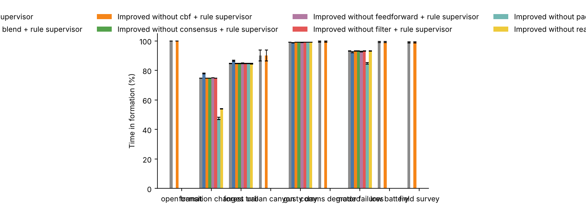
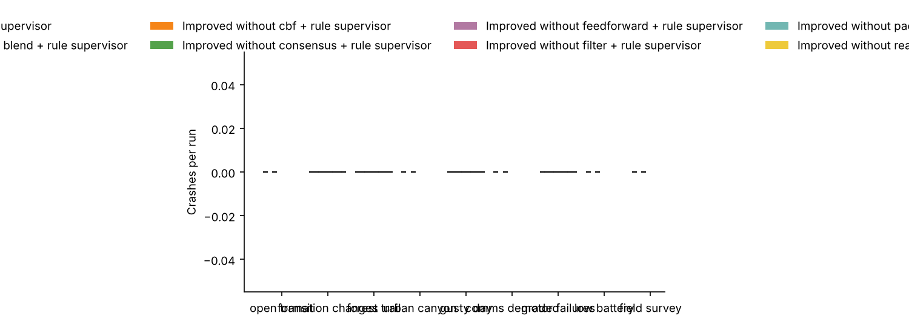
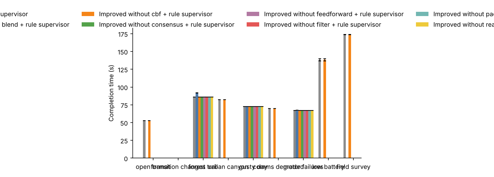
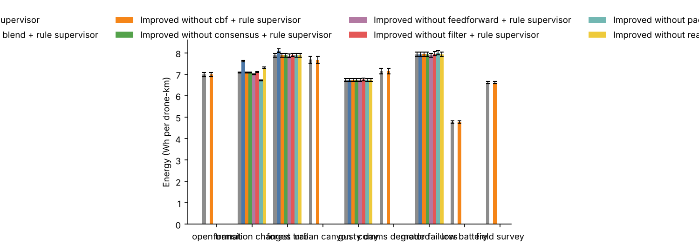

# Benchmark report

Source: `runs.jsonl`, 840 runs, seeds 1000-1019 (20 seeds).

Crashes count drones destroyed by collisions with each other, obstacles or the ground. Completion time and energy average only the runs where the value exists.

## Results by scenario

### open_transit

Mean over 20 seeds, with 95% bootstrap intervals.

| Configuration | Time in formation (%) | Formation error, mean (m) | Crashes per run | Near misses per run | Missions completed (%) | Completion time (s) | Energy (Wh per drone-km) | Drones retired (low battery) | Time faster than planned (%) |
|---|---|---|---|---|---|---|---|---|---|
| Improved + rule supervisor | 100 | 0.41 [0.40, 0.42] | 0.00 | 0.00 | 100 | 53 | 6.99 [6.89, 7.09] | 0.00 | 0 |
| Improved without cbf + rule supervisor | 100 | 0.41 [0.40, 0.42] | 0.00 | 0.00 | 100 | 53 | 6.99 [6.89, 7.09] | 0.00 | 0 |

### formation_changes

Mean over 20 seeds, with 95% bootstrap intervals.

| Configuration | Time in formation (%) | Formation error, mean (m) | Crashes per run | Near misses per run | Missions completed (%) | Completion time (s) | Energy (Wh per drone-km) | Drones retired (low battery) | Time faster than planned (%) |
|---|---|---|---|---|---|---|---|---|---|
| Improved + rule supervisor | 75 | 3.09 [3.09, 3.10] | 0.00 | 0.00 | n/a | n/a | 7.09 [7.07, 7.12] | 0.00 | 0 |
| Improved without blend + rule supervisor | 78 [78, 78] | 2.07 [2.06, 2.08] | 0.00 | 0.00 | n/a | n/a | 7.61 [7.58, 7.65] | 0.00 | 0 |
| Improved without cbf + rule supervisor | 75 | 3.09 [3.09, 3.10] | 0.00 | 0.00 | n/a | n/a | 7.09 [7.07, 7.12] | 0.00 | 0 |
| Improved without consensus + rule supervisor | 75 | 3.09 [3.09, 3.10] | 0.00 | 0.00 | n/a | n/a | 7.09 [7.07, 7.12] | 0.00 | 0 |
| Improved without feedforward + rule supervisor | 75 | 3.19 [3.19, 3.20] | 0.00 | 0.00 | n/a | n/a | 7.00 [6.97, 7.02] | 0.00 | 0 |
| Improved without filter + rule supervisor | 75 | 3.09 [3.09, 3.10] | 0.00 | 0.00 | n/a | n/a | 7.11 [7.08, 7.13] | 0.00 | 0 |
| Improved without pace + rule supervisor | 48 [47, 48] | 4.43 [4.34, 4.52] | 0.00 | 0.00 | n/a | n/a | 6.71 [6.69, 6.73] | 0.00 | 0 |
| Improved without reassign + rule supervisor | 54 | 5.48 [5.47, 5.50] | 0.00 | 0.00 | n/a | n/a | 7.30 [7.27, 7.34] | 0.00 | 0 |

### forest_trail

Mean over 20 seeds, with 95% bootstrap intervals.

| Configuration | Time in formation (%) | Formation error, mean (m) | Crashes per run | Near misses per run | Missions completed (%) | Completion time (s) | Energy (Wh per drone-km) | Drones retired (low battery) | Time faster than planned (%) |
|---|---|---|---|---|---|---|---|---|---|
| Improved + rule supervisor | 85 | 2.28 [2.25, 2.32] | 0.00 | 0.00 | 100 | 86 | 7.89 [7.81, 7.97] | 0.00 | 0 |
| Improved without blend + rule supervisor | 87 [86, 87] | 1.44 [1.42, 1.47] | 0.00 | 0.00 | 100 | 92 [91, 92] | 8.11 [8.02, 8.20] | 0.00 | 0 |
| Improved without cbf + rule supervisor | 85 | 2.28 [2.24, 2.32] | 0.00 | 0.00 | 100 | 86 | 7.89 [7.81, 7.98] | 0.00 | 0 |
| Improved without consensus + rule supervisor | 85 [84, 85] | 2.28 [2.24, 2.32] | 0.00 | 0.00 | 100 | 86 | 7.89 [7.81, 7.97] | 0.00 | 0 |
| Improved without feedforward + rule supervisor | 85 [84, 85] | 2.31 [2.28, 2.35] | 0.00 | 0.00 | 100 | 86 | 7.87 [7.78, 7.95] | 0.00 | 0 |
| Improved without filter + rule supervisor | 85 | 2.28 [2.25, 2.32] | 0.00 | 0.00 | 100 | 86 | 7.90 [7.82, 7.99] | 0.00 | 0 |
| Improved without pace + rule supervisor | 85 | 2.28 [2.25, 2.32] | 0.00 | 0.00 | 100 | 86 | 7.89 [7.80, 7.97] | 0.00 | 0 |
| Improved without reassign + rule supervisor | 85 [84, 85] | 2.29 [2.26, 2.33] | 0.00 | 0.00 | 100 | 86 | 7.89 [7.81, 7.98] | 0.00 | 0 |

### urban_canyon

Mean over 20 seeds, with 95% bootstrap intervals.

| Configuration | Time in formation (%) | Formation error, mean (m) | Crashes per run | Near misses per run | Missions completed (%) | Completion time (s) | Energy (Wh per drone-km) | Drones retired (low battery) | Time faster than planned (%) |
|---|---|---|---|---|---|---|---|---|---|
| Improved + rule supervisor | 90 [86, 94] | 1.45 [0.95, 1.98] | 0.00 | 0.00 | 100 | 82 | 7.68 [7.53, 7.85] | 0.00 | 0 |
| Improved without cbf + rule supervisor | 90 [86, 94] | 1.44 [0.96, 1.96] | 0.00 | 0.00 | 100 | 82 | 7.67 [7.52, 7.84] | 0.00 | 0 |

### gusty_day

Mean over 20 seeds, with 95% bootstrap intervals.

| Configuration | Time in formation (%) | Formation error, mean (m) | Crashes per run | Near misses per run | Missions completed (%) | Completion time (s) | Energy (Wh per drone-km) | Drones retired (low battery) | Time faster than planned (%) |
|---|---|---|---|---|---|---|---|---|---|
| Improved + rule supervisor | 99 | 0.44 [0.43, 0.45] | 0.00 | 0.00 | 100 | 73 | 6.75 [6.68, 6.81] | 0.00 | 0 |
| Improved without blend + rule supervisor | 99 | 0.44 [0.43, 0.45] | 0.00 | 0.00 | 100 | 73 | 6.74 [6.68, 6.80] | 0.00 | 0 |
| Improved without cbf + rule supervisor | 99 | 0.44 [0.43, 0.45] | 0.00 | 0.00 | 100 | 73 | 6.75 [6.68, 6.81] | 0.00 | 0 |
| Improved without consensus + rule supervisor | 99 | 0.44 [0.43, 0.45] | 0.00 | 0.00 | 100 | 73 | 6.75 [6.68, 6.81] | 0.00 | 0 |
| Improved without feedforward + rule supervisor | 99 | 0.44 [0.43, 0.45] | 0.00 | 0.00 | 100 | 73 | 6.73 [6.67, 6.79] | 0.00 | 0 |
| Improved without filter + rule supervisor | 99 | 0.44 [0.43, 0.45] | 0.00 | 0.00 | 100 | 73 | 6.76 [6.69, 6.82] | 0.00 | 0 |
| Improved without pace + rule supervisor | 99 | 0.44 [0.43, 0.45] | 0.00 | 0.00 | 100 | 73 | 6.75 [6.68, 6.81] | 0.00 | 0 |
| Improved without reassign + rule supervisor | 99 | 0.44 [0.43, 0.45] | 0.00 | 0.00 | 100 | 73 | 6.75 [6.68, 6.81] | 0.00 | 0 |

### comms_degraded

Mean over 20 seeds, with 95% bootstrap intervals.

| Configuration | Time in formation (%) | Formation error, mean (m) | Crashes per run | Near misses per run | Missions completed (%) | Completion time (s) | Energy (Wh per drone-km) | Drones retired (low battery) | Time faster than planned (%) |
|---|---|---|---|---|---|---|---|---|---|
| Improved + rule supervisor | 100 [99, 100] | 0.42 [0.41, 0.43] | 0.00 | 0.00 | 100 | 70 | 7.15 [7.02, 7.28] | 0.00 | 0 |
| Improved without cbf + rule supervisor | 100 [99, 100] | 0.42 [0.41, 0.43] | 0.00 | 0.00 | 100 | 70 | 7.15 [7.02, 7.28] | 0.00 | 0 |

### motor_failures

Mean over 20 seeds, with 95% bootstrap intervals.

| Configuration | Time in formation (%) | Formation error, mean (m) | Crashes per run | Near misses per run | Missions completed (%) | Completion time (s) | Energy (Wh per drone-km) | Drones retired (low battery) | Time faster than planned (%) |
|---|---|---|---|---|---|---|---|---|---|
| Improved + rule supervisor | 93 | 0.52 [0.50, 0.53] | 0.00 | 0.00 | 100 | 67 | 7.94 [7.85, 8.04] | 0.00 | 0 |
| Improved without blend + rule supervisor | 92 [92, 93] | 0.53 [0.51, 0.54] | 0.00 | 0.00 | 100 | 67 | 7.94 [7.85, 8.04] | 0.00 | 0 |
| Improved without cbf + rule supervisor | 93 | 0.52 [0.50, 0.53] | 0.00 | 0.00 | 100 | 67 | 7.95 [7.85, 8.05] | 0.00 | 0 |
| Improved without consensus + rule supervisor | 93 | 0.52 [0.50, 0.53] | 0.00 | 0.00 | 100 | 67 | 7.94 [7.85, 8.04] | 0.00 | 0 |
| Improved without feedforward + rule supervisor | 93 | 0.53 [0.52, 0.54] | 0.00 | 0.00 | 100 | 67 | 7.88 [7.79, 7.98] | 0.00 | 0 |
| Improved without filter + rule supervisor | 93 | 0.52 [0.50, 0.53] | 0.00 | 0.00 | 100 | 67 | 7.95 [7.86, 8.05] | 0.00 | 0 |
| Improved without pace + rule supervisor | 85 [84, 85] | 0.64 [0.62, 0.65] | 0.00 | 0.00 | 100 | 67 | 8.00 [7.92, 8.10] | 0.00 | 0 |
| Improved without reassign + rule supervisor | 93 | 0.52 [0.51, 0.53] | 0.00 | 0.00 | 100 | 67 | 7.94 [7.85, 8.04] | 0.00 | 0 |

### low_battery

Mean over 20 seeds, with 95% bootstrap intervals.

| Configuration | Time in formation (%) | Formation error, mean (m) | Crashes per run | Near misses per run | Missions completed (%) | Completion time (s) | Energy (Wh per drone-km) | Drones retired (low battery) | Time faster than planned (%) |
|---|---|---|---|---|---|---|---|---|---|
| Improved + rule supervisor | 99 [99, 100] | 0.42 [0.41, 0.43] | 0.00 | 0.00 | 100 | 138 [137, 140] | 4.77 [4.72, 4.83] | 0.65 [0.30, 1.00] | 55 [53, 57] |
| Improved without cbf + rule supervisor | 99 [99, 100] | 0.42 [0.41, 0.43] | 0.00 | 0.00 | 100 | 138 [137, 140] | 4.77 [4.72, 4.82] | 0.65 [0.30, 1.00] | 55 [53, 57] |

### field_survey

Mean over 20 seeds, with 95% bootstrap intervals.

| Configuration | Time in formation (%) | Formation error, mean (m) | Crashes per run | Near misses per run | Missions completed (%) | Completion time (s) | Energy (Wh per drone-km) | Drones retired (low battery) | Time faster than planned (%) |
|---|---|---|---|---|---|---|---|---|---|
| Improved + rule supervisor | 99 [99, 99] | 0.44 [0.43, 0.46] | 0.00 | 0.00 | 100 | 174 [174, 174] | 6.61 [6.55, 6.66] | 0.00 | 0 |
| Improved without cbf + rule supervisor | 99 [99, 99] | 0.44 [0.43, 0.46] | 0.00 | 0.00 | 100 | 174 [174, 174] | 6.61 [6.56, 6.66] | 0.00 | 0 |

## Which scenarios separate the configurations

A difference counts when the 95% bootstrap interval of the seed-by-seed difference excludes zero and, except for crashes and completions, the mean difference is more than 1% of the baseline.

* **open_transit**: no comparison differs beyond noise on the main metrics.
* **formation_changes**:
  * Improved without blend + rule supervisor vs Improved + rule supervisor: better on Time in formation (%) 74.78 → 77.97; worse on Energy (Wh per drone-km) 7.094 → 7.612
  * Improved without feedforward + rule supervisor vs Improved + rule supervisor: better on Energy (Wh per drone-km) 7.094 → 6.999
  * Improved without pace + rule supervisor vs Improved + rule supervisor: better on Energy (Wh per drone-km) 7.094 → 6.71; worse on Time in formation (%) 74.78 → 47.57
  * Improved without reassign + rule supervisor vs Improved + rule supervisor: worse on Time in formation (%) 74.78 → 53.98, Energy (Wh per drone-km) 7.094 → 7.305
* **forest_trail**:
  * Improved without blend + rule supervisor vs Improved + rule supervisor: better on Time in formation (%) 84.67 → 86.61; worse on Completion time (s) 86.18 → 91.67, Energy (Wh per drone-km) 7.889 → 8.11
* **urban_canyon**: no comparison differs beyond noise on the main metrics.
* **gusty_day**: no comparison differs beyond noise on the main metrics.
* **comms_degraded**: no comparison differs beyond noise on the main metrics.
* **motor_failures**:
  * Improved without pace + rule supervisor vs Improved + rule supervisor: worse on Time in formation (%) 93.14 → 84.85
* **low_battery**: no comparison differs beyond noise on the main metrics.
* **field_survey**: no comparison differs beyond noise on the main metrics.

## Paired comparisons (same seeds)

| Scenario | Comparison | Metric | A | B | B - A [95% CI] | B better / tie / worse |
|---|---|---|---|---|---|---|
| open_transit | Improved without cbf + rule supervisor vs Improved + rule supervisor | Time in formation (%) | 100.00 | 100.00 | +0.00 [+0.00, +0.00] | 0 / 20 / 0 |
| open_transit | Improved without cbf + rule supervisor vs Improved + rule supervisor | Crashes per run | 0.00 | 0.00 | +0.00 [+0.00, +0.00] | 0 / 20 / 0 |
| open_transit | Improved without cbf + rule supervisor vs Improved + rule supervisor | Completion time (s) | 52.66 | 52.66 | +0.00 [+0.00, +0.00] | 0 / 20 / 0 |
| open_transit | Improved without cbf + rule supervisor vs Improved + rule supervisor | Energy (Wh per drone-km) | 6.99 | 6.99 | +0.00 [+0.00, +0.00] | 0 / 20 / 0 |
| formation_changes | Improved without blend + rule supervisor vs Improved + rule supervisor | Time in formation (%) | 74.78 | 77.97 | +3.19 [+2.93, +3.45] | 20 / 0 / 0 |
| formation_changes | Improved without blend + rule supervisor vs Improved + rule supervisor | Crashes per run | 0.00 | 0.00 | +0.00 [+0.00, +0.00] | 0 / 20 / 0 |
| formation_changes | Improved without blend + rule supervisor vs Improved + rule supervisor | Energy (Wh per drone-km) | 7.09 | 7.61 | +0.52 [+0.49, +0.55] | 0 / 0 / 20 |
| formation_changes | Improved without cbf + rule supervisor vs Improved + rule supervisor | Time in formation (%) | 74.78 | 74.78 | +0.00 [+0.00, +0.00] | 0 / 20 / 0 |
| formation_changes | Improved without cbf + rule supervisor vs Improved + rule supervisor | Crashes per run | 0.00 | 0.00 | +0.00 [+0.00, +0.00] | 0 / 20 / 0 |
| formation_changes | Improved without cbf + rule supervisor vs Improved + rule supervisor | Energy (Wh per drone-km) | 7.09 | 7.09 | +0.00 [+0.00, +0.00] | 0 / 20 / 0 |
| formation_changes | Improved without consensus + rule supervisor vs Improved + rule supervisor | Time in formation (%) | 74.78 | 74.78 | +0.00 [-0.03, +0.03] | 0 / 20 / 0 |
| formation_changes | Improved without consensus + rule supervisor vs Improved + rule supervisor | Crashes per run | 0.00 | 0.00 | +0.00 [+0.00, +0.00] | 0 / 20 / 0 |
| formation_changes | Improved without consensus + rule supervisor vs Improved + rule supervisor | Energy (Wh per drone-km) | 7.09 | 7.09 | -0.00 [-0.00, -0.00] | 0 / 20 / 0 |
| formation_changes | Improved without feedforward + rule supervisor vs Improved + rule supervisor | Time in formation (%) | 74.78 | 75.00 | +0.22 [+0.18, +0.26] | 0 / 20 / 0 |
| formation_changes | Improved without feedforward + rule supervisor vs Improved + rule supervisor | Crashes per run | 0.00 | 0.00 | +0.00 [+0.00, +0.00] | 0 / 20 / 0 |
| formation_changes | Improved without feedforward + rule supervisor vs Improved + rule supervisor | Energy (Wh per drone-km) | 7.09 | 7.00 | -0.10 [-0.10, -0.09] | 20 / 0 / 0 |
| formation_changes | Improved without filter + rule supervisor vs Improved + rule supervisor | Time in formation (%) | 74.78 | 74.78 | -0.01 [-0.03, +0.01] | 0 / 20 / 0 |
| formation_changes | Improved without filter + rule supervisor vs Improved + rule supervisor | Crashes per run | 0.00 | 0.00 | +0.00 [+0.00, +0.00] | 0 / 20 / 0 |
| formation_changes | Improved without filter + rule supervisor vs Improved + rule supervisor | Energy (Wh per drone-km) | 7.09 | 7.11 | +0.01 [+0.01, +0.02] | 0 / 20 / 0 |
| formation_changes | Improved without pace + rule supervisor vs Improved + rule supervisor | Time in formation (%) | 74.78 | 47.57 | -27.21 [-28.00, -26.44] | 0 / 0 / 20 |
| formation_changes | Improved without pace + rule supervisor vs Improved + rule supervisor | Crashes per run | 0.00 | 0.00 | +0.00 [+0.00, +0.00] | 0 / 20 / 0 |
| formation_changes | Improved without pace + rule supervisor vs Improved + rule supervisor | Energy (Wh per drone-km) | 7.09 | 6.71 | -0.38 [-0.41, -0.35] | 20 / 0 / 0 |
| formation_changes | Improved without reassign + rule supervisor vs Improved + rule supervisor | Time in formation (%) | 74.78 | 53.98 | -20.81 [-20.93, -20.68] | 0 / 0 / 20 |
| formation_changes | Improved without reassign + rule supervisor vs Improved + rule supervisor | Crashes per run | 0.00 | 0.00 | +0.00 [+0.00, +0.00] | 0 / 20 / 0 |
| formation_changes | Improved without reassign + rule supervisor vs Improved + rule supervisor | Energy (Wh per drone-km) | 7.09 | 7.30 | +0.21 [+0.19, +0.24] | 0 / 0 / 20 |
| forest_trail | Improved without blend + rule supervisor vs Improved + rule supervisor | Time in formation (%) | 84.67 | 86.61 | +1.95 [+1.71, +2.19] | 20 / 0 / 0 |
| forest_trail | Improved without blend + rule supervisor vs Improved + rule supervisor | Crashes per run | 0.00 | 0.00 | +0.00 [+0.00, +0.00] | 0 / 20 / 0 |
| forest_trail | Improved without blend + rule supervisor vs Improved + rule supervisor | Completion time (s) | 86.18 | 91.67 | +5.50 [+5.26, +5.75] | 0 / 0 / 20 |
| forest_trail | Improved without blend + rule supervisor vs Improved + rule supervisor | Energy (Wh per drone-km) | 7.89 | 8.11 | +0.22 [+0.21, +0.23] | 0 / 0 / 20 |
| forest_trail | Improved without cbf + rule supervisor vs Improved + rule supervisor | Time in formation (%) | 84.67 | 84.70 | +0.03 [+0.01, +0.05] | 0 / 20 / 0 |
| forest_trail | Improved without cbf + rule supervisor vs Improved + rule supervisor | Crashes per run | 0.00 | 0.00 | +0.00 [+0.00, +0.00] | 0 / 20 / 0 |
| forest_trail | Improved without cbf + rule supervisor vs Improved + rule supervisor | Completion time (s) | 86.18 | 86.17 | -0.00 [-0.01, +0.00] | 0 / 20 / 0 |
| forest_trail | Improved without cbf + rule supervisor vs Improved + rule supervisor | Energy (Wh per drone-km) | 7.89 | 7.89 | +0.00 [-0.00, +0.00] | 0 / 20 / 0 |
| forest_trail | Improved without consensus + rule supervisor vs Improved + rule supervisor | Time in formation (%) | 84.67 | 84.67 | +0.01 [-0.03, +0.05] | 0 / 20 / 0 |
| forest_trail | Improved without consensus + rule supervisor vs Improved + rule supervisor | Crashes per run | 0.00 | 0.00 | +0.00 [+0.00, +0.00] | 0 / 20 / 0 |
| forest_trail | Improved without consensus + rule supervisor vs Improved + rule supervisor | Completion time (s) | 86.18 | 86.18 | +0.00 [+0.00, +0.00] | 0 / 20 / 0 |
| forest_trail | Improved without consensus + rule supervisor vs Improved + rule supervisor | Energy (Wh per drone-km) | 7.89 | 7.89 | -0.00 [-0.00, -0.00] | 0 / 20 / 0 |
| forest_trail | Improved without feedforward + rule supervisor vs Improved + rule supervisor | Time in formation (%) | 84.67 | 84.76 | +0.10 [-0.06, +0.23] | 0 / 20 / 0 |
| forest_trail | Improved without feedforward + rule supervisor vs Improved + rule supervisor | Crashes per run | 0.00 | 0.00 | +0.00 [+0.00, +0.00] | 0 / 20 / 0 |
| forest_trail | Improved without feedforward + rule supervisor vs Improved + rule supervisor | Completion time (s) | 86.18 | 86.19 | +0.01 [+0.00, +0.02] | 0 / 20 / 0 |
| forest_trail | Improved without feedforward + rule supervisor vs Improved + rule supervisor | Energy (Wh per drone-km) | 7.89 | 7.87 | -0.02 [-0.03, -0.02] | 0 / 20 / 0 |
| forest_trail | Improved without filter + rule supervisor vs Improved + rule supervisor | Time in formation (%) | 84.67 | 84.68 | +0.02 [-0.01, +0.05] | 0 / 20 / 0 |
| forest_trail | Improved without filter + rule supervisor vs Improved + rule supervisor | Crashes per run | 0.00 | 0.00 | +0.00 [+0.00, +0.00] | 0 / 20 / 0 |
| forest_trail | Improved without filter + rule supervisor vs Improved + rule supervisor | Completion time (s) | 86.18 | 86.18 | +0.00 [+0.00, +0.00] | 0 / 20 / 0 |
| forest_trail | Improved without filter + rule supervisor vs Improved + rule supervisor | Energy (Wh per drone-km) | 7.89 | 7.90 | +0.01 [+0.01, +0.01] | 0 / 20 / 0 |
| forest_trail | Improved without pace + rule supervisor vs Improved + rule supervisor | Time in formation (%) | 84.67 | 84.67 | +0.00 [+0.00, +0.00] | 0 / 20 / 0 |
| forest_trail | Improved without pace + rule supervisor vs Improved + rule supervisor | Crashes per run | 0.00 | 0.00 | +0.00 [+0.00, +0.00] | 0 / 20 / 0 |
| forest_trail | Improved without pace + rule supervisor vs Improved + rule supervisor | Completion time (s) | 86.18 | 86.16 | -0.02 [-0.03, -0.00] | 0 / 20 / 0 |
| forest_trail | Improved without pace + rule supervisor vs Improved + rule supervisor | Energy (Wh per drone-km) | 7.89 | 7.89 | -0.00 [-0.00, -0.00] | 0 / 20 / 0 |
| forest_trail | Improved without reassign + rule supervisor vs Improved + rule supervisor | Time in formation (%) | 84.67 | 84.59 | -0.08 [-0.12, -0.03] | 0 / 20 / 0 |
| forest_trail | Improved without reassign + rule supervisor vs Improved + rule supervisor | Crashes per run | 0.00 | 0.00 | +0.00 [+0.00, +0.00] | 0 / 20 / 0 |
| forest_trail | Improved without reassign + rule supervisor vs Improved + rule supervisor | Completion time (s) | 86.18 | 86.18 | +0.00 [+0.00, +0.00] | 0 / 20 / 0 |
| forest_trail | Improved without reassign + rule supervisor vs Improved + rule supervisor | Energy (Wh per drone-km) | 7.89 | 7.89 | +0.00 [+0.00, +0.00] | 0 / 20 / 0 |
| urban_canyon | Improved without cbf + rule supervisor vs Improved + rule supervisor | Time in formation (%) | 90.17 | 90.20 | +0.02 [+0.00, +0.05] | 0 / 20 / 0 |
| urban_canyon | Improved without cbf + rule supervisor vs Improved + rule supervisor | Crashes per run | 0.00 | 0.00 | +0.00 [+0.00, +0.00] | 0 / 20 / 0 |
| urban_canyon | Improved without cbf + rule supervisor vs Improved + rule supervisor | Completion time (s) | 82.18 | 82.17 | -0.01 [-0.03, +0.00] | 0 / 20 / 0 |
| urban_canyon | Improved without cbf + rule supervisor vs Improved + rule supervisor | Energy (Wh per drone-km) | 7.68 | 7.67 | -0.01 [-0.02, -0.01] | 0 / 20 / 0 |
| gusty_day | Improved without blend + rule supervisor vs Improved + rule supervisor | Time in formation (%) | 99.06 | 98.72 | -0.34 [-0.36, -0.31] | 0 / 20 / 0 |
| gusty_day | Improved without blend + rule supervisor vs Improved + rule supervisor | Crashes per run | 0.00 | 0.00 | +0.00 [+0.00, +0.00] | 0 / 20 / 0 |
| gusty_day | Improved without blend + rule supervisor vs Improved + rule supervisor | Completion time (s) | 72.66 | 72.80 | +0.14 [+0.14, +0.15] | 0 / 20 / 0 |
| gusty_day | Improved without blend + rule supervisor vs Improved + rule supervisor | Energy (Wh per drone-km) | 6.75 | 6.74 | -0.00 [-0.00, -0.00] | 0 / 20 / 0 |
| gusty_day | Improved without cbf + rule supervisor vs Improved + rule supervisor | Time in formation (%) | 99.06 | 99.05 | -0.01 [-0.03, +0.00] | 0 / 20 / 0 |
| gusty_day | Improved without cbf + rule supervisor vs Improved + rule supervisor | Crashes per run | 0.00 | 0.00 | +0.00 [+0.00, +0.00] | 0 / 20 / 0 |
| gusty_day | Improved without cbf + rule supervisor vs Improved + rule supervisor | Completion time (s) | 72.66 | 72.66 | +0.00 [+0.00, +0.00] | 0 / 20 / 0 |
| gusty_day | Improved without cbf + rule supervisor vs Improved + rule supervisor | Energy (Wh per drone-km) | 6.75 | 6.75 | -0.00 [-0.00, +0.00] | 0 / 20 / 0 |
| gusty_day | Improved without consensus + rule supervisor vs Improved + rule supervisor | Time in formation (%) | 99.06 | 99.05 | -0.01 [-0.03, +0.00] | 0 / 20 / 0 |
| gusty_day | Improved without consensus + rule supervisor vs Improved + rule supervisor | Crashes per run | 0.00 | 0.00 | +0.00 [+0.00, +0.00] | 0 / 20 / 0 |
| gusty_day | Improved without consensus + rule supervisor vs Improved + rule supervisor | Completion time (s) | 72.66 | 72.66 | +0.00 [+0.00, +0.00] | 0 / 20 / 0 |
| gusty_day | Improved without consensus + rule supervisor vs Improved + rule supervisor | Energy (Wh per drone-km) | 6.75 | 6.75 | -0.00 [-0.00, -0.00] | 0 / 20 / 0 |
| gusty_day | Improved without feedforward + rule supervisor vs Improved + rule supervisor | Time in formation (%) | 99.06 | 98.95 | -0.10 [-0.12, -0.08] | 0 / 20 / 0 |
| gusty_day | Improved without feedforward + rule supervisor vs Improved + rule supervisor | Crashes per run | 0.00 | 0.00 | +0.00 [+0.00, +0.00] | 0 / 20 / 0 |
| gusty_day | Improved without feedforward + rule supervisor vs Improved + rule supervisor | Completion time (s) | 72.66 | 72.66 | +0.00 [+0.00, +0.00] | 0 / 20 / 0 |
| gusty_day | Improved without feedforward + rule supervisor vs Improved + rule supervisor | Energy (Wh per drone-km) | 6.75 | 6.73 | -0.01 [-0.01, -0.01] | 0 / 20 / 0 |
| gusty_day | Improved without filter + rule supervisor vs Improved + rule supervisor | Time in formation (%) | 99.06 | 99.05 | -0.00 [-0.01, +0.00] | 0 / 20 / 0 |
| gusty_day | Improved without filter + rule supervisor vs Improved + rule supervisor | Crashes per run | 0.00 | 0.00 | +0.00 [+0.00, +0.00] | 0 / 20 / 0 |
| gusty_day | Improved without filter + rule supervisor vs Improved + rule supervisor | Completion time (s) | 72.66 | 72.66 | +0.00 [+0.00, +0.00] | 0 / 20 / 0 |
| gusty_day | Improved without filter + rule supervisor vs Improved + rule supervisor | Energy (Wh per drone-km) | 6.75 | 6.76 | +0.01 [+0.01, +0.01] | 0 / 20 / 0 |
| gusty_day | Improved without pace + rule supervisor vs Improved + rule supervisor | Time in formation (%) | 99.06 | 99.06 | +0.00 [+0.00, +0.00] | 0 / 20 / 0 |
| gusty_day | Improved without pace + rule supervisor vs Improved + rule supervisor | Crashes per run | 0.00 | 0.00 | +0.00 [+0.00, +0.00] | 0 / 20 / 0 |
| gusty_day | Improved without pace + rule supervisor vs Improved + rule supervisor | Completion time (s) | 72.66 | 72.66 | +0.00 [+0.00, +0.00] | 0 / 20 / 0 |
| gusty_day | Improved without pace + rule supervisor vs Improved + rule supervisor | Energy (Wh per drone-km) | 6.75 | 6.75 | +0.00 [+0.00, +0.00] | 0 / 20 / 0 |
| gusty_day | Improved without reassign + rule supervisor vs Improved + rule supervisor | Time in formation (%) | 99.06 | 99.06 | +0.00 [+0.00, +0.00] | 0 / 20 / 0 |
| gusty_day | Improved without reassign + rule supervisor vs Improved + rule supervisor | Crashes per run | 0.00 | 0.00 | +0.00 [+0.00, +0.00] | 0 / 20 / 0 |
| gusty_day | Improved without reassign + rule supervisor vs Improved + rule supervisor | Completion time (s) | 72.66 | 72.66 | +0.00 [+0.00, +0.00] | 0 / 20 / 0 |
| gusty_day | Improved without reassign + rule supervisor vs Improved + rule supervisor | Energy (Wh per drone-km) | 6.75 | 6.75 | +0.00 [+0.00, +0.00] | 0 / 20 / 0 |
| comms_degraded | Improved without cbf + rule supervisor vs Improved + rule supervisor | Time in formation (%) | 99.56 | 99.58 | +0.02 [+0.00, +0.04] | 0 / 20 / 0 |
| comms_degraded | Improved without cbf + rule supervisor vs Improved + rule supervisor | Crashes per run | 0.00 | 0.00 | +0.00 [+0.00, +0.00] | 0 / 20 / 0 |
| comms_degraded | Improved without cbf + rule supervisor vs Improved + rule supervisor | Completion time (s) | 69.85 | 69.85 | +0.00 [+0.00, +0.00] | 0 / 20 / 0 |
| comms_degraded | Improved without cbf + rule supervisor vs Improved + rule supervisor | Energy (Wh per drone-km) | 7.15 | 7.15 | +0.00 [-0.00, +0.00] | 0 / 20 / 0 |
| motor_failures | Improved without blend + rule supervisor vs Improved + rule supervisor | Time in formation (%) | 93.14 | 92.34 | -0.80 [-0.91, -0.68] | 0 / 15 / 5 |
| motor_failures | Improved without blend + rule supervisor vs Improved + rule supervisor | Crashes per run | 0.00 | 0.00 | +0.00 [+0.00, +0.00] | 0 / 20 / 0 |
| motor_failures | Improved without blend + rule supervisor vs Improved + rule supervisor | Completion time (s) | 67.04 | 67.42 | +0.38 [+0.33, +0.43] | 0 / 20 / 0 |
| motor_failures | Improved without blend + rule supervisor vs Improved + rule supervisor | Energy (Wh per drone-km) | 7.94 | 7.94 | -0.00 [-0.01, +0.00] | 0 / 20 / 0 |
| motor_failures | Improved without cbf + rule supervisor vs Improved + rule supervisor | Time in formation (%) | 93.14 | 93.17 | +0.03 [+0.01, +0.05] | 0 / 20 / 0 |
| motor_failures | Improved without cbf + rule supervisor vs Improved + rule supervisor | Crashes per run | 0.00 | 0.00 | +0.00 [+0.00, +0.00] | 0 / 20 / 0 |
| motor_failures | Improved without cbf + rule supervisor vs Improved + rule supervisor | Completion time (s) | 67.04 | 67.04 | +0.00 [+0.00, +0.00] | 0 / 20 / 0 |
| motor_failures | Improved without cbf + rule supervisor vs Improved + rule supervisor | Energy (Wh per drone-km) | 7.94 | 7.95 | +0.00 [+0.00, +0.00] | 0 / 20 / 0 |
| motor_failures | Improved without consensus + rule supervisor vs Improved + rule supervisor | Time in formation (%) | 93.14 | 93.13 | -0.01 [-0.02, +0.00] | 0 / 20 / 0 |
| motor_failures | Improved without consensus + rule supervisor vs Improved + rule supervisor | Crashes per run | 0.00 | 0.00 | +0.00 [+0.00, +0.00] | 0 / 20 / 0 |
| motor_failures | Improved without consensus + rule supervisor vs Improved + rule supervisor | Completion time (s) | 67.04 | 67.04 | +0.00 [+0.00, +0.00] | 0 / 20 / 0 |
| motor_failures | Improved without consensus + rule supervisor vs Improved + rule supervisor | Energy (Wh per drone-km) | 7.94 | 7.94 | -0.00 [-0.00, -0.00] | 0 / 20 / 0 |
| motor_failures | Improved without feedforward + rule supervisor vs Improved + rule supervisor | Time in formation (%) | 93.14 | 92.78 | -0.36 [-0.42, -0.31] | 0 / 20 / 0 |
| motor_failures | Improved without feedforward + rule supervisor vs Improved + rule supervisor | Crashes per run | 0.00 | 0.00 | +0.00 [+0.00, +0.00] | 0 / 20 / 0 |
| motor_failures | Improved without feedforward + rule supervisor vs Improved + rule supervisor | Completion time (s) | 67.04 | 67.05 | +0.01 [+0.00, +0.01] | 0 / 20 / 0 |
| motor_failures | Improved without feedforward + rule supervisor vs Improved + rule supervisor | Energy (Wh per drone-km) | 7.94 | 7.88 | -0.06 [-0.06, -0.06] | 0 / 20 / 0 |
| motor_failures | Improved without filter + rule supervisor vs Improved + rule supervisor | Time in formation (%) | 93.14 | 93.14 | -0.01 [-0.03, +0.01] | 0 / 20 / 0 |
| motor_failures | Improved without filter + rule supervisor vs Improved + rule supervisor | Crashes per run | 0.00 | 0.00 | +0.00 [+0.00, +0.00] | 0 / 20 / 0 |
| motor_failures | Improved without filter + rule supervisor vs Improved + rule supervisor | Completion time (s) | 67.04 | 67.04 | +0.00 [+0.00, +0.00] | 0 / 20 / 0 |
| motor_failures | Improved without filter + rule supervisor vs Improved + rule supervisor | Energy (Wh per drone-km) | 7.94 | 7.95 | +0.01 [+0.01, +0.01] | 0 / 20 / 0 |
| motor_failures | Improved without pace + rule supervisor vs Improved + rule supervisor | Time in formation (%) | 93.14 | 84.85 | -8.29 [-8.86, -7.74] | 0 / 0 / 20 |
| motor_failures | Improved without pace + rule supervisor vs Improved + rule supervisor | Crashes per run | 0.00 | 0.00 | +0.00 [+0.00, +0.00] | 0 / 20 / 0 |
| motor_failures | Improved without pace + rule supervisor vs Improved + rule supervisor | Completion time (s) | 67.04 | 67.04 | +0.00 [+0.00, +0.00] | 0 / 20 / 0 |
| motor_failures | Improved without pace + rule supervisor vs Improved + rule supervisor | Energy (Wh per drone-km) | 7.94 | 8.00 | +0.06 [+0.05, +0.07] | 0 / 15 / 5 |
| motor_failures | Improved without reassign + rule supervisor vs Improved + rule supervisor | Time in formation (%) | 93.14 | 93.08 | -0.06 [-0.17, +0.00] | 0 / 19 / 1 |
| motor_failures | Improved without reassign + rule supervisor vs Improved + rule supervisor | Crashes per run | 0.00 | 0.00 | +0.00 [+0.00, +0.00] | 0 / 20 / 0 |
| motor_failures | Improved without reassign + rule supervisor vs Improved + rule supervisor | Completion time (s) | 67.04 | 67.04 | +0.00 [+0.00, +0.00] | 0 / 20 / 0 |
| motor_failures | Improved without reassign + rule supervisor vs Improved + rule supervisor | Energy (Wh per drone-km) | 7.94 | 7.94 | -0.00 [-0.01, +0.00] | 0 / 20 / 0 |
| low_battery | Improved without cbf + rule supervisor vs Improved + rule supervisor | Time in formation (%) | 99.23 | 99.23 | +0.01 [-0.01, +0.02] | 0 / 20 / 0 |
| low_battery | Improved without cbf + rule supervisor vs Improved + rule supervisor | Crashes per run | 0.00 | 0.00 | +0.00 [+0.00, +0.00] | 0 / 20 / 0 |
| low_battery | Improved without cbf + rule supervisor vs Improved + rule supervisor | Completion time (s) | 138.35 | 138.35 | +0.00 [+0.00, +0.00] | 0 / 20 / 0 |
| low_battery | Improved without cbf + rule supervisor vs Improved + rule supervisor | Energy (Wh per drone-km) | 4.77 | 4.77 | +0.00 [+0.00, +0.00] | 0 / 20 / 0 |
| field_survey | Improved without cbf + rule supervisor vs Improved + rule supervisor | Time in formation (%) | 99.03 | 99.03 | +0.00 [+0.00, +0.00] | 0 / 20 / 0 |
| field_survey | Improved without cbf + rule supervisor vs Improved + rule supervisor | Crashes per run | 0.00 | 0.00 | +0.00 [+0.00, +0.00] | 0 / 20 / 0 |
| field_survey | Improved without cbf + rule supervisor vs Improved + rule supervisor | Completion time (s) | 173.85 | 173.85 | +0.00 [+0.00, +0.00] | 0 / 20 / 0 |
| field_survey | Improved without cbf + rule supervisor vs Improved + rule supervisor | Energy (Wh per drone-km) | 6.61 | 6.61 | +0.00 [+0.00, +0.00] | 0 / 20 / 0 |
