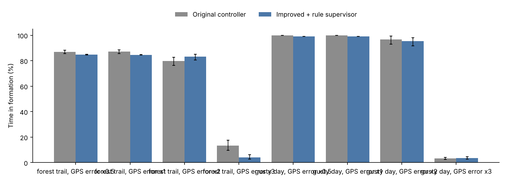
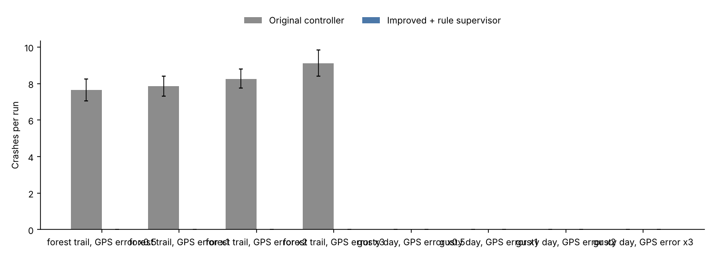
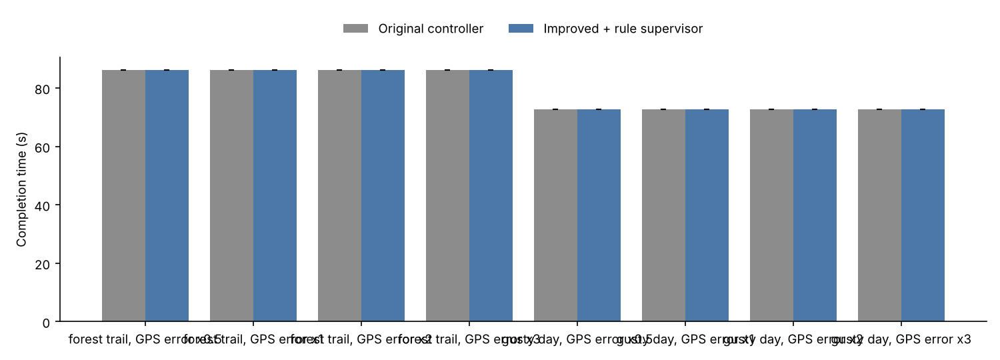
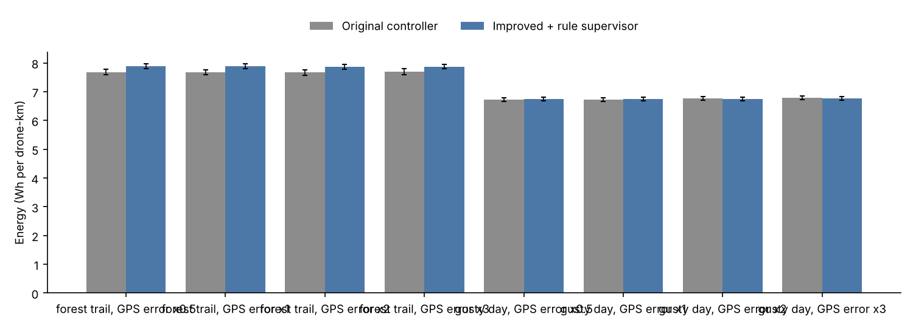

# Benchmark report

Source: `runs.jsonl`, 320 runs, seeds 1000-1019 (20 seeds).

Crashes count drones destroyed by collisions with each other, obstacles or the ground. Completion time and energy average only the runs where the value exists.

## Results by scenario

### forest_trail, GPS error x0.5

Mean over 20 seeds, with 95% bootstrap intervals.

| Configuration | Time in formation (%) | Formation error, mean (m) | Crashes per run | Near misses per run | Missions completed (%) | Completion time (s) | Energy (Wh per drone-km) | Drones retired (low battery) | Time faster than planned (%) |
|---|---|---|---|---|---|---|---|---|---|
| Original controller | 87 [86, 88] | 0.57 [0.54, 0.59] | 7.65 [7.05, 8.25] | 0.80 [0.50, 1.15] | 100 | 86 | 7.68 [7.60, 7.77] | 0.00 | 0 |
| Improved + rule supervisor | 85 [85, 85] | 2.11 [2.08, 2.15] | 0.00 | 0.00 | 100 | 86 | 7.89 [7.81, 7.98] | 0.00 | 0 |

### forest_trail, GPS error x1

Mean over 20 seeds, with 95% bootstrap intervals.

| Configuration | Time in formation (%) | Formation error, mean (m) | Crashes per run | Near misses per run | Missions completed (%) | Completion time (s) | Energy (Wh per drone-km) | Drones retired (low battery) | Time faster than planned (%) |
|---|---|---|---|---|---|---|---|---|---|
| Original controller | 87 [86, 88] | 0.72 [0.70, 0.75] | 7.85 [7.30, 8.40] | 0.90 [0.60, 1.25] | 100 | 86 | 7.67 [7.59, 7.76] | 0.00 | 0 |
| Improved + rule supervisor | 85 | 2.28 [2.25, 2.32] | 0.00 | 0.00 | 100 | 86 | 7.89 [7.81, 7.97] | 0.00 | 0 |

### forest_trail, GPS error x2

Mean over 20 seeds, with 95% bootstrap intervals.

| Configuration | Time in formation (%) | Formation error, mean (m) | Crashes per run | Near misses per run | Missions completed (%) | Completion time (s) | Energy (Wh per drone-km) | Drones retired (low battery) | Time faster than planned (%) |
|---|---|---|---|---|---|---|---|---|---|
| Original controller | 80 [76, 83] | 1.09 [1.06, 1.12] | 8.25 [7.75, 8.80] | 1.55 [1.05, 2.05] | 100 | 86 | 7.67 [7.57, 7.77] | 0.00 | 0 |
| Improved + rule supervisor | 83 [81, 85] | 2.53 [2.50, 2.55] | 0.00 | 0.00 | 100 | 86 | 7.87 [7.78, 7.95] | 0.00 | 0 |

### forest_trail, GPS error x3

Mean over 20 seeds, with 95% bootstrap intervals.

| Configuration | Time in formation (%) | Formation error, mean (m) | Crashes per run | Near misses per run | Missions completed (%) | Completion time (s) | Energy (Wh per drone-km) | Drones retired (low battery) | Time faster than planned (%) |
|---|---|---|---|---|---|---|---|---|---|
| Original controller | 13 [10, 18] | 1.42 [1.38, 1.45] | 9.10 [8.40, 9.85] | 1.80 [1.35, 2.30] | 100 | 86 | 7.69 [7.59, 7.79] | 0.00 | 0 |
| Improved + rule supervisor | 4 [3, 6] | 2.84 [2.82, 2.87] | 0.00 | 0.00 | 100 | 86 | 7.87 [7.79, 7.95] | 0.00 | 0 |

### gusty_day, GPS error x0.5

Mean over 20 seeds, with 95% bootstrap intervals.

| Configuration | Time in formation (%) | Formation error, mean (m) | Crashes per run | Near misses per run | Missions completed (%) | Completion time (s) | Energy (Wh per drone-km) | Drones retired (low battery) | Time faster than planned (%) |
|---|---|---|---|---|---|---|---|---|---|
| Original controller | 100 | 0.22 [0.22, 0.23] | 0.00 | 0.00 | 100 | 73 | 6.72 [6.66, 6.78] | 0.00 | 0 |
| Improved + rule supervisor | 99 | 0.25 [0.24, 0.26] | 0.00 | 0.00 | 100 | 73 | 6.75 [6.68, 6.81] | 0.00 | 0 |

### gusty_day, GPS error x1

Mean over 20 seeds, with 95% bootstrap intervals.

| Configuration | Time in formation (%) | Formation error, mean (m) | Crashes per run | Near misses per run | Missions completed (%) | Completion time (s) | Energy (Wh per drone-km) | Drones retired (low battery) | Time faster than planned (%) |
|---|---|---|---|---|---|---|---|---|---|
| Original controller | 100 | 0.42 [0.41, 0.43] | 0.00 | 0.00 | 100 | 73 | 6.73 [6.67, 6.79] | 0.00 | 0 |
| Improved + rule supervisor | 99 | 0.44 [0.43, 0.45] | 0.00 | 0.00 | 100 | 73 | 6.75 [6.68, 6.81] | 0.00 | 0 |

### gusty_day, GPS error x2

Mean over 20 seeds, with 95% bootstrap intervals.

| Configuration | Time in formation (%) | Formation error, mean (m) | Crashes per run | Near misses per run | Missions completed (%) | Completion time (s) | Energy (Wh per drone-km) | Drones retired (low battery) | Time faster than planned (%) |
|---|---|---|---|---|---|---|---|---|---|
| Original controller | 97 [93, 99] | 0.82 [0.81, 0.84] | 0.00 | 0.00 | 100 | 73 | 6.76 [6.70, 6.82] | 0.00 | 0 |
| Improved + rule supervisor | 95 [92, 98] | 0.84 [0.82, 0.85] | 0.00 | 0.00 | 100 | 73 | 6.75 [6.68, 6.81] | 0.00 | 0 |

### gusty_day, GPS error x3

Mean over 20 seeds, with 95% bootstrap intervals.

| Configuration | Time in formation (%) | Formation error, mean (m) | Crashes per run | Near misses per run | Missions completed (%) | Completion time (s) | Energy (Wh per drone-km) | Drones retired (low battery) | Time faster than planned (%) |
|---|---|---|---|---|---|---|---|---|---|
| Original controller | 3 [2, 4] | 1.23 [1.21, 1.26] | 0.00 | 0.00 | 100 | 73 | 6.80 [6.73, 6.86] | 0.00 | 0 |
| Improved + rule supervisor | 4 [3, 5] | 1.24 [1.21, 1.26] | 0.00 | 0.00 | 100 | 73 | 6.77 [6.70, 6.83] | 0.00 | 0 |

## Which scenarios separate the configurations

A difference counts when the 95% bootstrap interval of the seed-by-seed difference excludes zero and, except for crashes and completions, the mean difference is more than 1% of the baseline.

* **forest_trail, GPS error x0.5**:
  * Improved + rule supervisor vs Original controller: better on Crashes per run 7.65 → 0; worse on Time in formation (%) 86.96 → 84.79, Energy (Wh per drone-km) 7.68 → 7.891
* **forest_trail, GPS error x1**:
  * Improved + rule supervisor vs Original controller: better on Crashes per run 7.85 → 0; worse on Time in formation (%) 87.11 → 84.67, Energy (Wh per drone-km) 7.674 → 7.889
* **forest_trail, GPS error x2**:
  * Improved + rule supervisor vs Original controller: better on Time in formation (%) 79.71 → 83.13, Crashes per run 8.25 → 0; worse on Energy (Wh per drone-km) 7.666 → 7.866
* **forest_trail, GPS error x3**:
  * Improved + rule supervisor vs Original controller: better on Crashes per run 9.1 → 0; worse on Time in formation (%) 13.45 → 4.125, Energy (Wh per drone-km) 7.687 → 7.871
* **gusty_day, GPS error x0.5**: no comparison differs beyond noise on the main metrics.
* **gusty_day, GPS error x1**: no comparison differs beyond noise on the main metrics.
* **gusty_day, GPS error x2**:
  * Improved + rule supervisor vs Original controller: worse on Time in formation (%) 96.78 → 95.38
* **gusty_day, GPS error x3**:
  * Improved + rule supervisor vs Original controller: better on Time in formation (%) 3.27 → 3.68

## Paired comparisons (same seeds)

| Scenario | Comparison | Metric | A | B | B - A [95% CI] | B better / tie / worse |
|---|---|---|---|---|---|---|
| forest_trail, GPS error x0.5 | Improved + rule supervisor vs Original controller | Time in formation (%) | 86.96 | 84.79 | -2.16 [-3.37, -0.84] | 3 / 2 / 15 |
| forest_trail, GPS error x0.5 | Improved + rule supervisor vs Original controller | Crashes per run | 7.65 | 0.00 | -7.65 [-8.25, -7.05] | 20 / 0 / 0 |
| forest_trail, GPS error x0.5 | Improved + rule supervisor vs Original controller | Completion time (s) | 86.16 | 86.17 | +0.01 [+0.00, +0.02] | 0 / 20 / 0 |
| forest_trail, GPS error x0.5 | Improved + rule supervisor vs Original controller | Energy (Wh per drone-km) | 7.68 | 7.89 | +0.21 [+0.19, +0.24] | 0 / 0 / 20 |
| forest_trail, GPS error x1 | Improved + rule supervisor vs Original controller | Time in formation (%) | 87.11 | 84.67 | -2.45 [-3.81, -0.97] | 3 / 4 / 13 |
| forest_trail, GPS error x1 | Improved + rule supervisor vs Original controller | Crashes per run | 7.85 | 0.00 | -7.85 [-8.40, -7.30] | 20 / 0 / 0 |
| forest_trail, GPS error x1 | Improved + rule supervisor vs Original controller | Completion time (s) | 86.16 | 86.18 | +0.02 [+0.00, +0.03] | 0 / 20 / 0 |
| forest_trail, GPS error x1 | Improved + rule supervisor vs Original controller | Energy (Wh per drone-km) | 7.67 | 7.89 | +0.22 [+0.19, +0.24] | 0 / 0 / 20 |
| forest_trail, GPS error x2 | Improved + rule supervisor vs Original controller | Time in formation (%) | 79.71 | 83.13 | +3.42 [+1.35, +5.59] | 14 / 3 / 3 |
| forest_trail, GPS error x2 | Improved + rule supervisor vs Original controller | Crashes per run | 8.25 | 0.00 | -8.25 [-8.80, -7.75] | 20 / 0 / 0 |
| forest_trail, GPS error x2 | Improved + rule supervisor vs Original controller | Completion time (s) | 86.16 | 86.17 | +0.01 [+0.00, +0.01] | 0 / 20 / 0 |
| forest_trail, GPS error x2 | Improved + rule supervisor vs Original controller | Energy (Wh per drone-km) | 7.67 | 7.87 | +0.20 [+0.17, +0.24] | 0 / 1 / 19 |
| forest_trail, GPS error x3 | Improved + rule supervisor vs Original controller | Time in formation (%) | 13.45 | 4.13 | -9.32 [-13.26, -5.72] | 0 / 0 / 20 |
| forest_trail, GPS error x3 | Improved + rule supervisor vs Original controller | Crashes per run | 9.10 | 0.00 | -9.10 [-9.85, -8.40] | 20 / 0 / 0 |
| forest_trail, GPS error x3 | Improved + rule supervisor vs Original controller | Completion time (s) | 86.16 | 86.25 | +0.09 [+0.08, +0.09] | 0 / 20 / 0 |
| forest_trail, GPS error x3 | Improved + rule supervisor vs Original controller | Energy (Wh per drone-km) | 7.69 | 7.87 | +0.18 [+0.15, +0.23] | 0 / 3 / 17 |
| gusty_day, GPS error x0.5 | Improved + rule supervisor vs Original controller | Time in formation (%) | 100.00 | 99.08 | -0.92 [-0.94, -0.91] | 0 / 20 / 0 |
| gusty_day, GPS error x0.5 | Improved + rule supervisor vs Original controller | Crashes per run | 0.00 | 0.00 | +0.00 [+0.00, +0.00] | 0 / 20 / 0 |
| gusty_day, GPS error x0.5 | Improved + rule supervisor vs Original controller | Completion time (s) | 72.66 | 72.66 | +0.00 [+0.00, +0.00] | 0 / 20 / 0 |
| gusty_day, GPS error x0.5 | Improved + rule supervisor vs Original controller | Energy (Wh per drone-km) | 6.72 | 6.75 | +0.02 [+0.02, +0.03] | 0 / 20 / 0 |
| gusty_day, GPS error x1 | Improved + rule supervisor vs Original controller | Time in formation (%) | 100.00 | 99.06 | -0.94 [-0.98, -0.92] | 0 / 19 / 1 |
| gusty_day, GPS error x1 | Improved + rule supervisor vs Original controller | Crashes per run | 0.00 | 0.00 | +0.00 [+0.00, +0.00] | 0 / 20 / 0 |
| gusty_day, GPS error x1 | Improved + rule supervisor vs Original controller | Completion time (s) | 72.66 | 72.66 | +0.00 [+0.00, +0.00] | 0 / 20 / 0 |
| gusty_day, GPS error x1 | Improved + rule supervisor vs Original controller | Energy (Wh per drone-km) | 6.73 | 6.75 | +0.02 [+0.01, +0.02] | 0 / 20 / 0 |
| gusty_day, GPS error x2 | Improved + rule supervisor vs Original controller | Time in formation (%) | 96.78 | 95.38 | -1.39 [-1.73, -1.13] | 0 / 2 / 18 |
| gusty_day, GPS error x2 | Improved + rule supervisor vs Original controller | Crashes per run | 0.00 | 0.00 | +0.00 [+0.00, +0.00] | 0 / 20 / 0 |
| gusty_day, GPS error x2 | Improved + rule supervisor vs Original controller | Completion time (s) | 72.66 | 72.66 | +0.00 [+0.00, +0.01] | 0 / 20 / 0 |
| gusty_day, GPS error x2 | Improved + rule supervisor vs Original controller | Energy (Wh per drone-km) | 6.76 | 6.75 | -0.01 [-0.02, -0.01] | 0 / 20 / 0 |
| gusty_day, GPS error x3 | Improved + rule supervisor vs Original controller | Time in formation (%) | 3.27 | 3.68 | +0.41 [+0.15, +0.71] | 14 / 4 / 2 |
| gusty_day, GPS error x3 | Improved + rule supervisor vs Original controller | Crashes per run | 0.00 | 0.00 | +0.00 [+0.00, +0.00] | 0 / 20 / 0 |
| gusty_day, GPS error x3 | Improved + rule supervisor vs Original controller | Completion time (s) | 72.66 | 72.75 | +0.09 [+0.08, +0.10] | 0 / 20 / 0 |
| gusty_day, GPS error x3 | Improved + rule supervisor vs Original controller | Energy (Wh per drone-km) | 6.80 | 6.77 | -0.03 [-0.03, -0.03] | 0 / 20 / 0 |
