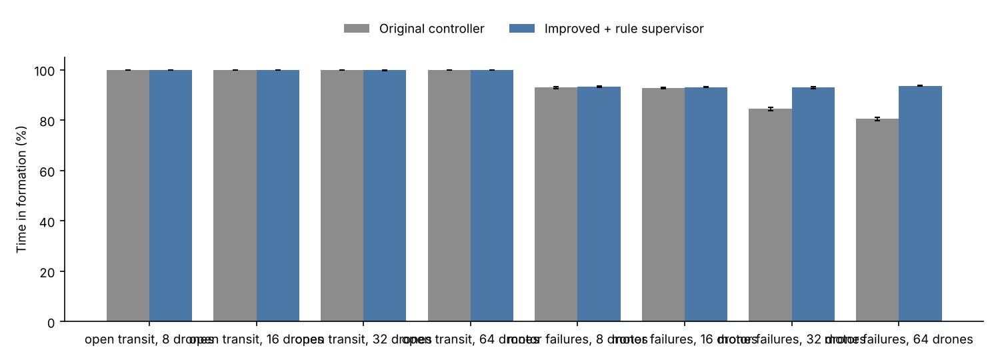
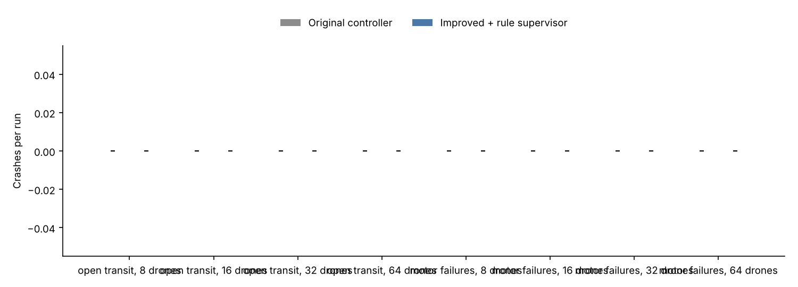
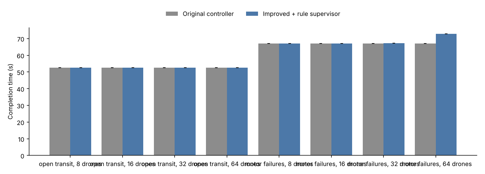
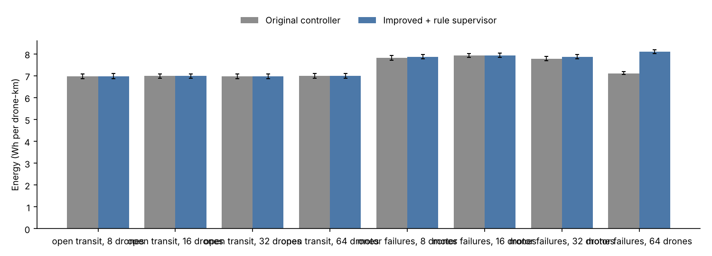

# Benchmark report

Source: `runs.jsonl`, 320 runs, seeds 1000-1019 (20 seeds).

Crashes count drones destroyed by collisions with each other, obstacles or the ground. Completion time and energy average only the runs where the value exists.

## Results by scenario

### open_transit, 8 drones

Mean over 20 seeds, with 95% bootstrap intervals.

| Configuration | Time in formation (%) | Formation error, mean (m) | Crashes per run | Near misses per run | Missions completed (%) | Completion time (s) | Energy (Wh per drone-km) | Drones retired (low battery) | Time faster than planned (%) |
|---|---|---|---|---|---|---|---|---|---|
| Original controller | 100 | 0.39 [0.37, 0.40] | 0.00 | 0.00 | 100 | 53 | 6.98 [6.87, 7.09] | 0.00 | 0 |
| Improved + rule supervisor | 100 | 0.38 [0.37, 0.40] | 0.00 | 0.00 | 100 | 53 | 6.98 [6.87, 7.10] | 0.00 | 0 |

### open_transit, 16 drones

Mean over 20 seeds, with 95% bootstrap intervals.

| Configuration | Time in formation (%) | Formation error, mean (m) | Crashes per run | Near misses per run | Missions completed (%) | Completion time (s) | Energy (Wh per drone-km) | Drones retired (low battery) | Time faster than planned (%) |
|---|---|---|---|---|---|---|---|---|---|
| Original controller | 100 | 0.41 [0.41, 0.42] | 0.00 | 0.00 | 100 | 53 | 6.99 [6.89, 7.09] | 0.00 | 0 |
| Improved + rule supervisor | 100 | 0.41 [0.40, 0.42] | 0.00 | 0.00 | 100 | 53 | 6.99 [6.89, 7.09] | 0.00 | 0 |

### open_transit, 32 drones

Mean over 20 seeds, with 95% bootstrap intervals.

| Configuration | Time in formation (%) | Formation error, mean (m) | Crashes per run | Near misses per run | Missions completed (%) | Completion time (s) | Energy (Wh per drone-km) | Drones retired (low battery) | Time faster than planned (%) |
|---|---|---|---|---|---|---|---|---|---|
| Original controller | 100 | 0.41 [0.41, 0.42] | 0.00 | 0.00 | 100 | 53 | 6.98 [6.87, 7.09] | 0.00 | 0 |
| Improved + rule supervisor | 100 | 0.41 [0.40, 0.42] | 0.00 | 0.00 | 100 | 53 | 6.98 [6.87, 7.09] | 0.00 | 0 |

### open_transit, 64 drones

Mean over 20 seeds, with 95% bootstrap intervals.

| Configuration | Time in formation (%) | Formation error, mean (m) | Crashes per run | Near misses per run | Missions completed (%) | Completion time (s) | Energy (Wh per drone-km) | Drones retired (low battery) | Time faster than planned (%) |
|---|---|---|---|---|---|---|---|---|---|
| Original controller | 100 | 0.42 [0.42, 0.42] | 0.00 | 0.00 | 100 | 53 | 7.00 [6.88, 7.10] | 0.00 | 0 |
| Improved + rule supervisor | 100 | 0.42 [0.41, 0.42] | 0.00 | 0.00 | 100 | 53 | 7.00 [6.89, 7.11] | 0.00 | 0 |

### motor_failures, 8 drones

Mean over 20 seeds, with 95% bootstrap intervals.

| Configuration | Time in formation (%) | Formation error, mean (m) | Crashes per run | Near misses per run | Missions completed (%) | Completion time (s) | Energy (Wh per drone-km) | Drones retired (low battery) | Time faster than planned (%) |
|---|---|---|---|---|---|---|---|---|---|
| Original controller | 93 [93, 93] | 0.49 [0.47, 0.51] | 0.00 | 0.00 | 100 | 67 | 7.82 [7.72, 7.92] | 0.00 | 0 |
| Improved + rule supervisor | 93 [93, 94] | 0.48 [0.46, 0.51] | 0.00 | 0.00 | 100 | 67 | 7.87 [7.77, 7.97] | 0.00 | 0 |

### motor_failures, 16 drones

Mean over 20 seeds, with 95% bootstrap intervals.

| Configuration | Time in formation (%) | Formation error, mean (m) | Crashes per run | Near misses per run | Missions completed (%) | Completion time (s) | Energy (Wh per drone-km) | Drones retired (low battery) | Time faster than planned (%) |
|---|---|---|---|---|---|---|---|---|---|
| Original controller | 93 [92, 93] | 0.53 [0.52, 0.55] | 0.00 | 0.00 | 100 | 67 | 7.92 [7.83, 8.02] | 0.00 | 0 |
| Improved + rule supervisor | 93 | 0.52 [0.50, 0.53] | 0.00 | 0.00 | 100 | 67 | 7.94 [7.85, 8.04] | 0.00 | 0 |

### motor_failures, 32 drones

Mean over 20 seeds, with 95% bootstrap intervals.

| Configuration | Time in formation (%) | Formation error, mean (m) | Crashes per run | Near misses per run | Missions completed (%) | Completion time (s) | Energy (Wh per drone-km) | Drones retired (low battery) | Time faster than planned (%) |
|---|---|---|---|---|---|---|---|---|---|
| Original controller | 84 [84, 85] | 0.63 [0.62, 0.64] | 0.00 | 0.00 | 100 | 67 | 7.78 [7.69, 7.88] | 0.00 | 0 |
| Improved + rule supervisor | 93 [93, 93] | 0.53 [0.51, 0.55] | 0.00 | 0.00 | 100 | 67 | 7.87 [7.77, 7.97] | 0.00 | 0 |

### motor_failures, 64 drones

Mean over 20 seeds, with 95% bootstrap intervals.

| Configuration | Time in formation (%) | Formation error, mean (m) | Crashes per run | Near misses per run | Missions completed (%) | Completion time (s) | Energy (Wh per drone-km) | Drones retired (low battery) | Time faster than planned (%) |
|---|---|---|---|---|---|---|---|---|---|
| Original controller | 80 [80, 81] | 0.92 [0.90, 0.95] | 0.00 | 0.00 | 100 | 67 | 7.12 [7.05, 7.18] | 0.00 | 0 |
| Improved + rule supervisor | 94 | 0.53 [0.52, 0.53] | 0.00 | 0.00 | 100 | 73 | 8.11 [8.02, 8.20] | 0.00 | 0 |

## Which scenarios separate the configurations

A difference counts when the 95% bootstrap interval of the seed-by-seed difference excludes zero and, except for crashes and completions, the mean difference is more than 1% of the baseline.

* **open_transit, 8 drones**: no comparison differs beyond noise on the main metrics.
* **open_transit, 16 drones**: no comparison differs beyond noise on the main metrics.
* **open_transit, 32 drones**: no comparison differs beyond noise on the main metrics.
* **open_transit, 64 drones**: no comparison differs beyond noise on the main metrics.
* **motor_failures, 8 drones**: no comparison differs beyond noise on the main metrics.
* **motor_failures, 16 drones**: no comparison differs beyond noise on the main metrics.
* **motor_failures, 32 drones**:
  * Improved + rule supervisor vs Original controller: better on Time in formation (%) 84.47 → 93; worse on Energy (Wh per drone-km) 7.778 → 7.866
* **motor_failures, 64 drones**:
  * Improved + rule supervisor vs Original controller: better on Time in formation (%) 80.47 → 93.63; worse on Completion time (s) 67.04 → 72.86, Energy (Wh per drone-km) 7.116 → 8.108

## Paired comparisons (same seeds)

| Scenario | Comparison | Metric | A | B | B - A [95% CI] | B better / tie / worse |
|---|---|---|---|---|---|---|
| open_transit, 8 drones | Improved + rule supervisor vs Original controller | Time in formation (%) | 100.00 | 100.00 | +0.00 [+0.00, +0.00] | 0 / 20 / 0 |
| open_transit, 8 drones | Improved + rule supervisor vs Original controller | Crashes per run | 0.00 | 0.00 | +0.00 [+0.00, +0.00] | 0 / 20 / 0 |
| open_transit, 8 drones | Improved + rule supervisor vs Original controller | Completion time (s) | 52.66 | 52.66 | +0.00 [+0.00, +0.00] | 0 / 20 / 0 |
| open_transit, 8 drones | Improved + rule supervisor vs Original controller | Energy (Wh per drone-km) | 6.98 | 6.98 | +0.00 [+0.00, +0.00] | 0 / 20 / 0 |
| open_transit, 16 drones | Improved + rule supervisor vs Original controller | Time in formation (%) | 100.00 | 100.00 | +0.00 [+0.00, +0.00] | 0 / 20 / 0 |
| open_transit, 16 drones | Improved + rule supervisor vs Original controller | Crashes per run | 0.00 | 0.00 | +0.00 [+0.00, +0.00] | 0 / 20 / 0 |
| open_transit, 16 drones | Improved + rule supervisor vs Original controller | Completion time (s) | 52.66 | 52.66 | +0.00 [+0.00, +0.00] | 0 / 20 / 0 |
| open_transit, 16 drones | Improved + rule supervisor vs Original controller | Energy (Wh per drone-km) | 6.99 | 6.99 | +0.00 [+0.00, +0.00] | 0 / 20 / 0 |
| open_transit, 32 drones | Improved + rule supervisor vs Original controller | Time in formation (%) | 100.00 | 99.91 | -0.09 [-0.26, +0.00] | 0 / 19 / 1 |
| open_transit, 32 drones | Improved + rule supervisor vs Original controller | Crashes per run | 0.00 | 0.00 | +0.00 [+0.00, +0.00] | 0 / 20 / 0 |
| open_transit, 32 drones | Improved + rule supervisor vs Original controller | Completion time (s) | 52.66 | 52.66 | +0.00 [+0.00, +0.00] | 0 / 20 / 0 |
| open_transit, 32 drones | Improved + rule supervisor vs Original controller | Energy (Wh per drone-km) | 6.98 | 6.98 | +0.00 [-0.00, +0.00] | 0 / 20 / 0 |
| open_transit, 64 drones | Improved + rule supervisor vs Original controller | Time in formation (%) | 100.00 | 100.00 | +0.00 [+0.00, +0.00] | 0 / 20 / 0 |
| open_transit, 64 drones | Improved + rule supervisor vs Original controller | Crashes per run | 0.00 | 0.00 | +0.00 [+0.00, +0.00] | 0 / 20 / 0 |
| open_transit, 64 drones | Improved + rule supervisor vs Original controller | Completion time (s) | 52.66 | 52.66 | +0.00 [+0.00, +0.00] | 0 / 20 / 0 |
| open_transit, 64 drones | Improved + rule supervisor vs Original controller | Energy (Wh per drone-km) | 7.00 | 7.00 | +0.00 [+0.00, +0.00] | 0 / 20 / 0 |
| motor_failures, 8 drones | Improved + rule supervisor vs Original controller | Time in formation (%) | 92.92 | 93.25 | +0.33 [+0.25, +0.40] | 0 / 20 / 0 |
| motor_failures, 8 drones | Improved + rule supervisor vs Original controller | Crashes per run | 0.00 | 0.00 | +0.00 [+0.00, +0.00] | 0 / 20 / 0 |
| motor_failures, 8 drones | Improved + rule supervisor vs Original controller | Completion time (s) | 67.04 | 67.04 | +0.00 [+0.00, +0.00] | 0 / 20 / 0 |
| motor_failures, 8 drones | Improved + rule supervisor vs Original controller | Energy (Wh per drone-km) | 7.82 | 7.87 | +0.05 [+0.05, +0.06] | 0 / 20 / 0 |
| motor_failures, 16 drones | Improved + rule supervisor vs Original controller | Time in formation (%) | 92.64 | 93.14 | +0.50 [+0.41, +0.59] | 0 / 20 / 0 |
| motor_failures, 16 drones | Improved + rule supervisor vs Original controller | Crashes per run | 0.00 | 0.00 | +0.00 [+0.00, +0.00] | 0 / 20 / 0 |
| motor_failures, 16 drones | Improved + rule supervisor vs Original controller | Completion time (s) | 67.04 | 67.04 | +0.00 [+0.00, +0.00] | 0 / 20 / 0 |
| motor_failures, 16 drones | Improved + rule supervisor vs Original controller | Energy (Wh per drone-km) | 7.92 | 7.94 | +0.02 [+0.01, +0.02] | 0 / 20 / 0 |
| motor_failures, 32 drones | Improved + rule supervisor vs Original controller | Time in formation (%) | 84.47 | 93.00 | +8.54 [+7.76, +9.27] | 20 / 0 / 0 |
| motor_failures, 32 drones | Improved + rule supervisor vs Original controller | Crashes per run | 0.00 | 0.00 | +0.00 [+0.00, +0.00] | 0 / 20 / 0 |
| motor_failures, 32 drones | Improved + rule supervisor vs Original controller | Completion time (s) | 67.04 | 67.30 | +0.26 [+0.22, +0.30] | 0 / 20 / 0 |
| motor_failures, 32 drones | Improved + rule supervisor vs Original controller | Energy (Wh per drone-km) | 7.78 | 7.87 | +0.09 [+0.08, +0.10] | 0 / 11 / 9 |
| motor_failures, 64 drones | Improved + rule supervisor vs Original controller | Time in formation (%) | 80.47 | 93.63 | +13.16 [+12.50, +13.80] | 20 / 0 / 0 |
| motor_failures, 64 drones | Improved + rule supervisor vs Original controller | Crashes per run | 0.00 | 0.00 | +0.00 [+0.00, +0.00] | 0 / 20 / 0 |
| motor_failures, 64 drones | Improved + rule supervisor vs Original controller | Completion time (s) | 67.04 | 72.86 | +5.82 [+5.77, +5.87] | 0 / 0 / 20 |
| motor_failures, 64 drones | Improved + rule supervisor vs Original controller | Energy (Wh per drone-km) | 7.12 | 8.11 | +0.99 [+0.96, +1.02] | 0 / 0 / 20 |
