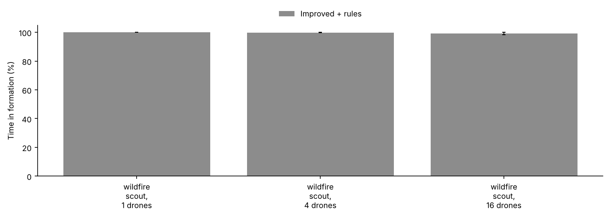
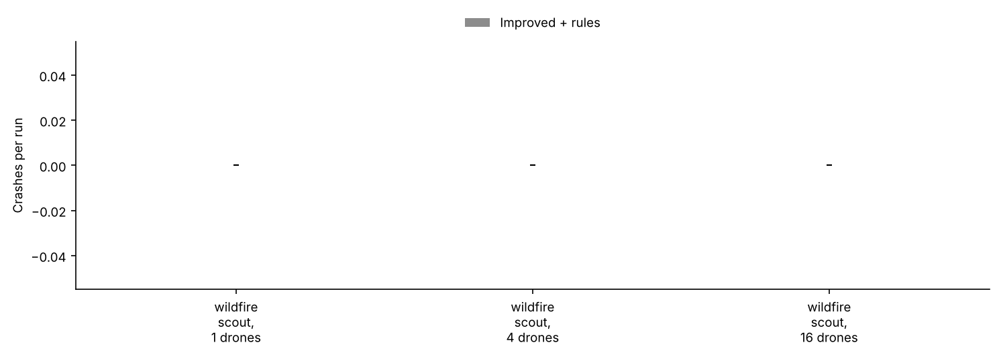
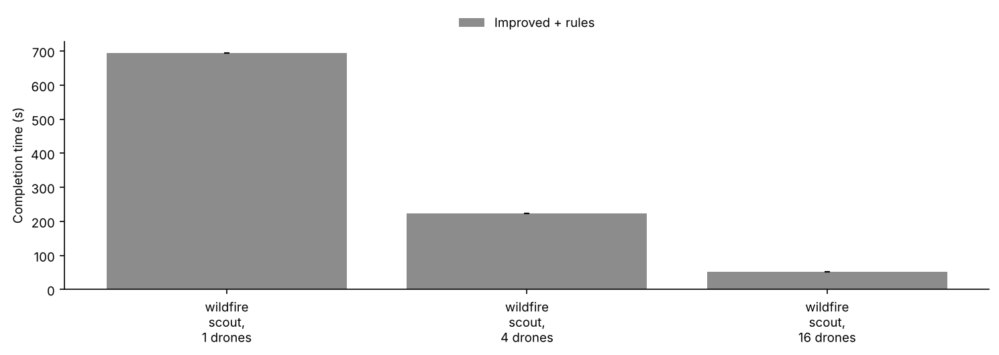
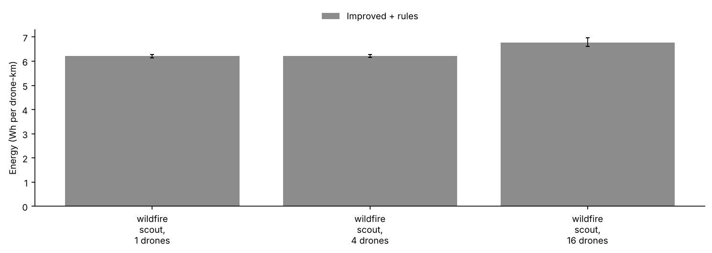

# Benchmark report

Source: `runs.jsonl`, 60 runs, seeds 1000-1019 (20 seeds).

Crashes count drones destroyed by collisions with each other, obstacles or the ground. Completion time and energy average only the runs where the value exists.

## Results by scenario

### wildfire_scout, 1 drones

Mean over 20 seeds, with 95% bootstrap intervals.

| Configuration | Time in formation (%) | Formation error, mean (m) | Crashes per run | Near misses per run | Missions completed (%) | Completion time (s) | Energy (Wh per drone-km) | Drones retired (low battery) | Time faster than planned (%) |
|---|---|---|---|---|---|---|---|---|---|
| Improved + rule supervisor | 100 | 0.00 | 0.00 | 0.00 | 100 | 694 | 6.21 [6.14, 6.28] | 0.00 | 0 |

Scouting: what the swarm found and covered. Time to find all is averaged over the runs that found every target.

| Configuration | Targets found (%) | Time to first find (s) | Time to find all (s) | Area covered (%) | Time to 90% coverage (s) | Coverage rate (ha/min) |
|---|---|---|---|---|---|---|
| Improved + rule supervisor | 100 | 95.8 [60.2, 135.2] | 536.0 [487.1, 579.9] | 100 | 619.9 [619.8, 619.9] | 0.5 |

### wildfire_scout, 4 drones

Mean over 20 seeds, with 95% bootstrap intervals.

| Configuration | Time in formation (%) | Formation error, mean (m) | Crashes per run | Near misses per run | Missions completed (%) | Completion time (s) | Energy (Wh per drone-km) | Drones retired (low battery) | Time faster than planned (%) |
|---|---|---|---|---|---|---|---|---|---|
| Improved + rule supervisor | 100 | 0.36 [0.35, 0.37] | 0.00 | 0.00 | 100 | 224 | 6.22 [6.16, 6.28] | 0.00 | 0 |

Scouting: what the swarm found and covered. Time to find all is averaged over the runs that found every target.

| Configuration | Targets found (%) | Time to first find (s) | Time to find all (s) | Area covered (%) | Time to 90% coverage (s) | Coverage rate (ha/min) |
|---|---|---|---|---|---|---|
| Improved + rule supervisor | 100 | 22.5 [12.7, 34.8] | 180.0 [162.6, 195.8] | 100 | 198.2 [198.1, 198.3] | 1.6 |

### wildfire_scout, 16 drones

Mean over 20 seeds, with 95% bootstrap intervals.

| Configuration | Time in formation (%) | Formation error, mean (m) | Crashes per run | Near misses per run | Missions completed (%) | Completion time (s) | Energy (Wh per drone-km) | Drones retired (low battery) | Time faster than planned (%) |
|---|---|---|---|---|---|---|---|---|---|
| Improved + rule supervisor | 99 [98, 100] | 0.44 [0.41, 0.47] | 0.00 | 0.00 | 100 | 53 | 6.78 [6.61, 6.97] | 0.00 | 0 |

Scouting: what the swarm found and covered. Time to find all is averaged over the runs that found every target.

| Configuration | Targets found (%) | Time to first find (s) | Time to find all (s) | Area covered (%) | Time to 90% coverage (s) | Coverage rate (ha/min) |
|---|---|---|---|---|---|---|
| Improved + rule supervisor | 100 | 6.5 [4.4, 8.9] | 41.0 [38.4, 43.2] | 100 | 43.8 [43.8, 43.9] | 6.2 |

## Which scenarios separate the configurations

A difference counts when the 95% bootstrap interval of the seed-by-seed difference excludes zero and, except for crashes and completions, the mean difference is more than 1% of the baseline.

No two configurations in this file are compared.

## Paired comparisons (same seeds)

| Scenario | Comparison | Metric | A | B | B - A [95% CI] | B better / tie / worse |
|---|---|---|---|---|---|---|
